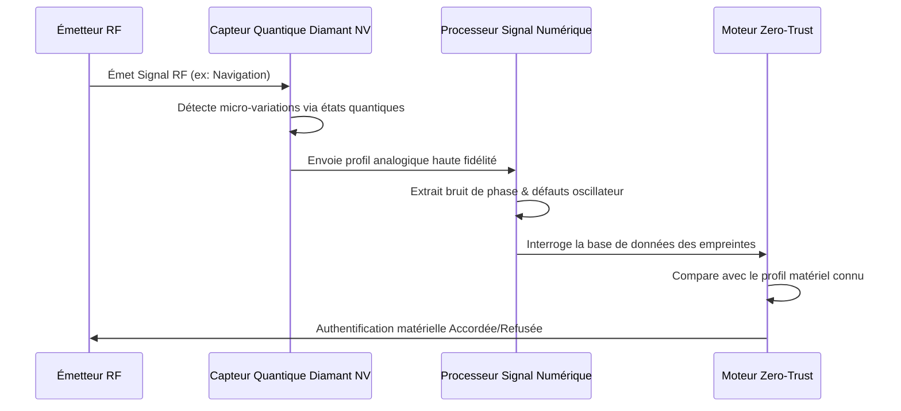

<!-- markdownlint-disable MD009 MD010 MD013 MD022 MD028 MD032 MD033 MD034 MD036 MD037 MD039 MD041 MD058 MD060 -->

[ 🇬🇧 English Version ](./README.md)

# Quantum RF Fingerprinting

> **Résumé exécutif :** Un système de sécurité Zero-Trust physique qui utilise des capteurs quantiques à centres NV (Azote-Lacune) pour authentifier l'empreinte électromagnétique matérielle, unique et inclonable, des émetteurs radio. Il neutralise totalement l'usurpation (spoofing) GPS/RF dans les infrastructures critiques.


---

## 1. Aperçu visuel & Effet Wahou

```mermaid
graph TD
    A[Drone Ennemi/Attaquant] -->|Signal GPS Usurpé (Crypto Valide)| B[Capteur RF Quantique]
    C[Drone Allié] -->|Signal GPS Valide (Crypto Valide)| B
    B -->|Analyse Imperfections Analogiques Microscopiques| D{Moteur d'Empreinte Quantique}
    D -->|Correspondance : Matériel Vérifié| E[Accepter le Signal]
    D -->|Non-Correspondance : Matériel Cloné| F[Bloquer le Signal Usurpé]
```

## 2. La thèse contrariante (Peter Thiel Style)

- **La croyance populaire :** Pour sécuriser les communications et la navigation autonome contre l'usurpation, nous avons juste besoin d'algorithmes de chiffrement plus forts et d'une meilleure gestion des clés.
- **La vérité cachée :** La cryptographie logicielle est fondamentalement fragile ; si les clés sont volées, l'attaquant devient l'utilisateur autorisé. La véritable sécurité doit être ancrée dans la physique. Chaque pièce de matériel analogique possède des imperfections microscopiques induites par sa fabrication. En utilisant des capteurs quantiques pour mesurer ces variations, nous pouvons authentifier le _matériel physique_ lui-même, rendant le vol de clés logicielles inutile.

## 3. Le problème & La cible

- **Modèle économique :** B2B
- **Cible précise :** Défense, aérospatial, opérateurs d'infrastructures critiques (satellites, drones), télécommunications 5G/6G.
- **La douleur urgente :** L'usurpation (spoofing) de signaux radiofréquences et GPS menace de plus en plus les flottes de drones, la navigation maritime et les constellations de satellites. Les signatures cryptographiques classiques authentifient les données, mais ne peuvent pas authentifier le matériel émettant le signal, laissant les systèmes vulnérables aux attaques par relais.

## 4. Architecture technique & Plomberie



## 5. Modèle économique & Viabilité financière

| Métrique                        | Valeur                                                                     |
| :------------------------------ | :------------------------------------------------------------------------- |
| **Structure de prix**           | Leasing matériel du capteur + Abonnement annuel base de données empreintes |
| **Objectif 12 mois**            | 3 déploiements pilotes Défense/Aérospatial                                 |
| **Calcul du CA (Target 100k€)** | 3 déploiements \* 40 000 € = 120 000 €                                     |
| **Marge brute estimée**         | 70%                                                                        |

## 6. Moteur de distribution & Fossé défensif (Moat)

- **Stratégie d'acquisition :** Cibler les entreprises de défense et les unités d'innovation militaire pour des programmes pilotes visant à sécuriser les communications critiques des drones, en s'appuyant sur des subventions gouvernementales.
- **Moat (Barrière à l'entrée) :** La cryptographie logicielle peut être volée. Cette approche authentifie l'empreinte physique unique (PUF) des composants analogiques. Elle nécessite une expertise de pointe en capteurs quantiques à diamant, une intégration matérielle ultra-sensible (optimisation SWaP), et un traitement du signal avancé — des capacités inaccessibles à une startup 100% logicielle.

## 7. Grille d'évaluation détaillée

| Critère                               | Score VC (/100) | Score Terrain (/100) |
| :------------------------------------ | :-------------- | :------------------- |
| **Thèse & Monopole / Urgence**        | -- / 25         | -- / 25              |
| **Moat / Résistance aux LLM natifs**  | -- / 25         | -- / 25              |
| **Scalabilité / Friction d'adoption** | -- / 25         | -- / 25              |
| **Unit Economics / ROI direct**       | -- / 25         | -- / 25              |
| **TOTAL**                             | **-- / 100**    | **-- / 100**         |

> **Verdict VC :** En attente d'évaluation.

> **Verdict Terrain :** En attente d'évaluation.
