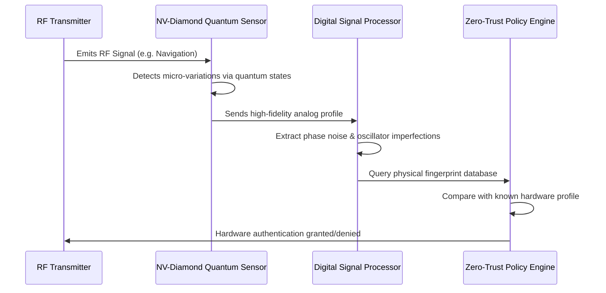

<!-- markdownlint-disable MD009 MD010 MD013 MD022 MD028 MD032 MD033 MD034 MD036 MD037 MD039 MD041 MD058 MD060 -->

[ 🇫🇷 Version Française ](./README.fr.md)

# Quantum RF Fingerprinting

> **Executive Summary:** A physical Zero-Trust security system that uses Nitrogen-Vacancy (NV) center quantum sensors to authenticate the unique, un-clonable electromagnetic hardware fingerprint of radio transmitters, completely neutralizing GPS/RF spoofing in critical infrastructure.


---

## 1. Visual Overview & Wow Effect

```mermaid
graph TD
    A[Rogue Drone/Attacker] -->|Spoofed GPS Signal (Valid Crypto)| B[Quantum RF Sensor]
    C[Friendly Drone] -->|Valid GPS Signal (Valid Crypto)| B
    B -->|Analyzes Microscopic Analog Imperfections| D{Quantum Fingerprint Engine}
    D -->|Match: Hardware Verified| E[Accept Signal]
    D -->|Mismatch: Cloned Hardware| F[Block Spoofed Signal]
```

## 2. Contrarian Thesis (Peter Thiel Style)

- **Popular Belief:** To secure communications and autonomous navigation against spoofing, we just need stronger encryption algorithms and better key management.
- **Hidden Truth:** Software cryptography is ultimately fragile; if the keys are stolen, the attacker becomes the authorized user. True security must be anchored in physics. Every piece of analog hardware has microscopic, manufacturing-induced imperfections. By using quantum sensors to measure these variations, we can authenticate the _physical hardware_ itself, rendering software key theft irrelevant.

## 3. Problem & Target Market

- **Business Model:** B2B
- **Target Audience:** Defense, aerospace, critical infrastructure operators (satellites, drones), 5G/6G telecommunications.
- **Urgent Pain Point:** RF and GPS spoofing attacks are escalating, threatening drone fleets, maritime navigation, and satellite constellations. Traditional cryptographic signatures authenticate the data, but cannot authenticate the actual hardware emitting the signal, leaving systems vulnerable to relay and spoofing attacks.

## 4. Technical Architecture & Infrastructure



## 5. Business Model & Financial Viability

| Metric                     | Value                                                                   |
| :------------------------- | :---------------------------------------------------------------------- |
| **Pricing Structure**      | Sensor hardware leasing + Annual subscription for fingerprint DB access |
| **12-Month Target**        | 3 defense/aerospace pilot deployments                                   |
| **Revenue Formula**        | 3 deployments \* €40,000 = €120,000                                     |
| **Estimated Gross Margin** | 70%                                                                     |

## 6. Distribution Engine & Moat

- **Acquisition Strategy:** Target defense contractors and military innovation units (e.g., DARPA, DIU) for initial pilot programs to secure critical drone communications, leveraging government grants.
- **Moat (Defensibility):** Software cryptography can be copied. This approach authenticates the physical unclonable function (PUF) of analog components. It requires deep expertise in quantum diamond sensors, ultra-sensitive hardware integration (SWaP optimization), and advanced signal processing—capabilities far beyond a pure software or SaaS startup.

## 7. Detailed Evaluation Grid

| Criterion                       | VC Score (/100) | Market Score (/100) |
| :------------------------------ | :-------------- | :------------------ |
| **Thesis & Monopoly / Urgency** | -- / 25         | -- / 25             |
| **Moat / LLM Immunity**         | -- / 25         | -- / 25             |
| **Scalability / UX Friction**   | -- / 25         | -- / 25             |
| **Unit Economics / ROI**        | -- / 25         | -- / 25             |
| **TOTAL**                       | **-- / 100**    | **-- / 100**        |

> **VC Verdict:** Pending evaluation.

> **Market Verdict:** Pending evaluation.
