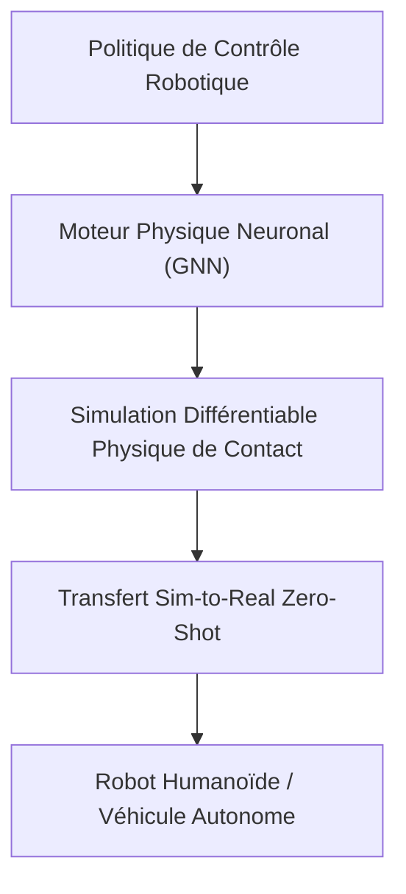
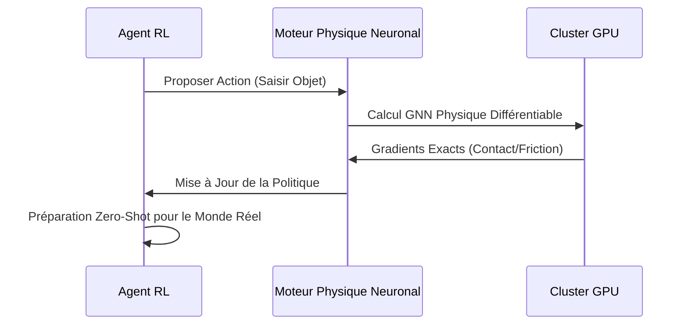

<!-- markdownlint-disable MD009 MD010 MD013 MD022 MD028 MD032 MD033 MD034 MD036 MD037 MD039 MD041 MD058 MD060 -->

[🇬🇧 English Version](./README.md)

# Neural Physics Engine

> **Résumé exécutif :** Un moteur physique neuronal différentiable utilisant des GNN (Graph Neural Networks) pour éliminer le 'sim-to-real gap' dans l'entraînement robotique.

---

## 1. Aperçu visuel & Effet Wahou

## 2. La thèse contrariante (Peter Thiel Style)

La croyance populaire : On peut entraîner des robots entièrement dans des moteurs de jeux vidéo (Unity/Unreal) puis les déployer dans le monde réel.
La vérité cachée : Les moteurs de jeu privilégient l'apparence à la précision physique rigoureuse. L'écart sim-to-real fait échouer les robots à cause d'une physique de contact imprécise. La simulation doit être différentiable et neuronale.

## 3. Le problème & La cible

Modèle économique : B2B
Cible précise : Fabricants de robots humanoïdes et constructeurs automobiles (Head of Robotics, VP Autonomy).
La douleur urgente : L'entraînement de robots dans le monde réel est lent et coûteux. Les simulateurs échouent car ils modélisent mal les contacts complexes, la friction et les matériaux déformables.

## 4. Architecture technique & Plomberie

## 5. Modèle économique & Viabilité financière

| Métrique                    | Valeur                                              |
| --------------------------- | --------------------------------------------------- |
| Structure de prix           | Licence entreprise par cœur de simulation/heure GPU |
| Objectif 12 mois            | 5 adoptions par des plateformes robotiques          |
| Calcul du CA (Target 100k€) | 5 plateformes \* 500k€ ARR                          |
| Marge brute estimée         | 85%                                                 |

## 6. Moteur de distribution & Fossé défensif (Moat)

Stratégie d'acquisition : Partenariats R&D directs avec les grands labos de robotique.
Moat (Barrière à l'entrée) : Les LLMs n'ont aucune notion de physique spatiale ou de gravité. Remplacer les solveurs classiques par des GNNs différentiables exige une expertise croisée IA-Physique extrêmement rare.

## 7. Grille d'évaluation détaillée

| Critère                           | Score VC (/100) | Score Terrain (/100) |
| --------------------------------- | --------------- | -------------------- |
| Thèse & Monopole / Urgence        | -- / 25         | -- / 25              |
| Moat / Résistance aux LLM natifs  | -- / 25         | -- / 25              |
| Scalabilité / Friction d'adoption | -- / 25         | -- / 25              |
| Unit Economics / ROI direct       | -- / 25         | -- / 25              |
| **TOTAL**                         | **-- / 100**    | **-- / 100**         |

> **Verdict VC :** En attente d'évaluation.
> **Verdict Terrain :** En attente d'évaluation.
