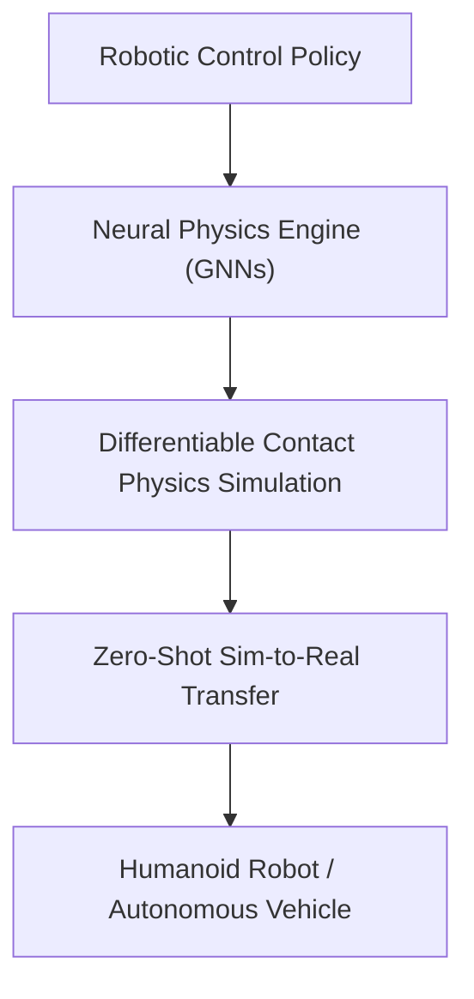
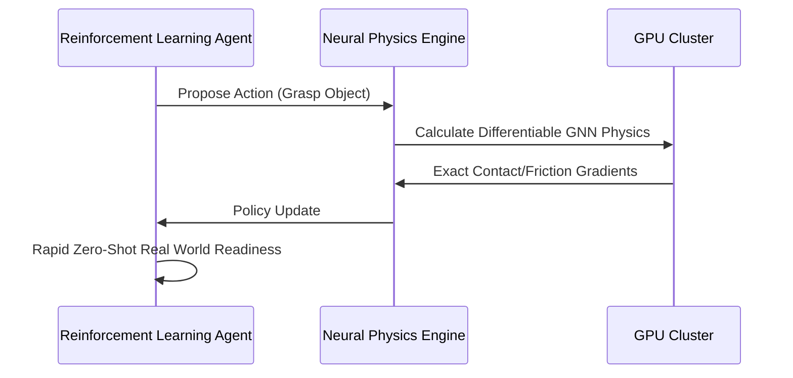

<!-- markdownlint-disable MD009 MD010 MD013 MD022 MD028 MD032 MD033 MD034 MD036 MD037 MD039 MD041 MD058 MD060 -->

[🇫🇷 Version Française](./README.fr.md)

# Neural Physics Engine

> **Executive Summary:** A differentiable neural physics engine using Graph Neural Networks to eliminate the sim-to-real gap for advanced robotic control training.

---

## 1. Visual Overview & Wow Effect

## 2. Contrarian Thesis (Peter Thiel Style)

Popular Belief: We can train robots entirely in video game engines (Unity/Unreal) and then deploy them directly in the real world.
Hidden Truth: Game engines prioritize visual appearance over rigorous physical accuracy. The "sim-to-real gap" causes robots to fail constantly due to inaccurate contact physics and friction modeling. Real physics simulation must be fully differentiable and neural-based.

## 3. Problem & Target Market

Business Model: B2B
Target Audience: Humanoid robot manufacturers, autonomous vehicle companies (Head of Robotics, VP Autonomy).
Urgent Pain Point: Training robotic control policies in the real world is too slow, expensive, and dangerous. Simulators fail because they cannot accurately model complex physical contacts, deformable materials, and friction.

## 4. Technical Architecture & Infrastructure

## 5. Business Model & Financial Viability

| Metric                 | Value                                           |
| ---------------------- | ----------------------------------------------- |
| Pricing Structure      | Enterprise license per simulation core/GPU hour |
| 12-Month Target        | 5 enterprise robotics platform adoptions        |
| Revenue Formula        | 5 platforms \* $500k ARR license                |
| Estimated Gross Margin | 85%                                             |

## 6. Distribution Engine & Moat

Acquisition Strategy: Direct R&D partnerships with leading robotics labs (e.g., Boston Dynamics, Figure, Tesla).
Moat (Defensibility): LLMs have zero understanding of spatial physics, gravity, or rigid body dynamics. Replacing classical physics solvers with differentiable Graph Neural Networks requires elite, highly scarce physics-AI engineering talent.

## 7. Detailed Evaluation Grid

| Criterion                   | VC Score (/100) | Market Score (/100) |
| --------------------------- | --------------- | ------------------- |
| Thesis & Monopoly / Urgency | -- / 25         | 21 / 25             |
| Moat / LLM Immunity         | -- / 25         | 19 / 25             |
| Scalability / UX Friction   | -- / 25         | 20 / 25             |
| Unit Economics / ROI        | -- / 25         | 22 / 25             |
| **TOTAL**                   | **-- / 100**    | **82 / 100**        |

> **VC Verdict:** Pending evaluation.
> **Market Verdict:** Drastically reduces physical prototyping costs in robotics, creating strong use value. Physical-virtual hybridization escapes the skills of a classic LLM. Despite setup complexity (friction), the B2B license model offers an obvious return on investment for industrials.
