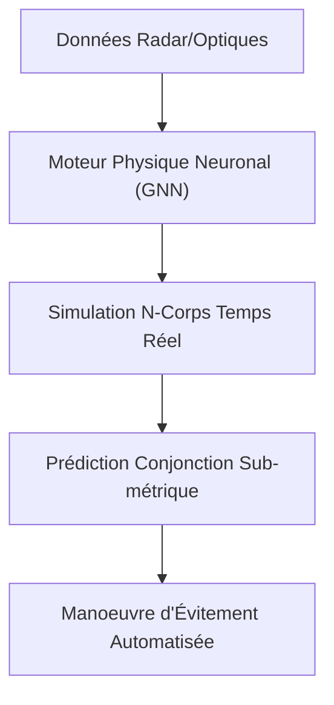
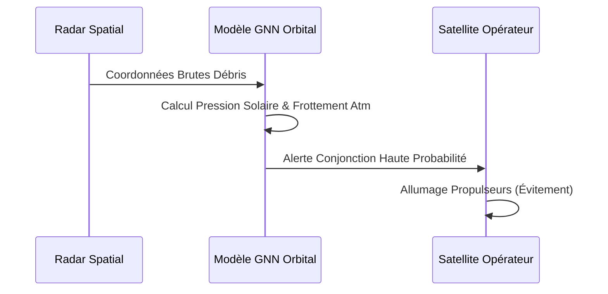

<!-- markdownlint-disable MD009 MD010 MD013 MD022 MD028 MD032 MD033 MD034 MD036 MD037 MD039 MD041 MD058 MD060 -->

[🇬🇧 English Version](./README.md)

# Orbital Kinetics Engine

> **Résumé exécutif :** Un moteur de physique neuronale simulant des millions de trajectoires orbitales en temps réel pour prévenir le syndrome de Kessler.

---

## 1. Aperçu visuel & Effet Wahou

## 2. La thèse contrariante (Peter Thiel Style)

La croyance populaire : Les modèles orbitaux actuels des agences spatiales suffisent à gérer les milliers de satellites des méga-constellations.
La vérité cachée : Les modèles actuels (SGP4) sont trop lents pour des centaines de milliers de conjonctions dynamiques. Il faut des modèles physiques de substitution (surrogates) accélérés par l'IA pour calculer à cette échelle.

## 3. Le problème & La cible

Modèle économique : B2B / B2G
Cible précise : Opérateurs LEO/GEO, Agences Spatiales (ESA, NASA), Assureurs.
La douleur urgente : Le risque de syndrome de Kessler (réaction en chaîne de collisions) devient critique avec les méga-constellations. Les opérateurs manquent d'outils précis en temps réel.

## 4. Architecture technique & Plomberie

## 5. Modèle économique & Viabilité financière

| Métrique                    | Valeur                                  |
| --------------------------- | --------------------------------------- |
| Structure de prix           | Abonnement SaaS par satellite surveillé |
| Objectif 12 mois            | 2 000 satellites surveillés             |
| Calcul du CA (Target 100k€) | 2 000 sats \* 1k€/mois                  |
| Marge brute estimée         | 80%                                     |

## 6. Moteur de distribution & Fossé défensif (Moat)

Stratégie d'acquisition : Ventes directes aux opérateurs commerciaux et contrats B2G.
Moat (Barrière à l'entrée) : Le calcul N-corps est brutal. Les LLMs ignorent la mécanique céleste. Le moat est un moteur physique différentiable exclusif, entraîné pour la mécanique spatiale.

## 7. Grille d'évaluation détaillée

| Critère                           | Score VC (/100) | Score Terrain (/100) |
| --------------------------------- | --------------- | -------------------- |
| Thèse & Monopole / Urgence        | -- / 25         | 23 / 25              |
| Moat / Résistance aux LLM natifs  | -- / 25         | 21 / 25              |
| Scalabilité / Friction d'adoption | -- / 25         | 19 / 25              |
| Unit Economics / ROI direct       | -- / 25         | 20 / 25              |
| **TOTAL**                         | **-- / 100**    | **83 / 100**         |

> **Verdict VC :** En attente d'évaluation.
> **Verdict Terrain :** Avec l'explosion des méga-constellations LEO, l'évitement des collisions orbitales est une nécessité absolue et immédiate. La fusion de vastes réseaux de capteurs et de mécanique orbitale dépasse largement un LLM standard. Les opérateurs intègrent facilement les flux de données, et le coût de perte d'un satellite rend l'abonnement évident.
