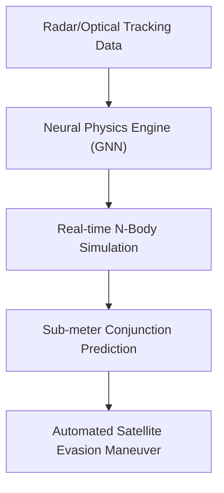
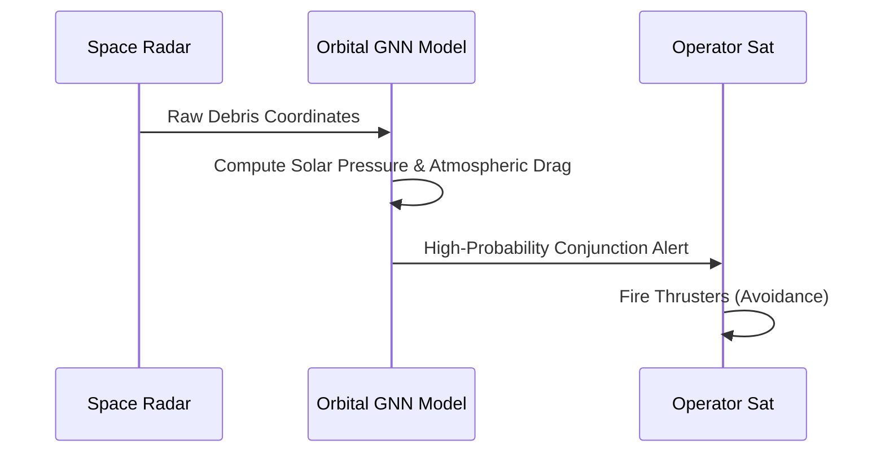

<!-- markdownlint-disable MD009 MD010 MD013 MD022 MD028 MD032 MD033 MD034 MD036 MD037 MD039 MD041 MD058 MD060 -->

[🇫🇷 Version Française](./README.fr.md)

# Orbital Kinetics Engine

> **Executive Summary:** A Neural Physics Engine using Graph Neural Networks to simulate millions of orbital trajectories in real-time, preventing the Kessler syndrome.

---

## 1. Visual Overview & Wow Effect

## 2. Contrarian Thesis (Peter Thiel Style)

Popular Belief: Current space agencies' orbital models are fast and precise enough to manage the upcoming thousands of mega-constellation satellites.
Hidden Truth: Current models (SGP4) are too slow and computationally heavy for hundreds of thousands of dynamic conjunctions. We need AI-accelerated physics surrogate models to manage this scale in real-time.

## 3. Problem & Target Market

Business Model: B2B / B2G
Target Audience: LEO/GEO Satellite operators, Space Agencies (ESA, NASA, Space Force), Space Insurers.
Urgent Pain Point: With the exponential growth of mega-constellations, the risk of a Kessler syndrome (cascading debris collisions) is critical. Operators lack real-time, high-precision tools to calculate collision probabilities.

## 4. Technical Architecture & Infrastructure

## 5. Business Model & Financial Viability

| Metric                 | Value                                              |
| ---------------------- | -------------------------------------------------- |
| Pricing Structure      | SaaS subscription per active satellite monitored   |
| 12-Month Target        | 2,000 satellites monitored (active constellations) |
| Revenue Formula        | 2,000 sats \* $1k/month                            |
| Estimated Gross Margin | 80%                                                |

## 6. Distribution Engine & Moat

Acquisition Strategy: Direct sales to commercial constellation operators and B2G contracts.
Moat (Defensibility): Computing perturbed N-body orbits is computationally brutal. LLMs cannot do celestial mechanics. Our moat is a proprietary, differentiable physics engine specifically trained for orbital mechanics.

## 7. Detailed Evaluation Grid

| Criterion                   | VC Score (/100) | Market Score (/100) |
| --------------------------- | --------------- | ------------------- |
| Thesis & Monopoly / Urgency | -- / 25         | 23 / 25             |
| Moat / LLM Immunity         | -- / 25         | 21 / 25             |
| Scalability / UX Friction   | -- / 25         | 19 / 25             |
| Unit Economics / ROI        | -- / 25         | 20 / 25             |
| **TOTAL**                   | **-- / 100**    | **83 / 100**        |

> **VC Verdict:** Pending evaluation.
> **Market Verdict:** With the explosion of LEO mega-constellations, orbital collision avoidance is an absolute, immediate necessity. It requires fusing vast sensor arrays with orbital mechanics, well beyond a standard LLM's capability. Satellite operators easily integrate the data feeds, and the cost of losing a satellite makes the subscription fee a no-brainer.
