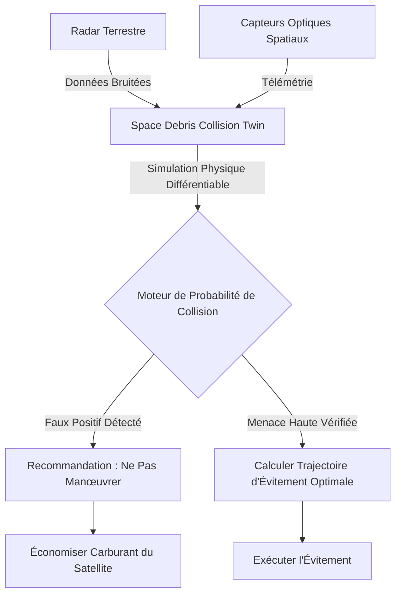
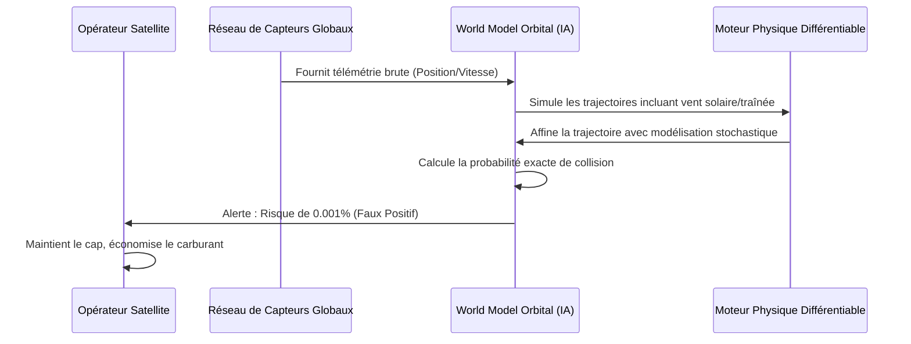

<!-- markdownlint-disable MD009 MD010 MD013 MD022 MD028 MD032 MD033 MD034 MD036 MD037 MD039 MD041 MD058 MD060 -->

[ 🇬🇧 English Version ](./README.md)

# Space Debris Collision Twin

> **Résumé exécutif :** Un World Model prédictif qui fusionne en temps réel les données des radars terrestres et des capteurs optiques spatiaux pour simuler la mécanique orbitale non linéaire. Il réduit drastiquement les fausses alertes de collision en orbite basse (LEO), évitant aux satellites de gaspiller leur précieux carburant pour des manœuvres inutiles.

---

## 1. Aperçu visuel & Effet Wahou

## 2. La thèse contrariante (Peter Thiel Style)

- **La croyance populaire :** Pour résoudre le problème des débris spatiaux, il suffit de lancer plus de satellites radars pour mieux suivre les objets et envoyer des alertes dès que deux objets se rapprochent.
- **La vérité cachée :** Nous avons déjà trop d'alertes. Les systèmes de suivi actuels génèrent un nombre écrasant de faux positifs car ils utilisent des modèles orbitaux simplifiés. Chaque manœuvre d'évitement inutile brûle un carburant irremplaçable, réduisant ainsi la durée de vie d'un satellite valant des millions. La vraie valeur n'est pas de générer plus d'alertes, mais de fournir une certitude de niveau physique pour dire en toute confiance à un opérateur de _ne pas_ bouger.

## 3. Le problème & La cible

- **Modèle économique :** B2B
- **Cible précise :** Opérateurs de constellations satellitaires en orbite basse (LEO), agences spatiales, compagnies d'assurance spatiale.
- **La douleur urgente :** L'encombrement de l'orbite terrestre basse crée un risque exponentiel de collisions (syndrome de Kessler). Les alertes de collision actuelles génèrent trop de faux positifs. Les opérateurs doivent deviner s'il faut manœuvrer (au risque de gaspiller du carburant) ou ignorer l'alerte (au risque d'une destruction totale du satellite).

## 4. Architecture technique & Plomberie

## 5. Modèle économique & Viabilité financière

| Métrique                        | Valeur                                                                   |
| :------------------------------ | :----------------------------------------------------------------------- |
| **Structure de prix**           | Abonnement par satellite surveillé + prime pour trajectoires d'évitement |
| **Objectif 12 mois**            | 1 opérateur de constellation LEO (ex: 50 satellites)                     |
| **Calcul du CA (Target 100k€)** | 50 satellites \* 2 000 €/an/sat = 100 000 €                              |
| **Marge brute estimée**         | 80%                                                                      |

## 6. Moteur de distribution & Fossé défensif (Moat)

- **Stratégie d'acquisition :** Cibler les opérateurs commerciaux de constellations LEO et les assureurs spatiaux, en prouvant le ROI grâce aux économies de carburant et à la réduction des primes d'assurance.
- **Moat (Barrière à l'entrée) :** La modélisation orbitale nécessite de gérer avec une extrême précision les perturbations atmosphériques imprévisibles, le vent solaire et le problème gravitationnel à N-corps. Un LLM ou un SaaS standard ne peut pas modéliser la physique stochastique à très haute vélocité. Cela requiert un moteur physique différentiable hautement spécialisé et l'accès à des données radar restreintes de haute qualité.

## 7. Grille d'évaluation détaillée

| Critère                               | Score VC (/100) | Score Terrain (/100) |
| :------------------------------------ | :-------------- | :------------------- |
| **Thèse & Monopole / Urgence**        | -- / 25         | -- / 25              |
| **Moat / Résistance aux LLM natifs**  | -- / 25         | -- / 25              |
| **Scalabilité / Friction d'adoption** | -- / 25         | -- / 25              |
| **Unit Economics / ROI direct**       | -- / 25         | -- / 25              |
| **TOTAL**                             | **-- / 100**    | **-- / 100**         |

> **Verdict VC :** En attente d'évaluation.

> **Verdict Terrain :** En attente d'évaluation.
