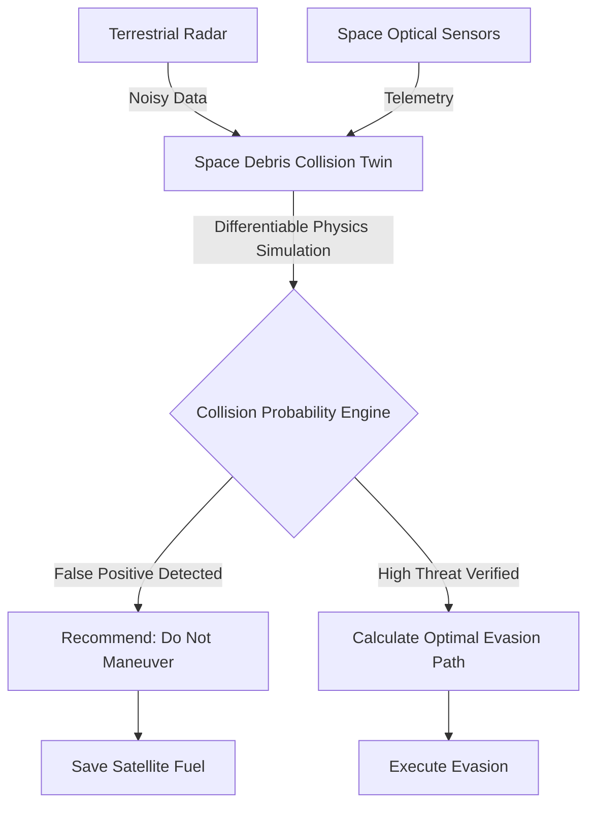
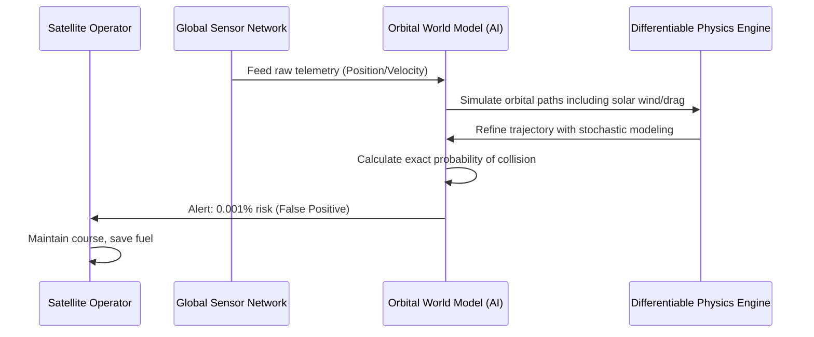

<!-- markdownlint-disable MD009 MD010 MD013 MD022 MD028 MD032 MD033 MD034 MD036 MD037 MD039 MD041 MD058 MD060 -->

[ 🇫🇷 Version Française ](./README.fr.md)

# Space Debris Collision Twin

> **Executive Summary:** A predictive World Model that fuses real-time data from terrestrial radars and spatial optical sensors to simulate complex, non-linear orbital mechanics. It drastically reduces false-positive collision alerts in Low Earth Orbit (LEO), saving satellites from wasting precious maneuvering fuel.

---

## 1. Visual Overview & Wow Effect

## 2. Contrarian Thesis (Peter Thiel Style)

- **Popular Belief:** To solve the space debris problem, we just need to launch more radar satellites to track objects better and send alerts whenever two objects get close.
- **Hidden Truth:** We already have too many alerts. Current tracking systems generate an overwhelming number of false positives because they use simplified orbital models. Every unnecessary evasion maneuver burns irreplaceable satellite fuel, effectively shortening a multi-million dollar satellite's lifespan. The real value is not in generating more alerts, but in providing the physics-grade certainty required to confidently tell an operator _not_ to move.

## 3. Problem & Target Market

- **Business Model:** B2B
- **Target Audience:** LEO satellite constellation operators, space agencies, and space insurance companies.
- **Urgent Pain Point:** The congestion of Low Earth Orbit (LEO) creates an exponential risk of collisions (Kessler Syndrome). Current collision warnings generate too many false positives. Operators must guess whether to maneuver, risking massive fuel waste and mission reduction, or to ignore the alert, risking total asset destruction.

## 4. Technical Architecture & Infrastructure

## 5. Business Model & Financial Viability

| Metric                     | Value                                                                       |
| :------------------------- | :-------------------------------------------------------------------------- |
| **Pricing Structure**      | Subscription per satellite monitored + premium for predictive evasion paths |
| **12-Month Target**        | 1 LEO constellation operator (e.g., 50 satellites)                          |
| **Revenue Formula**        | 50 satellites \* €2,000/year/sat = €100,000                                 |
| **Estimated Gross Margin** | 80%                                                                         |

## 6. Distribution Engine & Moat

- **Acquisition Strategy:** Target commercial LEO constellation operators and space insurance providers, proving ROI through fuel savings and reduced insurance premiums.
- **Moat (Defensibility):** Orbital modeling requires handling unpredictable atmospheric drag, solar wind, and the gravitational n-body problem with extreme precision. A standard management SaaS or LLM cannot model stochastic, hyper-velocity physics. It requires a highly specialized differentiable physics engine and access to restricted, high-quality radar data.

## 7. Detailed Evaluation Grid

| Criterion                       | VC Score (/100) | Market Score (/100) |
| :------------------------------ | :-------------- | :------------------ |
| **Thesis & Monopoly / Urgency** | -- / 25         | -- / 25             |
| **Moat / LLM Immunity**         | -- / 25         | -- / 25             |
| **Scalability / UX Friction**   | -- / 25         | -- / 25             |
| **Unit Economics / ROI**        | -- / 25         | -- / 25             |
| **TOTAL**                       | **-- / 100**    | **-- / 100**        |

> **VC Verdict:** Pending evaluation.

> **Market Verdict:** Pending evaluation.
