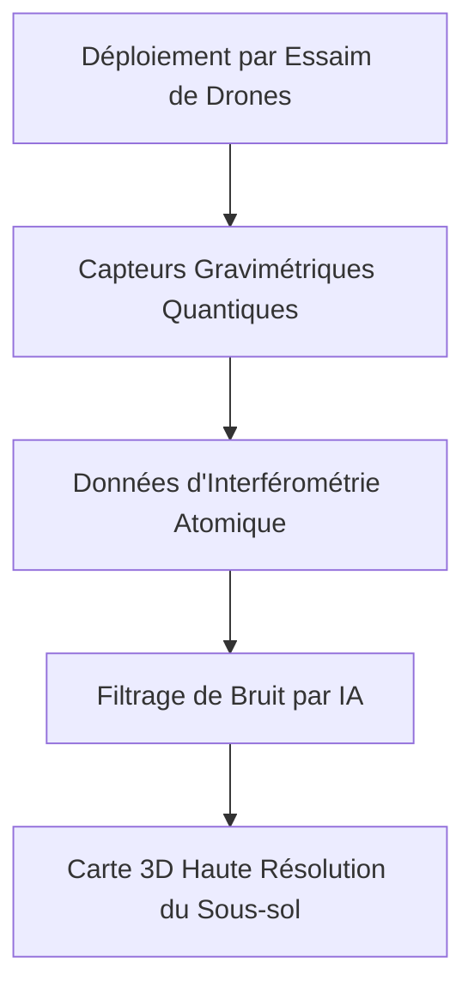
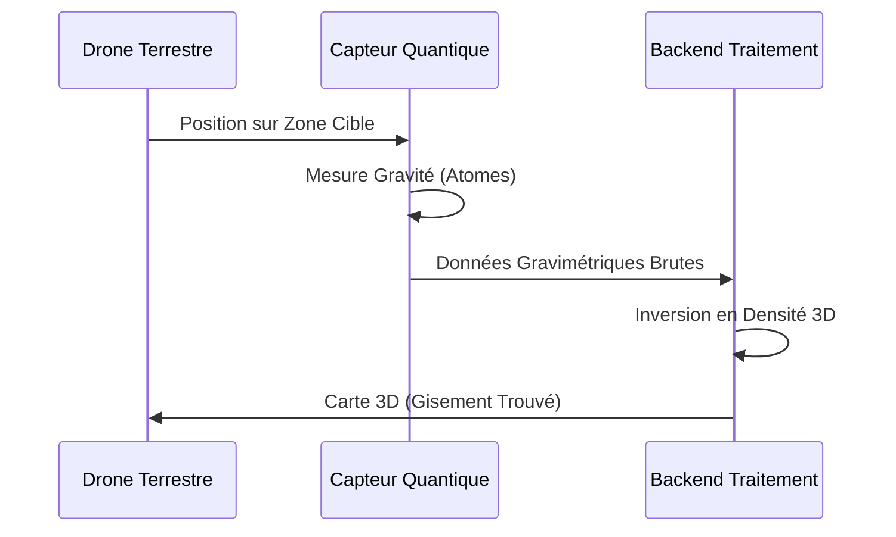

<!-- markdownlint-disable MD009 MD010 MD013 MD022 MD028 MD032 MD033 MD034 MD036 MD037 MD039 MD041 MD058 MD060 -->

[🇬🇧 English Version](./README.md)

# Quantum Subsurface Mapper

> **Résumé exécutif :** Un réseau de capteurs gravimétriques quantiques compacts pour générer des cartes 3D ultra-précises du sous-sol profond sans excavation.

---

## 1. Aperçu visuel & Effet Wahou

## 2. La thèse contrariante (Peter Thiel Style)

La croyance populaire : Les tests sismiques et les forages sont les seuls moyens fiables de cartographier les ressources souterraines profondes.
La vérité cachée : Le forage est aveugle et cher. En mesurant d'infimes variations de gravité via interférométrie atomique, on peut 'voir' à travers la roche pour cartographier minerais, nappes ou tunnels.

## 3. Le problème & La cible

Modèle économique : B2B / B2G
Cible précise : Entreprises minières, Construction civile, Défense, Gestion de l'eau.
La douleur urgente : L'exploration souterraine profonde repose sur des méthodes imprécises et lentes, entraînant des coûts de forage à sec massifs ou des surprises de construction.

## 4. Architecture technique & Plomberie

## 5. Modèle économique & Viabilité financière

| Métrique                    | Valeur                                            |
| --------------------------- | ------------------------------------------------- |
| Structure de prix           | Levé géologique as-a-Service + licence de données |
| Objectif 12 mois            | 10 levés majeurs d'exploration                    |
| Calcul du CA (Target 100k€) | 10 levés \* 500k€/contrat                         |
| Marge brute estimée         | 65%                                               |

## 6. Moteur de distribution & Fossé défensif (Moat)

Stratégie d'acquisition : Contrats B2B avec les conglomérats miniers et la Défense.
Moat (Barrière à l'entrée) : L'IA logicielle ne voit pas à travers la roche. Le moat est l'ingénierie extrême requise pour miniaturiser des chambres à vide quantiques et lasers de refroidissement pour un déploiement terrain robuste.

## 7. Grille d'évaluation détaillée

| Critère                           | Score VC (/100) | Score Terrain (/100) |
| --------------------------------- | --------------- | -------------------- |
| Thèse & Monopole / Urgence        | -- / 25         | 18 / 25              |
| Moat / Résistance aux LLM natifs  | -- / 25         | 25 / 25              |
| Scalabilité / Friction d'adoption | -- / 25         | 10 / 25              |
| Unit Economics / ROI direct       | -- / 25         | 15 / 25              |
| **TOTAL**                         | **-- / 100**    | **68 / 100**         |

> **Verdict VC :** En attente d'évaluation.
> **Verdict Terrain :** Détecter les ressources ou menaces souterraines est précieux mais manque souvent de l'urgence critique des opérations de surface. La détection matérielle par gravité quantique est totalement immunisée contre l'IA. Cependant, la friction de déploiement est phénoménale, et la monétisation est restreinte aux géants miniers ou de la défense très lents.
