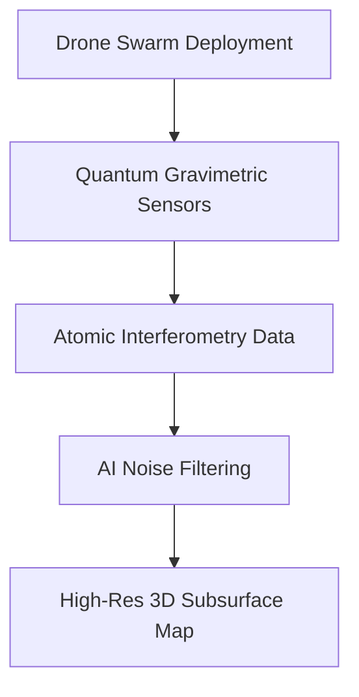
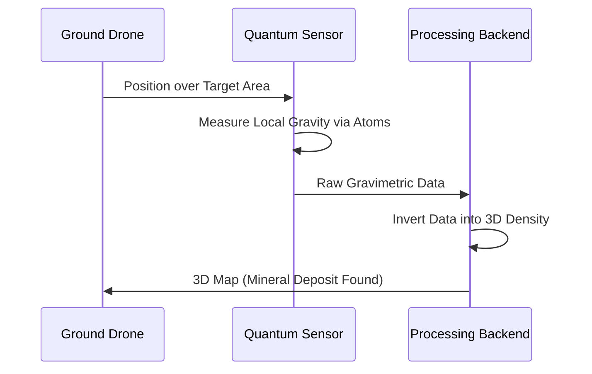

<!-- markdownlint-disable MD009 MD010 MD013 MD022 MD028 MD032 MD033 MD034 MD036 MD037 MD039 MD041 MD058 MD060 -->

[🇫🇷 Version Française](./README.fr.md)

# Quantum Subsurface Mapper

> **Executive Summary:** A network of compact quantum gravimetric sensors deployed by drones to generate ultra-precise 3D maps of deep subterranean density without excavation.

---

## 1. Visual Overview & Wow Effect

## 2. Contrarian Thesis (Peter Thiel Style)

Popular Belief: Seismic testing and core drilling are the only reliable ways to map deep underground resources or structures.
Hidden Truth: Drilling is blind and expensive. By measuring minute variations in Earth's gravity using atomic interferometry, we can 'see' through rock to map aquifers, rare minerals, or hidden tunnels instantly.

## 3. Problem & Target Market

Business Model: B2B / B2G
Target Audience: Mining companies, Civil engineering firms, Defense, Water resource managers.
Urgent Pain Point: Deep subsurface exploration relies on imprecise, slow, and expensive methods resulting in massive dry-hole drilling costs or catastrophic construction surprises.

## 4. Technical Architecture & Infrastructure

## 5. Business Model & Financial Viability

| Metric                 | Value                                  |
| ---------------------- | -------------------------------------- |
| Pricing Structure      | Survey-as-a-Service + data licensing   |
| 12-Month Target        | 10 major exploration surveys completed |
| Revenue Formula        | 10 surveys \* $500k average contract   |
| Estimated Gross Margin | 65%                                    |

## 6. Distribution Engine & Moat

Acquisition Strategy: B2B contracts with major mining conglomerates and defense agencies.
Moat (Defensibility): Software AI cannot see through rock. The bottleneck is hardware physical resolution. Our moat is the extreme engineering required to miniaturize quantum vacuum chambers and cooling lasers for rugged field deployment.

## 7. Detailed Evaluation Grid

| Criterion                   | VC Score (/100) | Market Score (/100) |
| --------------------------- | --------------- | ------------------- |
| Thesis & Monopoly / Urgency | -- / 25         | -- / 25             |
| Moat / LLM Immunity         | -- / 25         | -- / 25             |
| Scalability / UX Friction   | -- / 25         | -- / 25             |
| Unit Economics / ROI        | -- / 25         | -- / 25             |
| **TOTAL**                   | **-- / 100**    | **-- / 100**        |

> **VC Verdict:** Pending evaluation.
> **Market Verdict:** Pending evaluation.
