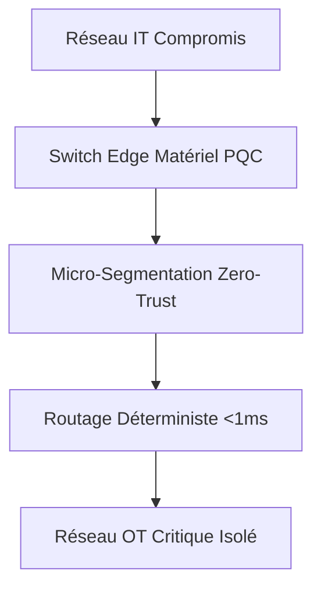
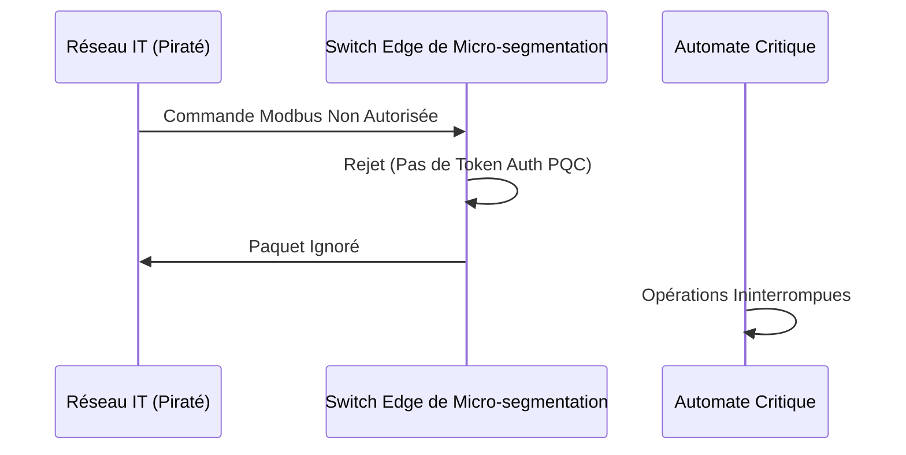

<!-- markdownlint-disable MD009 MD010 MD013 MD022 MD028 MD032 MD033 MD034 MD036 MD037 MD039 MD041 MD058 MD060 -->

[🇬🇧 English Version](./README.md)

# Quantum-Safe ICS Micro-segmentation

> **Résumé exécutif :** Une micro-segmentation dynamique matérielle utilisant la cryptographie post-quantique pour sécuriser les réseaux industriels critiques sans impacter la latence temps réel.

---

## 1. Aperçu visuel & Effet Wahou

## 2. La thèse contrariante (Peter Thiel Style)

La croyance populaire : L'isolation physique (air-gap) ou les pare-feu IT standards suffisent à protéger les systèmes industriels.
La vérité cachée : Les air-gaps sont un mythe aujourd'hui, et les pare-feu IT introduisent du jitter qui fait planter les boucles de contrôle. Il faut une micro-segmentation matérielle déterministe avec chiffrement post-quantique.

## 3. Le problème & La cible

Modèle économique : B2B
Cible précise : Infrastructures critiques (Réseaux électriques, Eau, Nucléaire, Pétrole & Gaz).
La douleur urgente : Les réseaux industriels (ICS/SCADA) utilisent des protocoles en clair. Une faille IT permet de pivoter vers l'OT, menaçant la sécurité nationale via la manipulation de machines physiques.

## 4. Architecture technique & Plomberie

## 5. Modèle économique & Viabilité financière

| Métrique                    | Valeur                                                |
| --------------------------- | ----------------------------------------------------- |
| Structure de prix           | Vente appliance matérielle + licence support annuelle |
| Objectif 12 mois            | 5 pilotes sur infrastructures critiques nationales    |
| Calcul du CA (Target 100k€) | 5 pilotes \* 250k€ (matériel & licences)              |
| Marge brute estimée         | 70%                                                   |

## 6. Moteur de distribution & Fossé défensif (Moat)

Stratégie d'acquisition : Ventes directes aux opérateurs nationaux, partenariats avec les équipementiers industriels (Siemens, ABB).
Moat (Barrière à l'entrée) : Les protocoles IT (IPsec/TLS) ne fonctionnent pas sur les vieux automates et introduisent de la latence. Le moat est l'intégration matérielle assurant un routage déterministe sub-milliseconde avec PQC.

## 7. Grille d'évaluation détaillée

| Critère                           | Score VC (/100) | Score Terrain (/100) |
| --------------------------------- | --------------- | -------------------- |
| Thèse & Monopole / Urgence        | -- / 25         | 24 / 25              |
| Moat / Résistance aux LLM natifs  | -- / 25         | 21 / 25              |
| Scalabilité / Friction d'adoption | -- / 25         | 17 / 25              |
| Unit Economics / ROI direct       | -- / 25         | 23 / 25              |
| **TOTAL**                         | **-- / 100**    | **85 / 100**         |

> **Verdict VC :** En attente d'évaluation.
> **Verdict Terrain :** Stopper les mouvements latéraux dans les systèmes de contrôle industriel est une urgence critique face aux cyberattaques étatiques. La maîtrise des protocoles ICS propriétaires offre une défense robuste contre les outils réseau LLM génériques. Bien que la segmentation de réseaux anciens induise des frictions par crainte d'arrêts, le coût faramineux d'une usine paralysée stimule les ventes.
