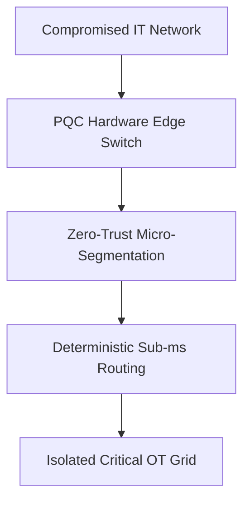
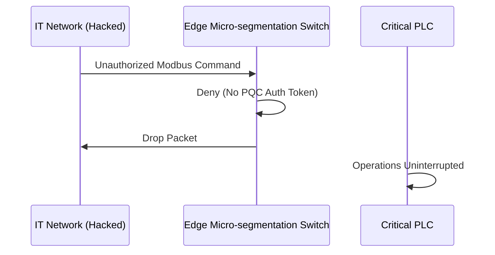

<!-- markdownlint-disable MD009 MD010 MD013 MD022 MD028 MD032 MD033 MD034 MD036 MD037 MD039 MD041 MD058 MD060 -->

[🇫🇷 Version Française](./README.fr.md)

# Quantum-Safe ICS Micro-segmentation

> **Executive Summary:** Hardware-level dynamic micro-segmentation using Post-Quantum Cryptography to secure critical industrial networks (SCADA) without impacting real-time control latency.

---

## 1. Visual Overview & Wow Effect

## 2. Contrarian Thesis (Peter Thiel Style)

Popular Belief: Air-gapping or standard IT firewalls are enough to protect industrial control systems from cyberattacks.
Hidden Truth: Air-gaps are largely a myth today, and standard IT firewalls introduce jitter that crashes real-time industrial control loops. True OT security requires hardware-level, deterministic micro-segmentation with quantum-safe encryption.

## 3. Problem & Target Market

Business Model: B2B
Target Audience: Critical infrastructures (Power grids, Water, Nuclear, Oil & Gas).
Urgent Pain Point: Industrial networks (ICS/SCADA) use unauthenticated cleartext protocols. A breach in the IT network easily pivots to OT, allowing attackers to manipulate physical machinery and threaten national security.

## 4. Technical Architecture & Infrastructure

## 5. Business Model & Financial Viability

| Metric                 | Value                                            |
| ---------------------- | ------------------------------------------------ |
| Pricing Structure      | Hardware appliance sale + annual support license |
| 12-Month Target        | 5 national critical infrastructure pilots        |
| Revenue Formula        | 5 pilots \* $250k hardware & licensing           |
| Estimated Gross Margin | 70%                                              |

## 6. Distribution Engine & Moat

Acquisition Strategy: Direct sales to national infrastructure operators, partnerships with industrial OEMs (Siemens, ABB).
Moat (Defensibility): IT protocols (IPsec/TLS) cannot be deployed on legacy PLCs and introduce latency. Our moat is deep protocol-level integration at the switch hardware level ensuring sub-millisecond deterministic routing with PQC overhead.

## 7. Detailed Evaluation Grid

| Criterion                   | VC Score (/100) | Market Score (/100) |
| --------------------------- | --------------- | ------------------- |
| Thesis & Monopoly / Urgency | -- / 25         | -- / 25             |
| Moat / LLM Immunity         | -- / 25         | -- / 25             |
| Scalability / UX Friction   | -- / 25         | -- / 25             |
| Unit Economics / ROI        | -- / 25         | -- / 25             |
| **TOTAL**                   | **-- / 100**    | **-- / 100**        |

> **VC Verdict:** Pending evaluation.
> **Market Verdict:** Pending evaluation.
