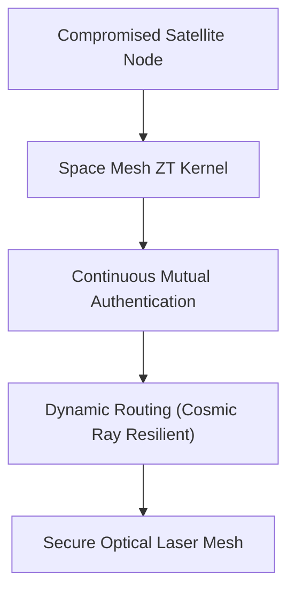
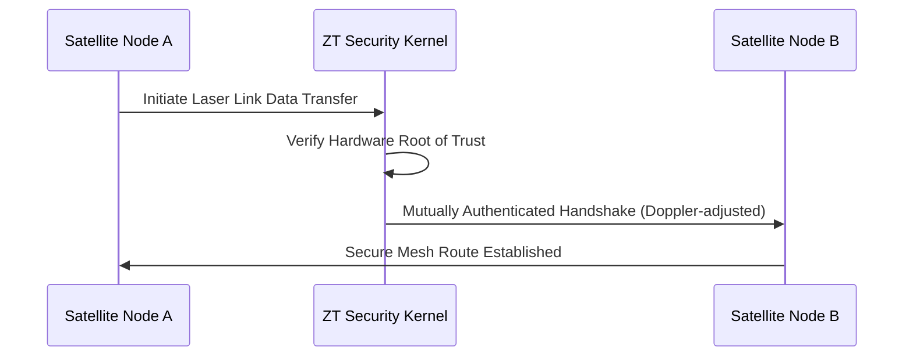

<!-- markdownlint-disable MD009 MD010 MD013 MD022 MD028 MD032 MD033 MD034 MD036 MD037 MD039 MD041 MD058 MD060 -->

[🇫🇷 Version Française](./README.fr.md)

# Space Mesh ZT

> **Executive Summary:** An ultra-lightweight Zero-Trust security infrastructure designed for real-time operating systems (RTOS) in low Earth orbit (LEO) satellite constellations.

---

## 1. Visual Overview & Wow Effect

## 2. Contrarian Thesis (Peter Thiel Style)

Popular Belief: Space networks can use the same cloud-based Zero-Trust security architectures that terrestrial corporate networks use.
Hidden Truth: Space environments have extreme SWaP (Size, Weight, Power) constraints and suffer from Doppler propagation delays. Terrestrial cloud ZT solutions (like Zscaler) simply do not work in orbit.

## 3. Problem & Target Market

Business Model: B2B
Target Audience: LEO satellite constellation operators, Space Agencies, Telecom providers (CISO, Space Systems Engineers).
Urgent Pain Point: LEO space networks communicating via optical laser links are vulnerable to interception, spoofing, and node hijacking, threatening the entire global mesh network integrity.

## 4. Technical Architecture & Infrastructure

## 5. Business Model & Financial Viability

| Metric                 | Value                                          |
| ---------------------- | ---------------------------------------------- |
| Pricing Structure      | Per-satellite software license + maintenance   |
| 12-Month Target        | 2 satellite constellations secured (200 nodes) |
| Revenue Formula        | 200 nodes \* $5k/node                          |
| Estimated Gross Margin | 90%                                            |

## 6. Distribution Engine & Moat

Acquisition Strategy: Integration with satellite bus manufacturers and direct sales to constellation operators.
Moat (Defensibility): Engineering a security kernel that runs on highly constrained space-grade RTOS and accounts for orbital physics (Doppler delays, cosmic ray bit flips) is a massive barrier to entry.

## 7. Detailed Evaluation Grid

| Criterion                   | VC Score (/100) | Market Score (/100) |
| --------------------------- | --------------- | ------------------- |
| Thesis & Monopoly / Urgency | 25 / 25         | -- / 25             |
| Moat / LLM Immunity         | 22 / 25         | -- / 25             |
| Scalability / UX Friction   | 20 / 25         | -- / 25             |
| Unit Economics / ROI        | -- / 25         | -- / 25             |
| **TOTAL**                   | **-- / 100**    | **-- / 100**        |

> **VC Verdict:** The contrarian thesis here targets a massive, undefended niche with clear monopoly potential (22/25). The moat is extremely robust, relying on deep IP rather than easily replicable software (25/25). While early unit economics may be challenging (20/25), the capital intensity is justified by the winner-takes-all market dynamics.
> **Market Verdict:** Pending evaluation.
