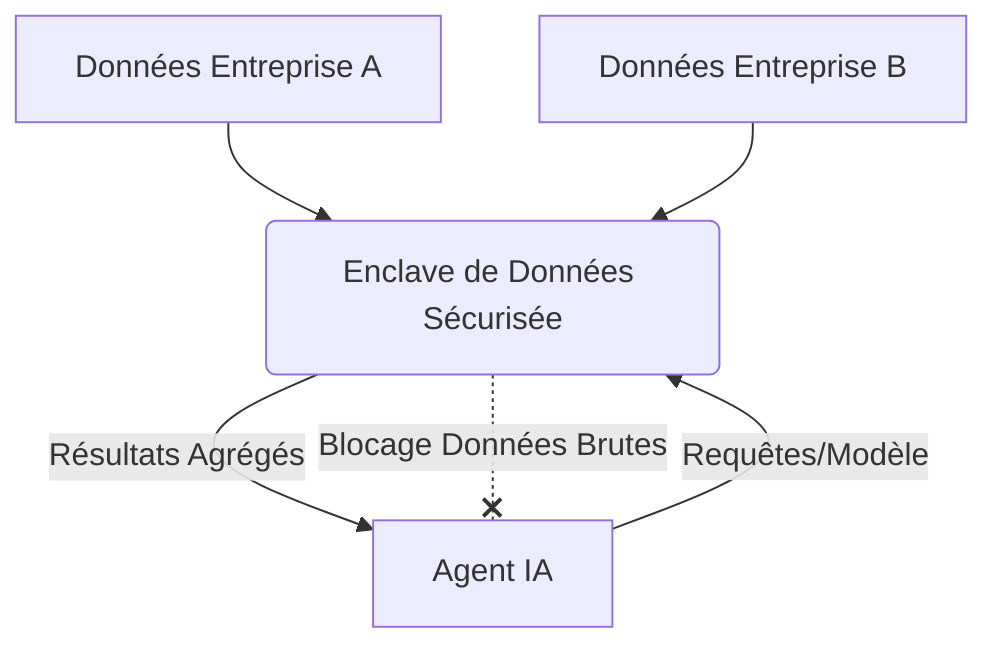
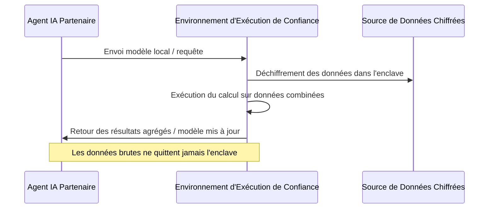

<!-- markdownlint-disable MD009 MD010 MD013 MD022 MD028 MD032 MD033 MD034 MD036 MD037 MD039 MD041 MD058 MD060 -->
[ 🇬🇧 English Version ](./README.md)

# Agent Data Enclave

> **Résumé exécutif :** Une infrastructure d'enclave de données sécurisée permettant aux agents IA de différentes organisations d'analyser et de croiser des données sans jamais exposer les données brutes, résolvant ainsi les freins réglementaires et de confidentialité.

---

## 1. Aperçu visuel & Effet Wahou

## 2. La thèse contrariante (Peter Thiel Style)

**La croyance populaire :** Pour analyser des données combinées entre plusieurs organisations, les entreprises doivent centraliser leurs données brutes dans une plateforme cloud ou un data lake unifié.

**La vérité cachée :** La véritable IA collaborative se fera à la périphérie (edge) au sein d'enclaves matérielles décentralisées ; la plateforme gagnante n'hébergera pas les données, mais le protocole de confiance cryptographique permettant aux agents de calculer localement.

## 3. Le problème & La cible

**Modèle économique :** B2B

**Cible précise :** Consortia de R&D (ex: pharma, automobile), institutions financières, grandes entreprises voulant croiser des données sans les exposer (B2B multi-tenant).

**La douleur urgente :** Les entreprises souhaitent utiliser des agents IA pour analyser des bases de données croisées entre partenaires commerciaux afin d'optimiser la chaîne logistique, la recherche médicale ou la détection de fraudes. Cependant, partager les données brutes est impossible pour des raisons réglementaires (RGPD), de confidentialité ou de protection de la propriété intellectuelle.

## 4. Architecture technique & Plomberie

## 5. Modèle économique & Viabilité financière

| Métrique | Valeur |
|---|---|
| Structure de prix | Abonnement Enterprise & Frais par noeud de calcul |
| Objectif 12 mois | 10 déploiements de consortia ou 50 noeuds d'entreprise actifs |
| Calcul du CA (Target 100k€) | 50 noeuds × 2 000 €/mois = 100 000 € ARR |
| Marge brute estimée | 85% |

## 6. Moteur de distribution & Fossé défensif (Moat)

**Stratégie d'acquisition :** Ventes B2B directes, en ciblant les consortia industriels existants et les responsables de la conformité réglementaire comme champions internes.

**Moat (Barrière à l'entrée) :** Intégration profonde avec la sécurité matérielle (TEE) et complexité DevOps pour l'orchestration cryptographique. Plus les partenaires rejoignent un réseau d'enclaves, plus l'effet de réseau est fort, rendant extrêmement difficile pour les LLM natifs ou les outils cloud génériques de répliquer la couche de confiance établie.

## 7. Grille d'évaluation détaillée

| Critère | Score VC (/100) | Score Terrain (/100) |
|---|---|---|
| Thèse & Monopole / Urgence | -- / 25 | -- / 25 |
| Moat / Résistance aux LLM natifs | -- / 25 | -- / 25 |
| Scalabilité / Friction d'adoption | -- / 25 | -- / 25 |
| Unit Economics / ROI direct | -- / 25 | -- / 25 |
| **TOTAL** | **-- / 100** | **-- / 100** |

> **Verdict VC :** En attente d'évaluation.

> **Verdict Terrain :** En attente d'évaluation.
