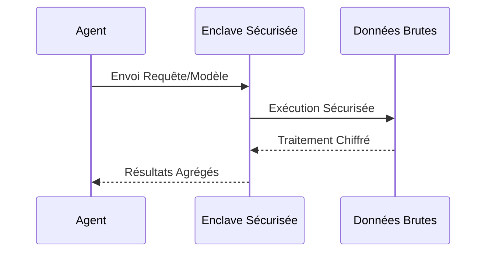

<!-- markdownlint-disable MD009 MD010 MD013 MD022 MD028 MD032 MD033 MD034 MD036 MD037 MD039 MD041 MD058 MD060 -->
[ 🇬🇧 English Version ](./README.md)

# Agent Data Enclave

> **Résumé exécutif :** Une infrastructure d'enclave de données sécurisée permettant la collaboration B2B multi-tenant et l'analyse IA sur des données sensibles sans jamais exposer les données brutes.


---

## 1. Aperçu visuel & Effet Wahou

```mermaid
graph TD
    A[Données Partenaire A] --> C{Secure Data Enclave (TEE)}
    B[Données Partenaire B] --> C
    D[Agent IA] --> C
    C --> E[Résultats Agrégés / Mise à jour Modèle]
```

## 2. La thèse contrariante (Peter Thiel Style)

**La croyance populaire :** Le partage de données pour l'IA nécessite l'agrégation de données brutes dans des data lakes centralisés.

**La vérité cachée :** La véritable valeur des données multi-parties réside dans leur calcul collaboratif sans jamais déplacer ni exposer les jeux de données, en s'appuyant sur un chiffrement matériel plutôt que sur la confiance.

## 3. Le problème & La cible

**Modèle économique :** B2B

**Cible précise :** Consortia de R&D (ex: pharma, automobile), institutions financières, grandes entreprises voulant croiser des données sans les exposer (B2B multi-tenant).

**La douleur urgente :** Les entreprises souhaitent utiliser des agents IA pour analyser des bases de données croisées mais le partage des données brutes est impossible (RGPD, confidentialité, IP), bloquant toute optimisation.

## 4. Architecture technique & Plomberie



## 5. Modèle économique & Viabilité financière

| Métrique | Valeur |
| --- | --- |
| Structure de prix | Abonnement mensuel par enclave / Volume de données |
| Objectif 12 mois | 10 consortiums d'entreprises |
| Calcul du CA (Target 100k€) | 10 consortiums * 10 000€ MRR * 12 = 1.2M€ ARR |
| Marge brute estimée | 85% |

## 6. Moteur de distribution & Fossé défensif (Moat)

**Stratégie d'acquisition :** Ventes directes aux consortiums d'entreprises, partenariats avec les grands instituts de recherche et fournisseurs cloud.

**Moat (Barrière à l'entrée) :** La complexité opérationnelle (DevOps lourd) pour déployer des TEE (Trusted Execution Environments) est massive. Les fournisseurs génériques ne peuvent répliquer la sécurité matérielle de bout en bout nécessaire pour les LLMs.

## 7. Grille d'évaluation détaillée

| Critère | Score VC (/100) | Score Terrain (/100) |
| :--- | :---: | :---: |
| Thèse & Monopole / Urgence | -- / 25 | -- / 25 |
| Moat / Résistance aux LLM natifs | -- / 25 | -- / 25 |
| Scalabilité / Friction d'adoption | -- / 25 | -- / 25 |
| Unit Economics / ROI direct | -- / 25 | -- / 25 |
| **TOTAL** | **-- / 100** | **-- / 100** |

> **Verdict VC :** En attente d'évaluation.
>
> **Verdict Terrain :** En attente d'évaluation.
