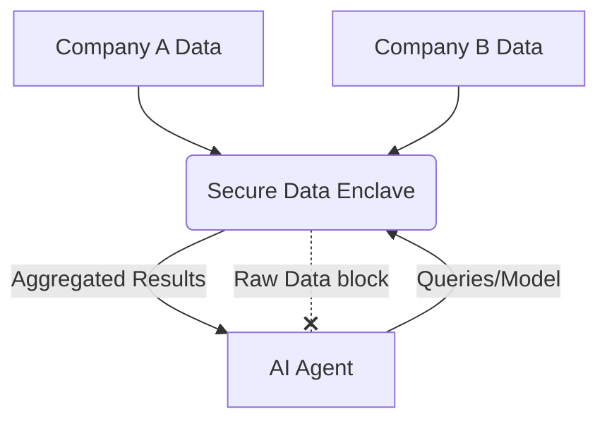
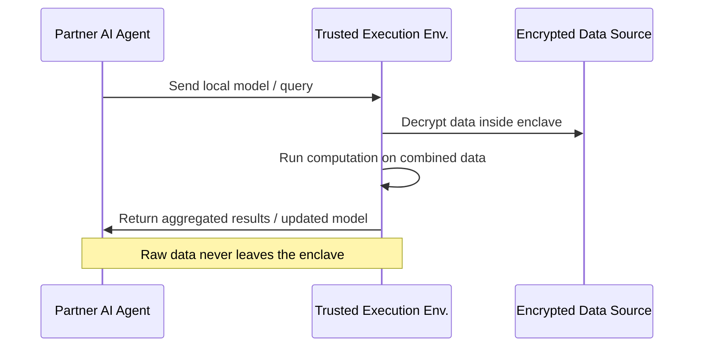

<!-- markdownlint-disable MD009 MD010 MD013 MD022 MD028 MD032 MD033 MD034 MD036 MD037 MD039 MD041 MD058 MD060 -->
[ 🇫🇷 Version Française ](./README.fr.md)

# Agent Data Enclave

> **Executive Summary:** A secure data enclave infrastructure allowing autonomous AI agents from different organizations to cross-analyze data and train models locally without exposing the raw data, solving major regulatory and confidentiality roadblocks.

---

## 1. Visual Overview & Wow Effect

## 2. Contrarian Thesis (Peter Thiel Style)

**Popular Belief:** To analyze combined data across organizations, companies must centralize their raw datasets in a unified cloud platform or data lake.

**Hidden Truth:** True collaborative AI will happen at the edge within decentralized hardware enclaves; the winning platform won't host the data, it will host the cryptographic trust protocol that lets agents compute locally.

## 3. Problem & Target Market

**Business Model:** B2B

**Target Audience:** R&D consortia (e.g., pharma, automotive), financial institutions, large enterprises needing to cross-reference data without exposing it (multi-tenant B2B).

**Urgent Pain Point:** Organizations want to leverage AI agents to optimize supply chains or detect fraud across partner databases, but GDPR, privacy laws, and intellectual property concerns make raw data sharing impossible. The cost of inaction is missed collaborative insights and stalled innovation.

## 4. Technical Architecture & Infrastructure

## 5. Business Model & Financial Viability

| Metric | Value |
|---|---|
| Pricing Structure | Enterprise Subscription & Per-Node Compute Fee |
| 12-Month Target | 10 consortia deployments or 50 active enterprise nodes |
| Revenue Formula | 50 nodes × €2,000/month = €100,000 ARR |
| Estimated Gross Margin | 85% |

## 6. Distribution Engine & Moat

**Acquisition Strategy:** Direct enterprise sales, targeting existing industry consortia and regulatory compliance officers as internal champions.

**Moat (Defensibility):** Deep integration with hardware-level security (TEE) and complex DevOps for cryptographic orchestration. The more partners join an enclave network, the stronger the network effect, making it extremely difficult for native LLMs or generic cloud tools to replicate the established trust layer.

## 7. Detailed Evaluation Grid

| Criterion | VC Score (/100) | Market Score (/100) |
|---|---|---|
| Thesis & Monopoly / Urgency | -- / 25 | -- / 25 |
| Moat / LLM Immunity | -- / 25 | -- / 25 |
| Scalability / UX Friction | -- / 25 | -- / 25 |
| Unit Economics / ROI | -- / 25 | -- / 25 |
| **TOTAL** | **-- / 100** | **-- / 100** |

> **VC Verdict:** Pending evaluation.

> **Market Verdict:** Pending evaluation.
