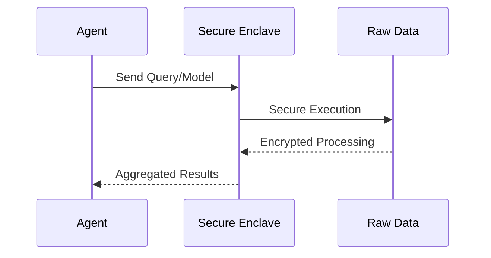

<!-- markdownlint-disable MD009 MD010 MD013 MD022 MD028 MD032 MD033 MD034 MD036 MD037 MD039 MD041 MD058 MD060 -->
[ 🇫🇷 Version Française ](./README.fr.md)

# Agent Data Enclave

> **Executive Summary:** A Secure Data Enclave infrastructure enabling multi-tenant B2B collaboration and AI analysis on sensitive data without exposing the raw data itself.


---

## 1. Visual Overview & Wow Effect

```mermaid
graph TD
    A[Partner A Data] --> C{Secure Data Enclave (TEE)}
    B[Partner B Data] --> C
    D[AI Agent] --> C
    C --> E[Aggregated Results / Model Update]
```

## 2. Contrarian Thesis (Peter Thiel Style)

**Popular Belief:** Data sharing for AI requires aggregating raw data into centralized data lakes or cloud platforms.

**Hidden Truth:** The true value of multi-party data lies in its collaborative computation without ever moving or exposing the raw datasets, relying on hardware-level encryption instead of trust.

## 3. Problem & Target Market

**Business Model:** B2B

**Target Audience:** R&D consortia (e.g., pharma, automotive), financial institutions, large enterprises needing to cross-reference data securely.

**Urgent Pain Point:** Companies cannot leverage AI on multi-party data due to strict regulations (GDPR), confidentiality, and IP protection, blocking critical collaborative optimization and research.

## 4. Technical Architecture & Infrastructure



## 5. Business Model & Financial Viability

| Metric | Value |
| --- | --- |
| Pricing Structure | Monthly Subscription per Enclave / Data Volume |
| 12-Month Target | 10 Enterprise Consortia |
| Revenue Formula | 10 consortia * 10,000€ MRR * 12 = 1.2M€ ARR |
| Estimated Gross Margin | 85% |

## 6. Distribution Engine & Moat

**Acquisition Strategy:** Direct sales to enterprise consortia, partnerships with major research institutions and cloud providers.

**Moat (Defensibility):** The complexity of managing TEEs (Trusted Execution Environments) and federated learning infrastructures creates a massive technical barrier to entry. Generic LLM providers cannot replicate this as it requires specialized hardware-level security orchestration.

## 7. Detailed Evaluation Grid

| Criterion | VC Score (/100) | Market Score (/100) |
| :--- | :---: | :---: |
| Thesis & Monopoly / Urgency | -- / 25 | -- / 25 |
| Moat / LLM Immunity | -- / 25 | -- / 25 |
| Scalability / UX Friction | -- / 25 | -- / 25 |
| Unit Economics / ROI | -- / 25 | -- / 25 |
| **TOTAL** | **-- / 100** | **-- / 100** |

> **VC Verdict:** Pending evaluation.
>
> **Market Verdict:** Pending evaluation.
