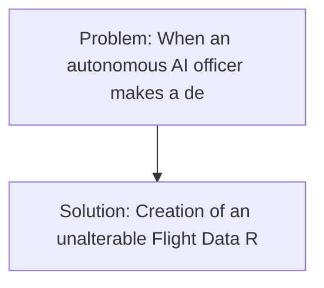
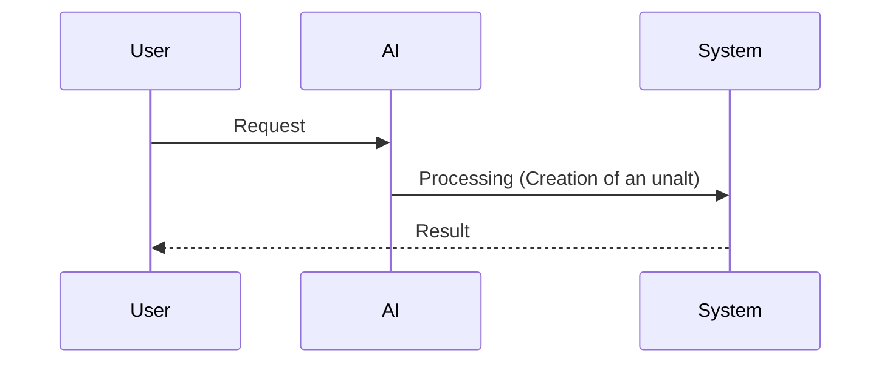

<!-- markdownlint-disable MD013 MD033 MD041 -->

[🇫🇷 Version Française](./README.fr.md)

# Agent Liability Blackbox

> **Executive Summary:** A B2B solution targeting Companies deploying autonomous AI agents (banks, health, e-commerce), cyber risk insurers IA to solve the following problem: When an autonomous AI officer makes a decision that results in a financial loss or a legal violation, it is impossible to trace exactly why this decision was made. This paralyzes the deployment of agents in production for fear of non-compliance and makes insurance policies impossible to price. The approach relies on: Creation of an unalterable Flight Data Recorder (black box) for AI agents. The system captures the agent's cryptographic decision tree (Merkle tree), context status (short-term memory), API calls made, and signs the set with an immutable time stamp on a low-level Zero-Trust registry.

---

## 1. Visual Overview & Wow Effect

## 2. Contrarian Thesis (Peter Thiel Style)

- **Popular Belief:** A generic SaaS approach is sufficient.
- **Hidden Truth:** The classic server logs (Datadog, Splunk) are editable and do not capture the non-deterministic state of an LLM orchestrating workflow. It requires a cryptographic anchor that proves the state of the agent at the time of inference with non-repudiation.

## 3. Problem & Target Market

- **Business Model:** B2B
- **Target Audience:** Companies deploying autonomous AI agents (banks, health, e-commerce), cyber risk insurers IA
- **Urgent Pain Point:** When an autonomous AI officer makes a decision that results in a financial loss or a legal violation, it is impossible to trace exactly why this decision was made. This paralyzes the deployment of agents in production for fear of non-compliance and makes insurance policies impossible to price.

## 4. Technical Architecture & Infrastructure

Creation of an unalterable Flight Data Recorder (black box) for AI agents. The system captures the agent's cryptographic decision tree (Merkle tree), context status (short-term memory), API calls made, and signs the set with an immutable time stamp on a low-level Zero-Trust registry.

## 5. Business Model & Financial Viability

| Metric                 | Value                              |
| ---------------------- | ---------------------------------- |
| Pricing Structure      | B2B Subscription / License         |
| 12-Month Target        | 100 clients (or equivalent volume) |
| Revenue Formula        | 100 \* 1000€ = 100k€               |
| Estimated Gross Margin | 80%                                |

## 6. Distribution Engine & Moat

- **Acquisition Strategy:** Direct sales and partnerships in the domain: IA & Autonomous Agents
- **Moat (Defensibility):** The classic server logs (Datadog, Splunk) are editable and do not capture the non-deterministic state of an LLM orchestrating workflow. It requires a cryptographic anchor that proves the state of the agent at the time of inference with non-repudiation. Risks include: Overhead (latency) added during agent calls, slow adoption due to lack of clear legal standards on the liability of AI agents, complex integration with multiple orchestration frameworks (LangChain, AutoGen, etc.).

## 7. Detailed Evaluation Grid

| Criterion                   | VC Score (/100) | Market Score (/100) |
| --------------------------- | --------------- | ------------------- |
| Thesis & Monopoly / Urgency | -- / 25         | -- / 25             |
| Moat / LLM Immunity         | -- / 25         | -- / 25             |
| Scalability / UX Friction   | -- / 25         | -- / 25             |
| Unit Economics / ROI        | -- / 25         | -- / 25             |
| **TOTAL**                   | -- / 100        | -- / 100            |

> **VC Verdict:** Pending evaluation.
> **Market Verdict:** Pending evaluation.
