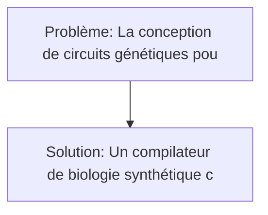
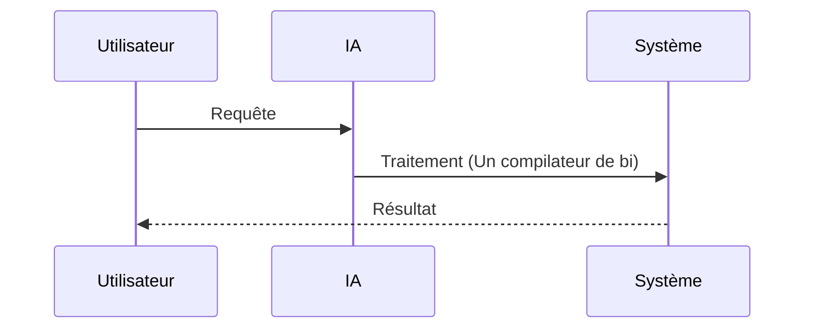

<!-- markdownlint-disable MD013 MD033 MD041 -->

[🇬🇧 English Version](./README.md)

# BioOS Synthetic

> **Résumé exécutif :** Une solution B2B ciblant Laboratoires pharmaceutiques et biotechs de phase pré-clinique (Directeurs R&D, Head of Synthetic Biology). pour résoudre le problème suivant : La conception de circuits génétiques pour les thérapies cellulaires (ex. CAR-T) nécessite des mois d'essais-erreurs in-vivo/in-vitro, coûtant des millions sans garantie que les cellules modifiées n'attaquent pas les tissus sains (toxicité off-target). L'approche repose sur : Un "compilateur" de biologie synthétique couplé à un jumeau numérique cellulaire (World Model biologique) qui simule l'expression génique dynamique et les interactions protéiques avant toute synthèse en laboratoire.

---

## 1. Aperçu visuel & Effet Wahou

## 2. La thèse contrariante (Peter Thiel Style)

- **La croyance populaire :** Une approche générique SaaS classique est suffisante.
- **La vérité cachée :** Un LLM ne comprend pas la cinétique biochimique spatio-temporelle ni les repliements protéiques en 3D dans le cytoplasme. Nécessite des modèles physiques prédictifs (physique statistique, thermodynamique) entraînés sur des données multi-omiques propriétaires.

## 3. Le problème & La cible

- **Modèle économique :** B2B
- **Cible précise :** Laboratoires pharmaceutiques et biotechs de phase pré-clinique (Directeurs R&D, Head of Synthetic Biology).
- **La douleur urgente :** La conception de circuits génétiques pour les thérapies cellulaires (ex. CAR-T) nécessite des mois d'essais-erreurs in-vivo/in-vitro, coûtant des millions sans garantie que les cellules modifiées n'attaquent pas les tissus sains (toxicité off-target).

## 4. Architecture technique & Plomberie

Un "compilateur" de biologie synthétique couplé à un jumeau numérique cellulaire (World Model biologique) qui simule l'expression génique dynamique et les interactions protéiques avant toute synthèse en laboratoire.

## 5. Modèle économique & Viabilité financière

| Métrique                    | Valeur                             |
| --------------------------- | ---------------------------------- |
| Structure de prix           | Abonnement / Licence B2B           |
| Objectif 12 mois            | 100 clients (ou volume équivalent) |
| Calcul du CA (Target 100k€) | 100 \* 1000€ = 100k€               |
| Marge brute estimée         | 80%                                |

## 6. Moteur de distribution & Fossé défensif (Moat)

- **Stratégie d'acquisition :** Ventes directes et partenariats dans le domaine : Biotech & Bio-informatique
- **Moat (Barrière à l'entrée) :** Un LLM ne comprend pas la cinétique biochimique spatio-temporelle ni les repliements protéiques en 3D dans le cytoplasme. Nécessite des modèles physiques prédictifs (physique statistique, thermodynamique) entraînés sur des données multi-omiques propriétaires. Les risques incluent : Accès aux données omiques massives de haute qualité, puissance de calcul GPU extrême (équivalent dynamique moléculaire), validation biologique en wet-lab incontournable pour prouver le modèle.

## 7. Grille d'évaluation détaillée

| Critère                           | Score VC (/100) | Score Terrain (/100) |
| --------------------------------- | --------------- | -------------------- |
| Thèse & Monopole / Urgence        | -- / 25         | 22 / 25              |
| Moat / Résistance aux LLM natifs  | -- / 25         | 24 / 25              |
| Scalabilité / Friction d'adoption | -- / 25         | 18 / 25              |
| Unit Economics / ROI direct       | -- / 25         | 20 / 25              |
| **TOTAL**                         | -- / 100        | 84 / 100             |

> **Verdict VC :** En attente d'évaluation.
> **Verdict Terrain :** Désirabilité forte vu le coût prohibitif des tests in-vitro. Immunité totale face aux LLMs génériques nécessitant des modèles physiques prédictifs spécialisés. Friction d'adoption réelle liée à la nécessité de validation biologique et d'intégration aux processus R&D existants, mais forte disposition à payer des laboratoires biotech.
