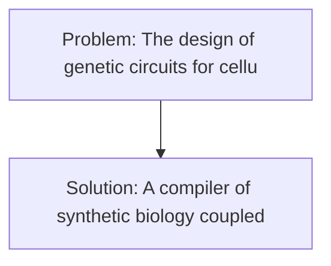
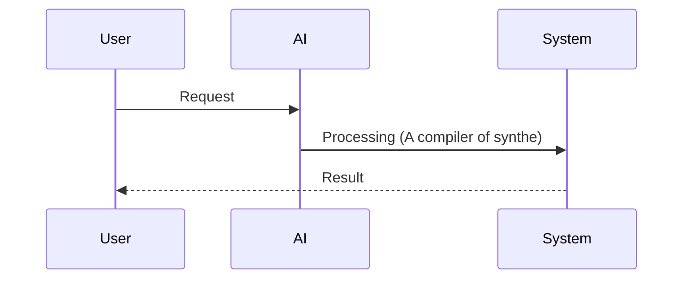

<!-- markdownlint-disable MD013 MD033 MD041 -->

[🇫🇷 Version Française](./README.fr.md)

# BioOS Synthetic

> **Executive Summary:** A B2B solution targeting Preclinical phase pharmaceutical and biotech laboratories (R&D Directors, Head of Synthetic Biology). to solve the following problem: The design of genetic circuits for cellular therapies (e.g. CAR-T) requires months of in-vivo/in-vitro error testing, costing millions without guarantee that modified cells do not attack healthy tissues (off-target toxicity). The approach relies on: A "compiler" of synthetic biology coupled with a biological World Model that simulates dynamic gene expression and protein interactions before any synthesis in the laboratory.

---

## 1. Visual Overview & Wow Effect

## 2. Contrarian Thesis (Peter Thiel Style)

- **Popular Belief:** A generic SaaS approach is sufficient.
- **Hidden Truth:** A LLM does not include spatiotemporal biochemical kinetics or 3D protein folds in the cytoplasm. Requires predictive physical models (statistical physics, thermodynamics) driven on proprietary multi-omical data.

## 3. Problem & Target Market

- **Business Model:** B2B
- **Target Audience:** Preclinical phase pharmaceutical and biotech laboratories (R&D Directors, Head of Synthetic Biology).
- **Urgent Pain Point:** The design of genetic circuits for cellular therapies (e.g. CAR-T) requires months of in-vivo/in-vitro error testing, costing millions without guarantee that modified cells do not attack healthy tissues (off-target toxicity).

## 4. Technical Architecture & Infrastructure

A "compiler" of synthetic biology coupled with a biological World Model that simulates dynamic gene expression and protein interactions before any synthesis in the laboratory.

## 5. Business Model & Financial Viability

| Metric                 | Value                              |
| ---------------------- | ---------------------------------- |
| Pricing Structure      | B2B Subscription / License         |
| 12-Month Target        | 100 clients (or equivalent volume) |
| Revenue Formula        | 100 \* 1000€ = 100k€               |
| Estimated Gross Margin | 80%                                |

## 6. Distribution Engine & Moat

- **Acquisition Strategy:** Direct sales and partnerships in the domain: Biotech & Bioinformatics
- **Moat (Defensibility):** A LLM does not include spatiotemporal biochemical kinetics or 3D protein folds in the cytoplasm. Requires predictive physical models (statistical physics, thermodynamics) driven on proprietary multi-omical data. Risks include: Access to high quality massive omic data, extreme GPU computing power (molecular dynamic equivalent), biological validation in wet-lab essential to prove the model.

## 7. Detailed Evaluation Grid

| Criterion                   | VC Score (/100) | Market Score (/100) |
| --------------------------- | --------------- | ------------------- |
| Thesis & Monopoly / Urgency | -- / 25         | -- / 25             |
| Moat / LLM Immunity         | -- / 25         | -- / 25             |
| Scalability / UX Friction   | -- / 25         | -- / 25             |
| Unit Economics / ROI        | -- / 25         | -- / 25             |
| **TOTAL**                   | -- / 100        | -- / 100            |

> **VC Verdict:** Pending evaluation.
> **Market Verdict:** Pending evaluation.
