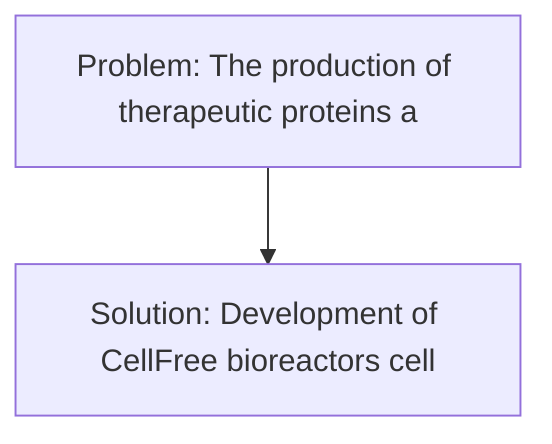
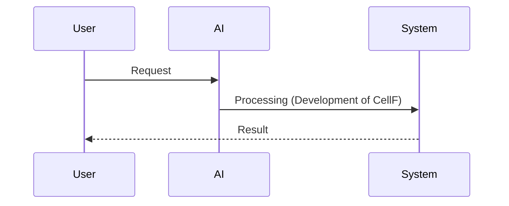

<!-- markdownlint-disable MD013 MD033 MD041 -->

[🇫🇷 Version Française](./README.fr.md)

# Cell-Free Protein Reactor

> **Executive Summary:** A B2B solution targeting Pharmaceutical companies, bioproduction (CDMOs), synthetic biology startups, and cosmetics. to solve the following problem: The production of therapeutic proteins, antibodies or enzymes depends on the culture of living cells (e.g. CHO, E. coli) in huge bioreactors. This process is slow (weeks), vulnerable to viral contamination, and limited by the toxicity of proteins to the host cell (which dies if some molecules are produced). The approach relies on: Development of Cell-Free bioreactors (cell-free) on a continuous industrial scale. Molecular machinery (ribosomes, enzymes, cofactors) is extracted from cells and stabilized in a microfluidic system or hydrogel, allowing proteins to be synthesized directly from DNA or mRNA, without the constraint of keeping a cell alive.

---

## 1. Visual Overview & Wow Effect

## 2. Contrarian Thesis (Peter Thiel Style)

- **Popular Belief:** A generic SaaS approach is sufficient.
- **Hidden Truth:** It is a fundamental lock in physical and chemical bioengineering. Optimizing enzyme reactions outside a cell membrane, recycling ATP and continuous flow purification require deep expertise in microfluidic, polymer chemistry and biochemistry, far from the capabilities of a software or SaaS optimization.

## 3. Problem & Target Market

- **Business Model:** B2B
- **Target Audience:** Pharmaceutical companies, bioproduction (CDMOs), synthetic biology startups, and cosmetics.
- **Urgent Pain Point:** The production of therapeutic proteins, antibodies or enzymes depends on the culture of living cells (e.g. CHO, E. coli) in huge bioreactors. This process is slow (weeks), vulnerable to viral contamination, and limited by the toxicity of proteins to the host cell (which dies if some molecules are produced).

## 4. Technical Architecture & Infrastructure

Development of Cell-Free bioreactors (cell-free) on a continuous industrial scale. Molecular machinery (ribosomes, enzymes, cofactors) is extracted from cells and stabilized in a microfluidic system or hydrogel, allowing proteins to be synthesized directly from DNA or mRNA, without the constraint of keeping a cell alive.

## 5. Business Model & Financial Viability

| Metric                 | Value                              |
| ---------------------- | ---------------------------------- |
| Pricing Structure      | B2B Subscription / License         |
| 12-Month Target        | 100 clients (or equivalent volume) |
| Revenue Formula        | 100 \* 1000€ = 100k€               |
| Estimated Gross Margin | 80%                                |

## 6. Distribution Engine & Moat

- **Acquisition Strategy:** Direct sales and partnerships in the domain: Biotech & Bioinformatics
- **Moat (Defensibility):** It is a fundamental lock in physical and chemical bioengineering. Optimizing enzyme reactions outside a cell membrane, recycling ATP and continuous flow purification require deep expertise in microfluidic, polymer chemistry and biochemistry, far from the capabilities of a software or SaaS optimization. Risks include: The prohibitive cost of initial cell extracts and nucleotides (NTPs), energy regeneration (ATP) over long periods of time, difficulty in performing complex posttranslational changes (glycosylation) outside the endoplasmic reticulum of a living cell.

## 7. Detailed Evaluation Grid

| Criterion                   | VC Score (/100) | Market Score (/100) |
| --------------------------- | --------------- | ------------------- |
| Thesis & Monopoly / Urgency | -- / 25         | -- / 25             |
| Moat / LLM Immunity         | -- / 25         | -- / 25             |
| Scalability / UX Friction   | -- / 25         | -- / 25             |
| Unit Economics / ROI        | -- / 25         | -- / 25             |
| **TOTAL**                   | -- / 100        | -- / 100            |

> **VC Verdict:** Pending evaluation.
> **Market Verdict:** Pending evaluation.
