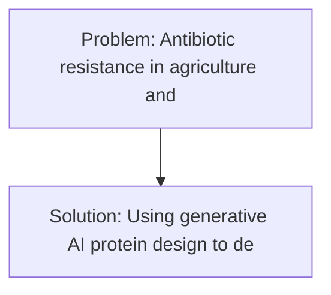
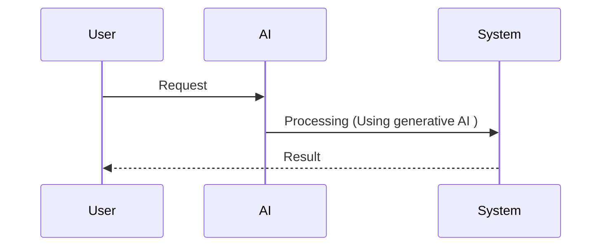

<!-- markdownlint-disable MD013 MD033 MD041 -->

[🇫🇷 Version Française](./README.fr.md)

# Engineered Phage AgTech

> **Executive Summary:** A B2B solution targeting Large farms, seed producers, and agricultural cooperatives dealing with endemic bacterial diseases (e.g. fire, canker). to solve the following problem: Antibiotic resistance in agriculture and the growing ban on chemical pesticides threaten global yields. Phytopathogenic bacteria destroy billions of dollars of crops every year, without a targeted and environmentally sustainable solution. The approach relies on: Using generative AI (protein design) to design and synthesize "tailored" bacteriophages (bacterial killer viruses) specifically targeting only the pathogenic strains of crops, while preserving the beneficial microbiome of the soil and plant.

---

## 1. Visual Overview & Wow Effect

## 2. Contrarian Thesis (Peter Thiel Style)

- **Popular Belief:** A generic SaaS approach is sufficient.
- **Hidden Truth:** This is a molecular biology problem requiring a wet-lab, high-speed screening robotics, and an in vivo feedback loop. Pure software cannot synthesize DNA or test the viability and infectivity of phage in the field.

## 3. Problem & Target Market

- **Business Model:** B2B
- **Target Audience:** Large farms, seed producers, and agricultural cooperatives dealing with endemic bacterial diseases (e.g. fire, canker).
- **Urgent Pain Point:** Antibiotic resistance in agriculture and the growing ban on chemical pesticides threaten global yields. Phytopathogenic bacteria destroy billions of dollars of crops every year, without a targeted and environmentally sustainable solution.

## 4. Technical Architecture & Infrastructure

Using generative AI (protein design) to design and synthesize "tailored" bacteriophages (bacterial killer viruses) specifically targeting only the pathogenic strains of crops, while preserving the beneficial microbiome of the soil and plant.

## 5. Business Model & Financial Viability

| Metric                 | Value                              |
| ---------------------- | ---------------------------------- |
| Pricing Structure      | B2B Subscription / License         |
| 12-Month Target        | 100 clients (or equivalent volume) |
| Revenue Formula        | 100 \* 1000€ = 100k€               |
| Estimated Gross Margin | 80%                                |

## 6. Distribution Engine & Moat

- **Acquisition Strategy:** Direct sales and partnerships in the domain: Biotech & Bioinformatics
- **Moat (Defensibility):** This is a molecular biology problem requiring a wet-lab, high-speed screening robotics, and an in vivo feedback loop. Pure software cannot synthesize DNA or test the viability and infectivity of phage in the field. Risks include: Extremely strict regulation on the introduction of genetically modified or synthetic organisms (GMOs) into the open environment, instability of phages in the face of solar UV rays on fields, industrial scale production capacity (bioproduction).

## 7. Detailed Evaluation Grid

| Criterion                   | VC Score (/100) | Market Score (/100) |
| --------------------------- | --------------- | ------------------- |
| Thesis & Monopoly / Urgency | -- / 25         | -- / 25             |
| Moat / LLM Immunity         | -- / 25         | -- / 25             |
| Scalability / UX Friction   | -- / 25         | -- / 25             |
| Unit Economics / ROI        | -- / 25         | -- / 25             |
| **TOTAL**                   | -- / 100        | -- / 100            |

> **VC Verdict:** Pending evaluation.
> **Market Verdict:** Pending evaluation.
