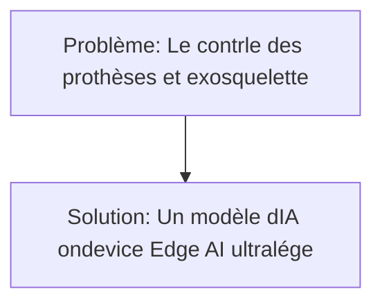
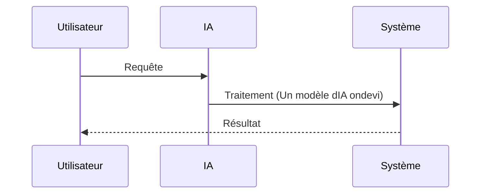

<!-- markdownlint-disable MD013 MD033 MD041 -->

[🇬🇧 English Version](./README.md)

# Exoskeleton Myoelectric Decoder

> **Résumé exécutif :** Une solution B2B (Licensing Software & Edge AI) ciblant Fabricants d'exosquelettes industriels et médicaux, entreprises de prothèses robotiques pour résoudre le problème suivant : Le contrôle des prothèses et exosquelettes via les signaux musculaires de surface (EMG) est lent, erratique et nécessite une recalibration constante liée à la sueur ou la fatigue musculaire. Cela crée un rejet massif de la technologie par les utilisateurs (friction d'adoption). L'approche repose sur : Un modèle d'IA "on-device" (Edge AI) ultra-léger, entraîné sur des données biométriques massives, capable de décoder l'intention motrice humaine (les signaux myoélectriques bruités) en temps réel (< 20 ms), sans recalibration. L'IA prédit le mouvement avant même que le muscle ne se contracte complètement.

---

## 1. Aperçu visuel & Effet Wahou

## 2. La thèse contrariante (Peter Thiel Style)

- **La croyance populaire :** Une approche générique SaaS classique est suffisante.
- **La vérité cachée :** Il faut une inférence à latence ultra-faible fonctionnant sur des microcontrôleurs embarqués à faible consommation d'énergie (sans accès Cloud). Une API Cloud introduirait un lag inacceptable et dangereux pour le mouvement physique.

## 3. Le problème & La cible

- **Modèle économique :** B2B (Licensing Software & Edge AI)
- **Cible précise :** Fabricants d'exosquelettes industriels et médicaux, entreprises de prothèses robotiques
- **La douleur urgente :** Le contrôle des prothèses et exosquelettes via les signaux musculaires de surface (EMG) est lent, erratique et nécessite une recalibration constante liée à la sueur ou la fatigue musculaire. Cela crée un rejet massif de la technologie par les utilisateurs (friction d'adoption).

## 4. Architecture technique & Plomberie

Un modèle d'IA "on-device" (Edge AI) ultra-léger, entraîné sur des données biométriques massives, capable de décoder l'intention motrice humaine (les signaux myoélectriques bruités) en temps réel (< 20 ms), sans recalibration. L'IA prédit le mouvement avant même que le muscle ne se contracte complètement.

## 5. Modèle économique & Viabilité financière

| Métrique                    | Valeur                                                  |
| --------------------------- | ------------------------------------------------------- |
| Structure de prix           | Abonnement / Licence B2B (Licensing Software & Edge AI) |
| Objectif 12 mois            | 100 clients (ou volume équivalent)                      |
| Calcul du CA (Target 100k€) | 100 \* 1000€ = 100k€                                    |
| Marge brute estimée         | 80%                                                     |

## 6. Moteur de distribution & Fossé défensif (Moat)

- **Stratégie d'acquisition :** Ventes directes et partenariats dans le domaine : Robotique & Systèmes embarqués
- **Moat (Barrière à l'entrée) :** Il faut une inférence à latence ultra-faible fonctionnant sur des microcontrôleurs embarqués à faible consommation d'énergie (sans accès Cloud). Une API Cloud introduirait un lag inacceptable et dangereux pour le mouvement physique. Les risques incluent : Collecte d'un jeu de données diversifié de signaux EMG (différents types de corps, âges, conditions). Le verrou matériel : nécessité de s'intégrer avec les capteurs électrodes propriétaires des différents constructeurs hardware.

## 7. Grille d'évaluation détaillée

| Critère                           | Score VC (/100) | Score Terrain (/100) |
| --------------------------------- | --------------- | -------------------- |
| Thèse & Monopole / Urgence        | -- / 25         | -- / 25              |
| Moat / Résistance aux LLM natifs  | -- / 25         | -- / 25              |
| Scalabilité / Friction d'adoption | -- / 25         | -- / 25              |
| Unit Economics / ROI direct       | -- / 25         | -- / 25              |
| **TOTAL**                         | -- / 100        | -- / 100             |

> **Verdict VC :** En attente d'évaluation.
> **Verdict Terrain :** En attente d'évaluation.
