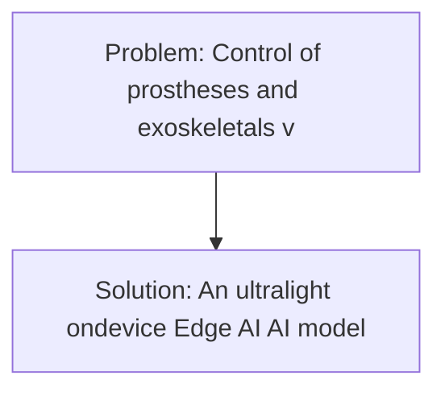
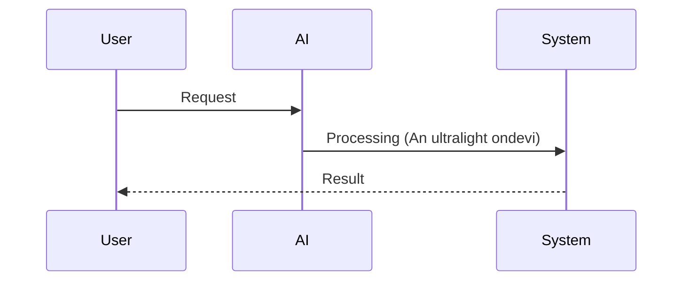

<!-- markdownlint-disable MD013 MD033 MD041 -->

[🇫🇷 Version Française](./README.fr.md)

# Exoskeleton Myoelectric Decoder

> **Executive Summary:** A B2B (Licensing Software & Edge AI) solution targeting Manufacturers of industrial and medical exoskeletons, robotic prosthetics companies to solve the following problem: Control of prostheses and exoskeletals via surface muscle signals (EMG) is slow, erratic and requires constant recalibration due to sweat or muscle fatigue. This creates a massive rejection of technology by users (adoption friction). The approach relies on: An ultra-light "on-device" (Edge AI) AI model, driven on massive biometric data, capable of decoding human motor intent (noise myoelectric signals) in real time (< 20 ms), without recalibration. AI predicts movement even before the muscle contracts completely.

---

## 1. Visual Overview & Wow Effect

## 2. Contrarian Thesis (Peter Thiel Style)

- **Popular Belief:** A generic SaaS approach is sufficient.
- **Hidden Truth:** It requires an ultra-low latency inference operating on on-board microcontrollers with low energy consumption (without cloud access). A Cloud API would introduce an unacceptable and dangerous lagoon for physical movement.

## 3. Problem & Target Market

- **Business Model:** B2B (Licensing Software & Edge AI)
- **Target Audience:** Manufacturers of industrial and medical exoskeletons, robotic prosthetics companies
- **Urgent Pain Point:** Control of prostheses and exoskeletals via surface muscle signals (EMG) is slow, erratic and requires constant recalibration due to sweat or muscle fatigue. This creates a massive rejection of technology by users (adoption friction).

## 4. Technical Architecture & Infrastructure

An ultra-light "on-device" (Edge AI) AI model, driven on massive biometric data, capable of decoding human motor intent (noise myoelectric signals) in real time (< 20 ms), without recalibration. AI predicts movement even before the muscle contracts completely.

## 5. Business Model & Financial Viability

| Metric                 | Value                                                     |
| ---------------------- | --------------------------------------------------------- |
| Pricing Structure      | B2B (Licensing Software & Edge AI) Subscription / License |
| 12-Month Target        | 100 clients (or equivalent volume)                        |
| Revenue Formula        | 100 \* 1000€ = 100k€                                      |
| Estimated Gross Margin | 80%                                                       |

## 6. Distribution Engine & Moat

- **Acquisition Strategy:** Direct sales and partnerships in the domain: Robotics & Embedded Systems
- **Moat (Defensibility):** It requires an ultra-low latency inference operating on on-board microcontrollers with low energy consumption (without cloud access). A Cloud API would introduce an unacceptable and dangerous lagoon for physical movement. Risks include: Collection of a diverse data set of EMG signals (different types of body, ages, conditions). The hardware lock: need to integrate with the electrode sensors owned by the various hardware manufacturers.

## 7. Detailed Evaluation Grid

| Criterion                   | VC Score (/100) | Market Score (/100) |
| --------------------------- | --------------- | ------------------- |
| Thesis & Monopoly / Urgency | -- / 25         | -- / 25             |
| Moat / LLM Immunity         | -- / 25         | -- / 25             |
| Scalability / UX Friction   | -- / 25         | -- / 25             |
| Unit Economics / ROI        | -- / 25         | -- / 25             |
| **TOTAL**                   | -- / 100        | -- / 100            |

> **VC Verdict:** Pending evaluation.
> **Market Verdict:** Pending evaluation.
