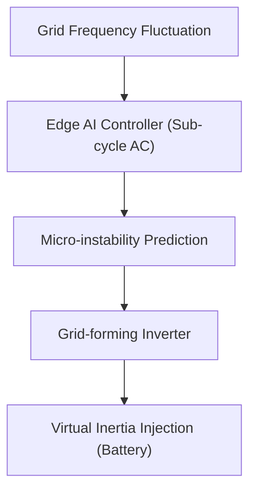
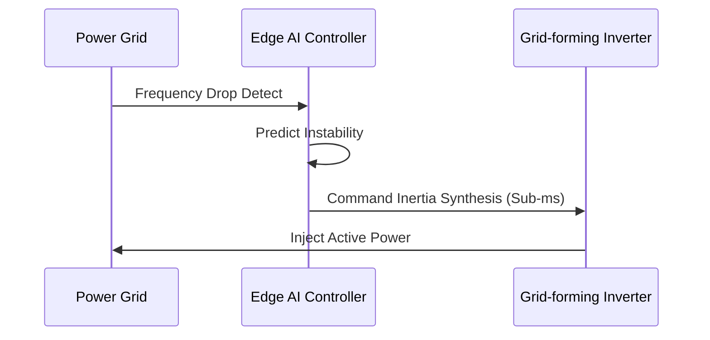

<!-- markdownlint-disable MD009 MD010 MD013 MD022 MD028 MD032 MD033 MD034 MD036 MD037 MD039 MD041 MD058 MD060 -->

[🇫🇷 Version Française](./README.fr.md)

# Grid Inertia Synthesizer

> **Executive Summary:** An edge-computing hardware/software controller for grid-forming inverters that uses AI to synthesize virtual inertia, preventing power grid blackouts.

---

## 1. Visual Overview & Wow Effect

## 2. Contrarian Thesis (Peter Thiel Style)

Popular Belief: Power grids can simply replace fossil fuel turbines with solar and wind power without fundamentally changing how the grid maintains stability.
Hidden Truth: The transition to renewable energy removes the physical 'spinning inertia' of massive fossil turbines, making the grid highly unstable. We must synthesize this inertia digitally in milliseconds.

## 3. Problem & Target Market

Business Model: B2B
Target Audience: Transmission System Operators (TSOs) and Renewable Energy producers (e.g., National Grid, RTE, wind/solar farm operators).
Urgent Pain Point: As more renewables come online, the grid loses its physical inertia, becoming increasingly susceptible to massive blackouts caused by rapid frequency fluctuations.

## 4. Technical Architecture & Infrastructure

## 5. Business Model & Financial Viability

| Metric                 | Value                                        |
| ---------------------- | -------------------------------------------- |
| Pricing Structure      | Hardware node sale + SaaS management license |
| 12-Month Target        | 50 MW of managed virtual inertia capacity    |
| Revenue Formula        | 50 MW \* $2000/MW software license           |
| Estimated Gross Margin | 65%                                          |

## 6. Distribution Engine & Moat

Acquisition Strategy: B2B sales to large renewable operators and direct pilots with national TSOs.
Moat (Defensibility): This is a critical cyber-physical problem requiring ultra-fast, low-level (sub-cycle AC) hardware control. Cloud SaaS would introduce fatal latency causing grid collapse. The moat is the proprietary edge hardware and real-time control algorithms.

## 7. Detailed Evaluation Grid

| Criterion                   | VC Score (/100) | Market Score (/100) |
| --------------------------- | --------------- | ------------------- |
| Thesis & Monopoly / Urgency | -- / 25         | 24 / 25             |
| Moat / LLM Immunity         | -- / 25         | 25 / 25             |
| Scalability / UX Friction   | -- / 25         | 16 / 25             |
| Unit Economics / ROI        | -- / 25         | 22 / 25             |
| **TOTAL**                   | **-- / 100**    | **87 / 100**        |

> **VC Verdict:** Pending evaluation.
> **Market Verdict:** The need for synthetic inertia is critical given the rise of intermittent renewables, justifying maximum urgency. Hardware-in-the-loop solution totally immune to text AIs. Adoption remains slowed by heavy TSO qualifications, but system service remuneration mechanisms guarantee clear revenue.
