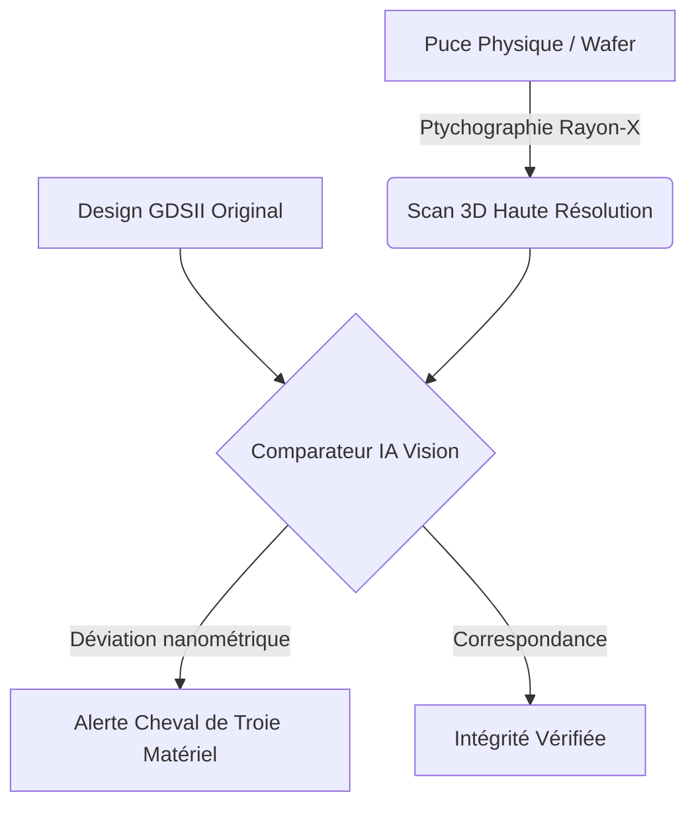
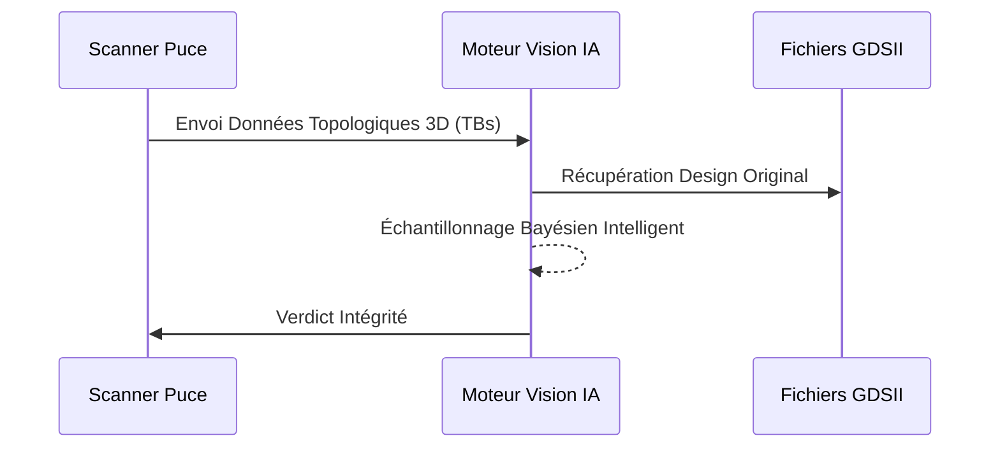

<!-- markdownlint-disable MD009 MD010 MD013 MD022 MD028 MD032 MD033 MD034 MD036 MD037 MD039 MD041 MD058 MD060 -->
[ 🇬🇧 English Version ](./README.md)

# Hardware Trojan Scanner

> **Résumé exécutif :** Un moteur de vérification d'intégrité matérielle non destructif couplant ptychographie aux rayons X et vision par ordinateur spécialisée pour détecter les altérations physiques des puces à l'échelle nanométrique.

---

## 1. Aperçu visuel & Effet Wahou

## 2. La thèse contrariante (Peter Thiel Style)

**La croyance populaire :** La cybersécurité consiste à protéger les logiciels et les systèmes d'exploitation contre les intrusions numériques.

**La vérité cachée :** La vulnérabilité ultime de la chaîne d'approvisionnement est gravée physiquement dans le silicium ; la sécurité logicielle est inutile si le matériel intègre un "kill switch" invisible.

## 3. Le problème & La cible

**Modèle économique :** B2B

**Cible précise :** Fonderies de semi-conducteurs, contractants de la défense, agences gouvernementales, aérospatial, systèmes critiques.

**La douleur urgente :** Un acteur malveillant peut insérer un "Hardware Trojan" modifiant la logique de la puce. La détection actuelle est lente, destructrice (reverse engineering) et inadaptée à la production de masse.

## 4. Architecture technique & Plomberie

## 5. Modèle économique & Viabilité financière

| Métrique | Valeur |
| --- | --- |
| Structure de prix | Frais par scan de wafer + Licence logicielle |
| Objectif 12 mois | 5 grands clients défense/fonderie |
| Calcul du CA (Target 100k€) | 5 clients * 20 000€/mois = 1.2M€ ARR |
| Marge brute estimée | 75% |

## 6. Moteur de distribution & Fossé défensif (Moat)

**Stratégie d'acquisition :** Vente directe aux agences de sécurité nationale et partenariats avec les géants de la fabrication de semi-conducteurs.

**Moat (Barrière à l'entrée) :** C'est un problème de convergence matériel physique extrême et de traitement de données massives. Les SaaS de sécurité classiques sont totalement incompétents sur la topologie des semi-conducteurs.

## 7. Grille d'évaluation détaillée

| Critère | Score VC (/100) | Score Terrain (/100) |
| :--- | :---: | :---: |
| Thèse & Monopole / Urgence | -- / 25 | -- / 25 |
| Moat / Résistance aux LLM natifs | -- / 25 | -- / 25 |
| Scalabilité / Friction d'adoption | -- / 25 | -- / 25 |
| Unit Economics / ROI direct | -- / 25 | -- / 25 |
| **TOTAL** | **-- / 100** | **-- / 100** |

> **Verdict VC :** En attente d'évaluation.
>
> **Verdict Terrain :** En attente d'évaluation.
