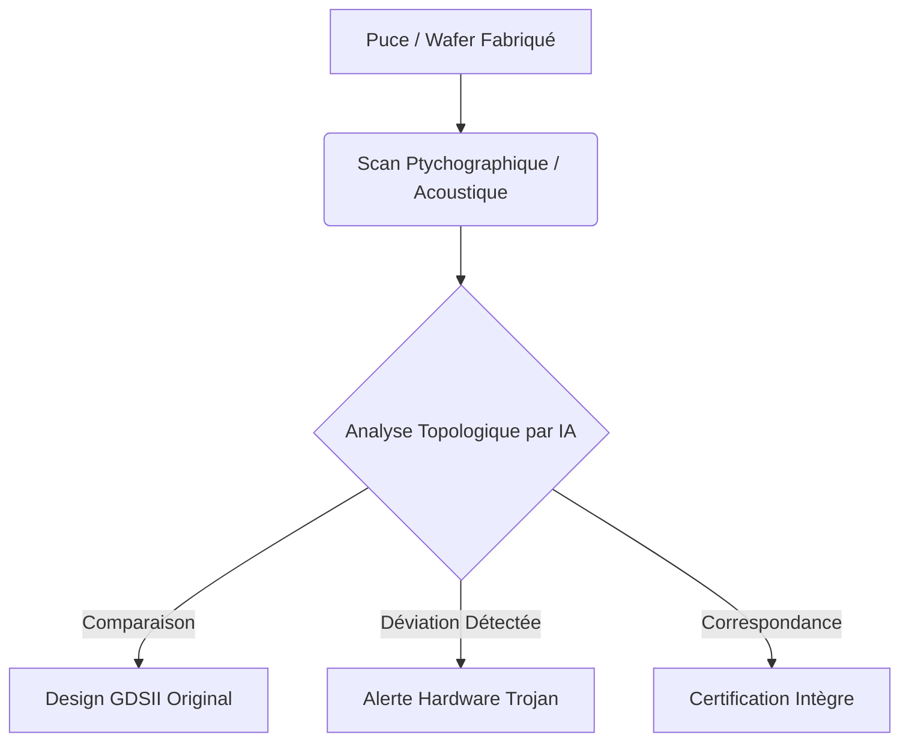
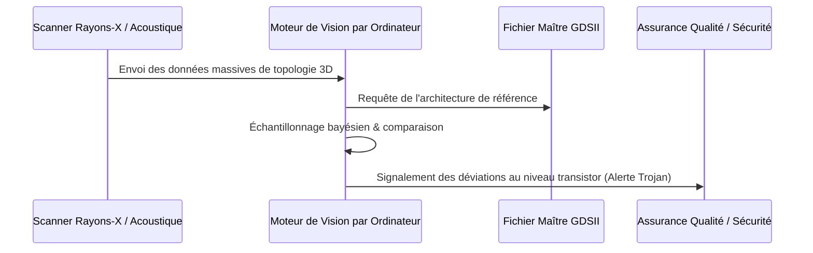

<!-- markdownlint-disable MD009 MD010 MD013 MD022 MD028 MD032 MD033 MD034 MD036 MD037 MD039 MD041 MD058 MD060 -->
[ 🇬🇧 English Version ](./README.md)

# Hardware Trojan Scanner

> **Résumé exécutif :** Un moteur de vérification d'intégrité matérielle non-destructif combinant imagerie ultra-haute résolution et vision par ordinateur pour détecter les altérations malveillantes microscopiques (Hardware Trojans) dans les puces semi-conductrices.

---

## 1. Aperçu visuel & Effet Wahou

## 2. La thèse contrariante (Peter Thiel Style)

**La croyance populaire :** La cybersécurité est principalement un problème logiciel résolu au niveau de l'OS ou du réseau via des pare-feu, des architectures zéro-trust et la détection sur les points d'accès.

**La vérité cachée :** La porte dérobée ultime est physique. La vulnérabilité la plus profonde réside dans le silicium lui-même. Avec la fragmentation des chaînes d'approvisionnement, la confiance matérielle ne peut être présumée ; elle doit être vérifiée au microscope avant le déploiement.

## 3. Le problème & La cible

**Modèle économique :** B2B

**Cible précise :** Foundries de semi-conducteurs (TSMC, Samsung, GlobalFoundries), sous-traitants d'emballage (OSAT), agences gouvernementales de défense, équipementiers critiques.

**La douleur urgente :** La chaîne d'approvisionnement des puces électroniques est mondialisée et fragmentée. Un acteur malveillant au stade de la fonderie (ou lors du packaging) peut insérer un "cheval de Troie matériel" (Hardware Trojan) : une modification nanométrique de la logique de la puce (ex: portes logiques supplémentaires) créant un kill switch invisible au niveau logiciel. La détection actuelle est lente, destructrice ou très limitée statistiquement.

## 4. Architecture technique & Plomberie

## 5. Modèle économique & Viabilité financière

| Métrique | Valeur |
|---|---|
| Structure de prix | Licence logicielle + Frais par scan de wafer |
| Objectif 12 mois | 3 déploiements pilotes avec des fonderies/agences majeures |
| Calcul du CA (Target 100k€) | 3 déploiements × 35 000 €/an = 105 000 € ARR |
| Marge brute estimée | 75% (Coûts de calcul élevés) |

## 6. Moteur de distribution & Fossé défensif (Moat)

**Stratégie d'acquisition :** Ventes directes B2B/B2G, en ciblant les agences de sécurité nationale et les fonderies de premier plan nécessitant de garantir un silicium "propre" pour les infrastructures critiques.

**Moat (Barrière à l'entrée) :** La convergence entre le hardware optique/physique extrême (résolution nanométrique) et le traitement de données massives (des téraoctets par puce). Les logiciels de cybersécurité classiques opèrent au niveau de l'OS et sont impuissants face à une faille physique. Gérer la physique des scans 3nm/2nm crée une barrière technique insurmontable pour un simple acteur logiciel.

## 7. Grille d'évaluation détaillée

| Critère | Score VC (/100) | Score Terrain (/100) |
|---|---|---|
| Thèse & Monopole / Urgence | -- / 25 | -- / 25 |
| Moat / Résistance aux LLM natifs | -- / 25 | -- / 25 |
| Scalabilité / Friction d'adoption | -- / 25 | -- / 25 |
| Unit Economics / ROI direct | -- / 25 | -- / 25 |
| **TOTAL** | **-- / 100** | **-- / 100** |

> **Verdict VC :** En attente d'évaluation.

> **Verdict Terrain :** En attente d'évaluation.
