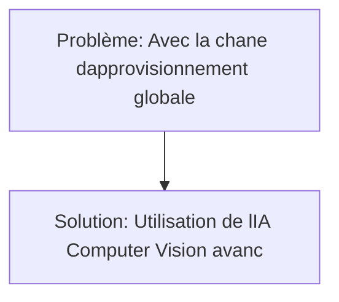
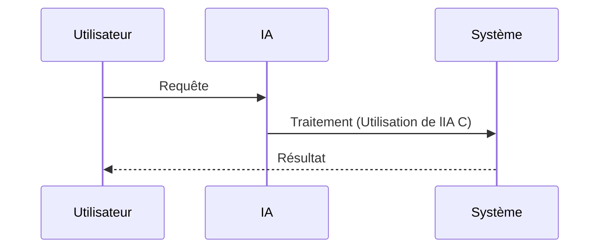

<!-- markdownlint-disable MD013 MD033 MD041 -->

[🇬🇧 English Version](./README.md)

# Hardware Trojan Scanner

> **Résumé exécutif :** Une solution B2B ciblant Fabricants de semi-conducteurs, armée, aérospatial, opérateurs de datacenters cloud pour résoudre le problème suivant : Avec la chaîne d'approvisionnement globale des puces (fabriquées souvent à l'étranger), le risque d'insertion de "Hardware Trojans" (portes dérobées physiques ajoutées au niveau du silicium pour provoquer des pannes ou fuir des données) est massif et indétectable par la sécurité logicielle. L'approche repose sur : Utilisation de l'IA (Computer Vision avancée et Graph Neural Networks) pour comparer les plans CAO d'origine (GDSII) avec des images au microscope électronique à balayage (SEM) des puces après fabrication, afin de détecter des altérations de l'ordre du nanomètre dans la fonderie.

---

## 1. Aperçu visuel & Effet Wahou

## 2. La thèse contrariante (Peter Thiel Style)

- **La croyance populaire :** Une approche générique SaaS classique est suffisante.
- **La vérité cachée :** C'est un problème d'inspection de milliards de transistors physiques. Une vérification manuelle ou par simple algorithme heuristique est mathématiquement impossible en temps raisonnable vu la densité des puces modernes (5nm et moins).

## 3. Le problème & La cible

- **Modèle économique :** B2B
- **Cible précise :** Fabricants de semi-conducteurs, armée, aérospatial, opérateurs de datacenters cloud
- **La douleur urgente :** Avec la chaîne d'approvisionnement globale des puces (fabriquées souvent à l'étranger), le risque d'insertion de "Hardware Trojans" (portes dérobées physiques ajoutées au niveau du silicium pour provoquer des pannes ou fuir des données) est massif et indétectable par la sécurité logicielle.

## 4. Architecture technique & Plomberie

Utilisation de l'IA (Computer Vision avancée et Graph Neural Networks) pour comparer les plans CAO d'origine (GDSII) avec des images au microscope électronique à balayage (SEM) des puces après fabrication, afin de détecter des altérations de l'ordre du nanomètre dans la fonderie.

## 5. Modèle économique & Viabilité financière

| Métrique                    | Valeur                             |
| --------------------------- | ---------------------------------- |
| Structure de prix           | Abonnement / Licence B2B           |
| Objectif 12 mois            | 100 clients (ou volume équivalent) |
| Calcul du CA (Target 100k€) | 100 \* 1000€ = 100k€               |
| Marge brute estimée         | 80%                                |

## 6. Moteur de distribution & Fossé défensif (Moat)

- **Stratégie d'acquisition :** Ventes directes et partenariats dans le domaine : Cybersécurité & Résilience
- **Moat (Barrière à l'entrée) :** C'est un problème d'inspection de milliards de transistors physiques. Une vérification manuelle ou par simple algorithme heuristique est mathématiquement impossible en temps raisonnable vu la densité des puces modernes (5nm et moins). Les risques incluent : Besoin d'accéder à des microscopes électroniques hors de prix. Secret industriel extrême rendant l'accès aux designs CAO (IP) très difficile pour entraîner les modèles. Vente uniquement possible si certifié par des agences gouvernementales.

## 7. Grille d'évaluation détaillée

| Critère                           | Score VC (/100) | Score Terrain (/100) |
| --------------------------------- | --------------- | -------------------- |
| Thèse & Monopole / Urgence        | -- / 25         | -- / 25              |
| Moat / Résistance aux LLM natifs  | -- / 25         | -- / 25              |
| Scalabilité / Friction d'adoption | -- / 25         | -- / 25              |
| Unit Economics / ROI direct       | -- / 25         | -- / 25              |
| **TOTAL**                         | -- / 100        | -- / 100             |

> **Verdict VC :** En attente d'évaluation.
> **Verdict Terrain :** En attente d'évaluation.
