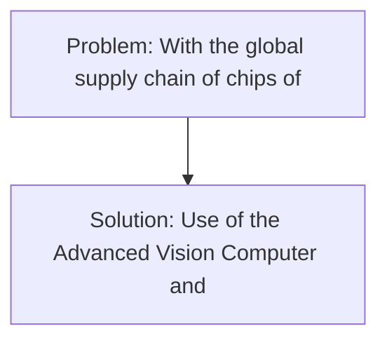
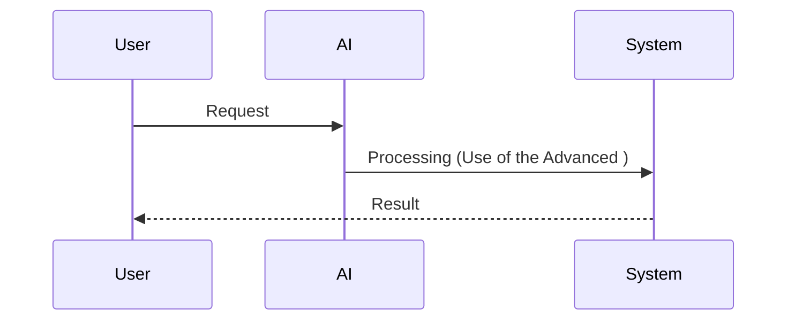

<!-- markdownlint-disable MD013 MD033 MD041 -->

[🇫🇷 Version Française](./README.fr.md)

# Hardware Trojan Scanner

> **Executive Summary:** A B2B solution targeting Semiconductor manufacturers, armed, aerospace, cloud data center operators to solve the following problem: With the global supply chain of chips (often manufactured abroad), the risk of inserting "Hardware Trojans" (physically removed doors added to silicon to cause breakdowns or leak data) is massive and undetectable by software security. The approach relies on: Use of the Advanced Vision Computer and Graph Neural Networks (AI) to compare original CAD plans (GDSII) with scanning electron microscope (SEM) images of chips after manufacture to detect changes in the order of the nanometer in the foundry.

---

## 1. Visual Overview & Wow Effect

## 2. Contrarian Thesis (Peter Thiel Style)

- **Popular Belief:** A generic SaaS approach is sufficient.
- **Hidden Truth:** This is a problem of inspecting billions of physical transistors. A manual or simple heuristic algorithm check is mathematically impossible in reasonable time given the density of modern chips (5nm and less).

## 3. Problem & Target Market

- **Business Model:** B2B
- **Target Audience:** Semiconductor manufacturers, armed, aerospace, cloud data center operators
- **Urgent Pain Point:** With the global supply chain of chips (often manufactured abroad), the risk of inserting "Hardware Trojans" (physically removed doors added to silicon to cause breakdowns or leak data) is massive and undetectable by software security.

## 4. Technical Architecture & Infrastructure

Use of the Advanced Vision Computer and Graph Neural Networks (AI) to compare original CAD plans (GDSII) with scanning electron microscope (SEM) images of chips after manufacture to detect changes in the order of the nanometer in the foundry.

## 5. Business Model & Financial Viability

| Metric                 | Value                              |
| ---------------------- | ---------------------------------- |
| Pricing Structure      | B2B Subscription / License         |
| 12-Month Target        | 100 clients (or equivalent volume) |
| Revenue Formula        | 100 \* 1000€ = 100k€               |
| Estimated Gross Margin | 80%                                |

## 6. Distribution Engine & Moat

- **Acquisition Strategy:** Direct sales and partnerships in the domain: Cybersecurity & Resilience
- **Moat (Defensibility):** This is a problem of inspecting billions of physical transistors. A manual or simple heuristic algorithm check is mathematically impossible in reasonable time given the density of modern chips (5nm and less). Risks include: Need access to expensive electronic microscopes. Extreme industrial secret making access to CAD (IP) designs very difficult to train models. Sale only possible if certified by government agencies.

## 7. Detailed Evaluation Grid

| Criterion                   | VC Score (/100) | Market Score (/100) |
| --------------------------- | --------------- | ------------------- |
| Thesis & Monopoly / Urgency | -- / 25         | -- / 25             |
| Moat / LLM Immunity         | -- / 25         | -- / 25             |
| Scalability / UX Friction   | -- / 25         | -- / 25             |
| Unit Economics / ROI        | -- / 25         | -- / 25             |
| **TOTAL**                   | -- / 100        | -- / 100            |

> **VC Verdict:** Pending evaluation.
> **Market Verdict:** Pending evaluation.
