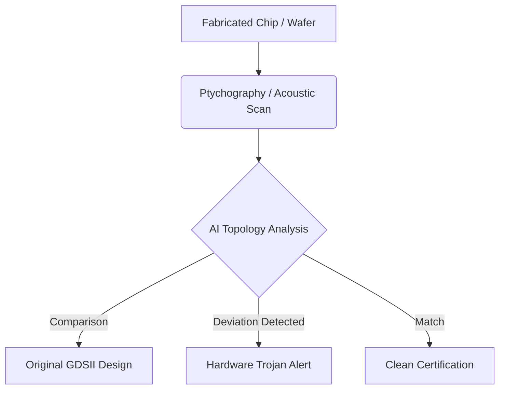
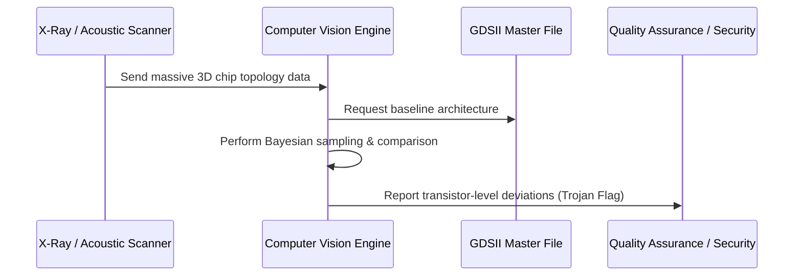

<!-- markdownlint-disable MD009 MD010 MD013 MD022 MD028 MD032 MD033 MD034 MD036 MD037 MD039 MD041 MD058 MD060 -->
[ 🇫🇷 Version Française ](./README.fr.md)

# Hardware Trojan Scanner

> **Executive Summary:** A non-destructive hardware integrity verification engine that combines extreme high-resolution imaging and computer vision to detect microscopic malicious alterations (Hardware Trojans) in semiconductor chips.

---

## 1. Visual Overview & Wow Effect

## 2. Contrarian Thesis (Peter Thiel Style)

**Popular Belief:** Cybersecurity is primarily a software problem solved at the OS or network layer through firewalls, zero-trust architectures, and endpoint detection.

**Hidden Truth:** The ultimate backdoor is physical. The deepest vulnerability lies in the silicon itself, and as supply chains fragment, hardware trust cannot be assumed; it must be microscopically verified before deployment.

## 3. Problem & Target Market

**Business Model:** B2B

**Target Audience:** Semiconductor foundries (TSMC, Samsung, GlobalFoundries), outsourced semiconductor assembly and test (OSAT), government defense agencies, critical infrastructure equipment manufacturers.

**Urgent Pain Point:** A malicious actor at the foundry or packaging stage can insert a "Hardware Trojan" (nanometric alterations to the logic gates or interconnects) creating a software-invisible kill switch or backdoor. Current detection methods are slow, destructive (reverse engineering), or statistically inadequate.

## 4. Technical Architecture & Infrastructure

## 5. Business Model & Financial Viability

| Metric | Value |
|---|---|
| Pricing Structure | Enterprise Licensing + Per-Wafer Scan Fee |
| 12-Month Target | 3 pilot deployments with major foundries/agencies |
| Revenue Formula | 3 deployments × €35,000/year = €105,000 ARR |
| Estimated Gross Margin | 75% (High compute costs) |

## 6. Distribution Engine & Moat

**Acquisition Strategy:** Direct B2B/B2G sales, targeting national security agencies and top-tier foundries needing to guarantee "clean" silicon for critical infrastructure.

**Moat (Defensibility):** The convergence of extreme optical/physical hardware with massive data processing (terabytes per chip). Standard cybersecurity software operates at the OS level and is powerless against physical silicon flaws. Handling the physics of 3nm/2nm scans creates a massive technical barrier.

## 7. Detailed Evaluation Grid

| Criterion | VC Score (/100) | Market Score (/100) |
|---|---|---|
| Thesis & Monopoly / Urgency | -- / 25 | -- / 25 |
| Moat / LLM Immunity | -- / 25 | -- / 25 |
| Scalability / UX Friction | -- / 25 | -- / 25 |
| Unit Economics / ROI | -- / 25 | -- / 25 |
| **TOTAL** | **-- / 100** | **-- / 100** |

> **VC Verdict:** Pending evaluation.

> **Market Verdict:** Pending evaluation.
