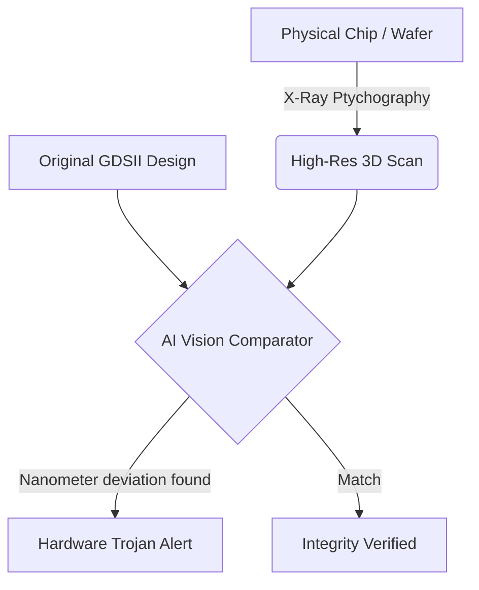
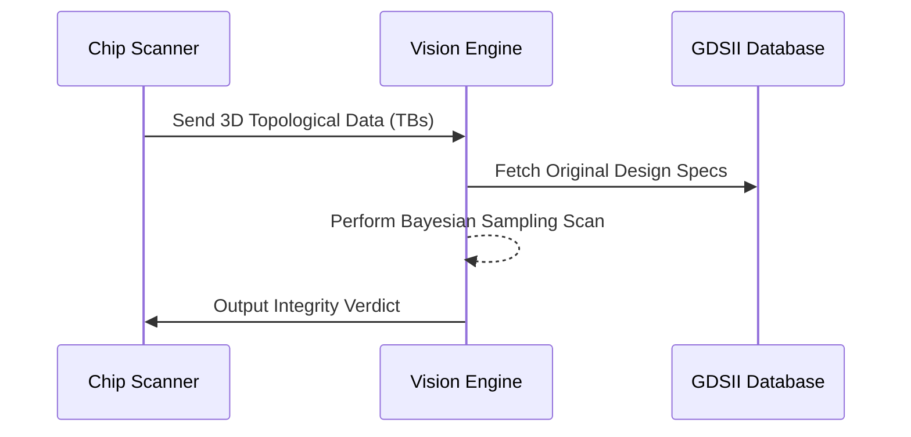

<!-- markdownlint-disable MD009 MD010 MD013 MD022 MD028 MD032 MD033 MD034 MD036 MD037 MD039 MD041 MD058 MD060 -->
[ 🇫🇷 Version Française ](./README.fr.md)

# Hardware Trojan Scanner

> **Executive Summary:** A non-destructive hardware integrity verification engine coupling X-ray ptychography and specialized computer vision to detect physical chip alterations at the nanometer scale.

---

## 1. Visual Overview & Wow Effect

## 2. Contrarian Thesis (Peter Thiel Style)

**Popular Belief:** Cybersecurity relies on protecting software and operating systems from digital intrusions.

**Hidden Truth:** The ultimate supply chain vulnerability is physically etched into the silicon at the foundry level; software security is useless if the hardware itself contains an invisible kill switch.

## 3. Problem & Target Market

**Business Model:** B2B

**Target Audience:** Semiconductor foundries (TSMC, Intel), defense contractors, government agencies, aerospace companies, and automotive manufacturers.

**Urgent Pain Point:** A malicious actor at the foundry can insert a "Hardware Trojan" (extra logic gates) that bypasses all software security. Detecting this currently requires slow, destructive reverse engineering.

## 4. Technical Architecture & Infrastructure

## 5. Business Model & Financial Viability

| Metric | Value |
| --- | --- |
| Pricing Structure | Per-wafer scan fee + Software License |
| 12-Month Target | 5 Major Defense/Foundry Clients |
| Revenue Formula | 5 clients * 20,000€/month = 1.2M€ ARR |
| Estimated Gross Margin | 75% |

## 6. Distribution Engine & Moat

**Acquisition Strategy:** Direct partnerships with defense agencies (DARPA, DGA) and specialized semiconductor manufacturers requiring zero-trust hardware.

**Moat (Defensibility):** The intersection of extreme optical physics (nanometer resolution) and massive data processing (terabytes per chip). Standard SaaS cybersecurity companies have zero expertise in physical semiconductor topology.

## 7. Detailed Evaluation Grid

| Criterion | VC Score (/100) | Market Score (/100) |
| :--- | :---: | :---: |
| Thesis & Monopoly / Urgency | -- / 25 | -- / 25 |
| Moat / LLM Immunity | -- / 25 | -- / 25 |
| Scalability / UX Friction | -- / 25 | -- / 25 |
| Unit Economics / ROI | -- / 25 | -- / 25 |
| **TOTAL** | **-- / 100** | **-- / 100** |

> **VC Verdict:** Pending evaluation.
>
> **Market Verdict:** Pending evaluation.
