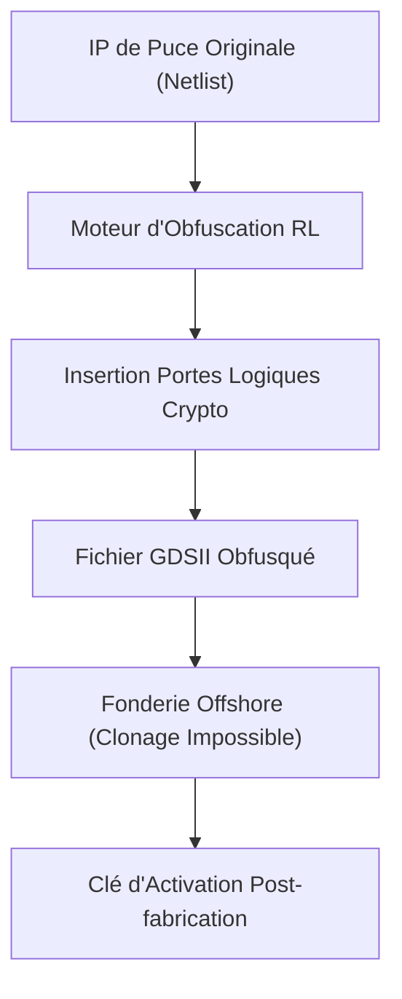
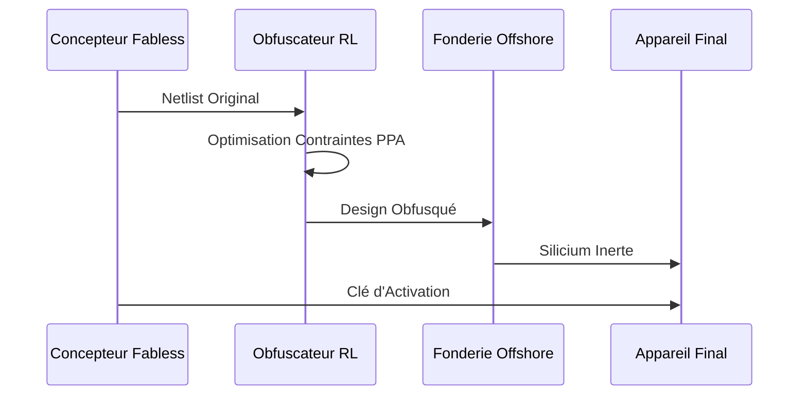

<!-- markdownlint-disable MD009 MD010 MD013 MD022 MD028 MD032 MD033 MD034 MD036 MD037 MD039 MD041 MD058 MD060 -->

[🇬🇧 English Version](./README.md)

# Hardware Obfuscator AI

> **Résumé exécutif :** Un moteur d'Apprentissage par Renforcement qui obfusque cryptographiquement les netlists de semi-conducteurs pour prévenir le vol d'IP dans les fonderies offshore.

---

## 1. Aperçu visuel & Effet Wahou

## 2. La thèse contrariante (Peter Thiel Style)

La croyance populaire : Les contrats légaux suffisent à protéger la propriété intellectuelle (IP) matérielle contre le clonage ou les chevaux de Troie.
La vérité cachée : Les fonderies offshore surproduisent régulièrement pour le marché gris. La véritable sécurité exige de verrouiller cryptographiquement la logique physique du silicium pour qu'il soit inerte sans clé d'activation.

## 3. Le problème & La cible

Modèle économique : B2B
Cible précise : Concepteurs de puces IA (Fabless), fonderies de semi-conducteurs, fournisseurs de cœurs IP.
La douleur urgente : Le vol d'IP matérielle coûte très cher. Les fonderies peuvent cloner des plans (GDSII) ou insérer des chevaux de Troie. Sécuriser la chaîne d'approvisionnement est critique.

## 4. Architecture technique & Plomberie

## 5. Modèle économique & Viabilité financière

| Métrique                    | Valeur                                                    |
| --------------------------- | --------------------------------------------------------- |
| Structure de prix           | Frais de licence par tapeout + royalties par puce activée |
| Objectif 12 mois            | 5 tapeouts majeurs sécurisés                              |
| Calcul du CA (Target 100k€) | 5 tapeouts \* 250k€ + 0.05€ par puce                      |
| Marge brute estimée         | 90%                                                       |

## 6. Moteur de distribution & Fossé défensif (Moat)

Stratégie d'acquisition : Partenariats d'intégration avec les vendeurs d'outils EDA et ventes directes.
Moat (Barrière à l'entrée) : Modifier des milliards de transistors tout en respectant les contraintes PPA est un problème de graphe géométrique complexe. Nécessite un Apprentissage par Renforcement spécialisé, intégré aux workflows EDA.

## 7. Grille d'évaluation détaillée

| Critère                           | Score VC (/100) | Score Terrain (/100) |
| --------------------------------- | --------------- | -------------------- |
| Thèse & Monopole / Urgence        | -- / 25         | 22 / 25              |
| Moat / Résistance aux LLM natifs  | -- / 25         | 25 / 25              |
| Scalabilité / Friction d'adoption | -- / 25         | 15 / 25              |
| Unit Economics / ROI direct       | -- / 25         | 20 / 25              |
| **TOTAL**                         | **-- / 100**    | **82 / 100**         |

> **Verdict VC :** En attente d'évaluation.
> **Verdict Terrain :** La protection de la PI matérielle devient une priorité stratégique absolue pour les concepteurs de puces. Cette solution d'obfuscation offre une barrière infranchissable pour les approches LLM classiques. L'intégration au flux EDA implique des frictions, mais la valeur du secret industriel justifie pleinement le modèle économique.
