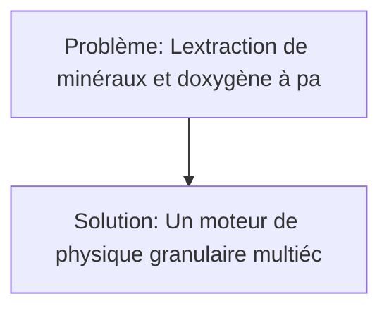
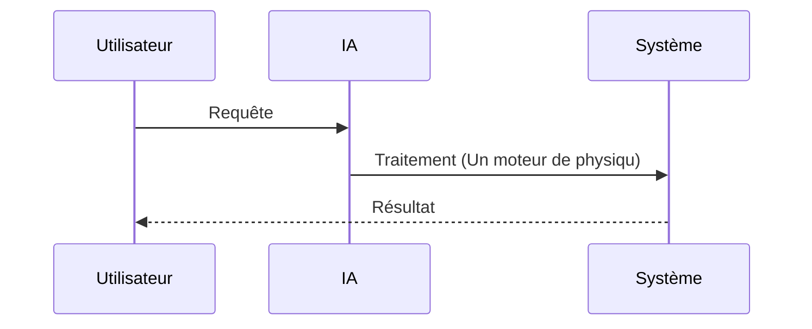

<!-- markdownlint-disable MD013 MD033 MD041 -->

[🇬🇧 English Version](./README.md)

# Lunar Regolith Refinery Sim

> **Résumé exécutif :** Une solution B2B ciblant Agences spatiales (NASA, ESA), startups minières spatiales, entreprises de construction extra-terrestre pour résoudre le problème suivant : L'extraction de minéraux et d'oxygène à partir du régolithe lunaire est essentielle pour l'exploration spatiale à long terme (ISRU - In-Situ Resource Utilization), mais les tests physiques coûtent des milliards (lancement de prototypes) et échouent souvent à cause du comportement imprévu de la poussière lunaire abrasive dans le vide et en faible gravité. L'approche repose sur : Un moteur de physique granulaire multi-échelles (Discrete Element Method - DEM) couplé à des modèles thermochimiques fonctionnant sur GPU. Il simule exactement comment le régolithe va fondre, s'agglomérer ou se fracturer sous l'effet de lasers ou de réactions d'électrolyse dans les conditions lunaires.

---

## 1. Aperçu visuel & Effet Wahou

## 2. La thèse contrariante (Peter Thiel Style)

- **La croyance populaire :** Une approche générique SaaS classique est suffisante.
- **La vérité cachée :** Les moteurs de jeu physique (Unity, Unreal) font de la physique approchée. Il faut ici une physique d'ingénierie absolue (calculée particule par particule) couplée à des équations d'état thermodynamiques qui n'existent pas dans les outils CAO standards.

## 3. Le problème & La cible

- **Modèle économique :** B2B
- **Cible précise :** Agences spatiales (NASA, ESA), startups minières spatiales, entreprises de construction extra-terrestre
- **La douleur urgente :** L'extraction de minéraux et d'oxygène à partir du régolithe lunaire est essentielle pour l'exploration spatiale à long terme (ISRU - In-Situ Resource Utilization), mais les tests physiques coûtent des milliards (lancement de prototypes) et échouent souvent à cause du comportement imprévu de la poussière lunaire abrasive dans le vide et en faible gravité.

## 4. Architecture technique & Plomberie

Un moteur de physique granulaire multi-échelles (Discrete Element Method - DEM) couplé à des modèles thermochimiques fonctionnant sur GPU. Il simule exactement comment le régolithe va fondre, s'agglomérer ou se fracturer sous l'effet de lasers ou de réactions d'électrolyse dans les conditions lunaires.

## 5. Modèle économique & Viabilité financière

| Métrique                    | Valeur                             |
| --------------------------- | ---------------------------------- |
| Structure de prix           | Abonnement / Licence B2B           |
| Objectif 12 mois            | 100 clients (ou volume équivalent) |
| Calcul du CA (Target 100k€) | 100 \* 1000€ = 100k€               |
| Marge brute estimée         | 80%                                |

## 6. Moteur de distribution & Fossé défensif (Moat)

- **Stratégie d'acquisition :** Ventes directes et partenariats dans le domaine : Deep Tech Infra
- **Moat (Barrière à l'entrée) :** Les moteurs de jeu physique (Unity, Unreal) font de la physique approchée. Il faut ici une physique d'ingénierie absolue (calculée particule par particule) couplée à des équations d'état thermodynamiques qui n'existent pas dans les outils CAO standards. Les risques incluent : Marché de niche extrêmement restreint à court terme (faible TAM actuel). Nécessite des données expérimentales limitées (échantillons d'Apollo) pour valider le modèle physique, risque technologique de surapprentissage des modèles sur des données terrestres.

## 7. Grille d'évaluation détaillée

| Critère                           | Score VC (/100) | Score Terrain (/100) |
| --------------------------------- | --------------- | -------------------- |
| Thèse & Monopole / Urgence        | -- / 25         | -- / 25              |
| Moat / Résistance aux LLM natifs  | -- / 25         | -- / 25              |
| Scalabilité / Friction d'adoption | -- / 25         | -- / 25              |
| Unit Economics / ROI direct       | -- / 25         | -- / 25              |
| **TOTAL**                         | -- / 100        | -- / 100             |

> **Verdict VC :** En attente d'évaluation.
> **Verdict Terrain :** En attente d'évaluation.
