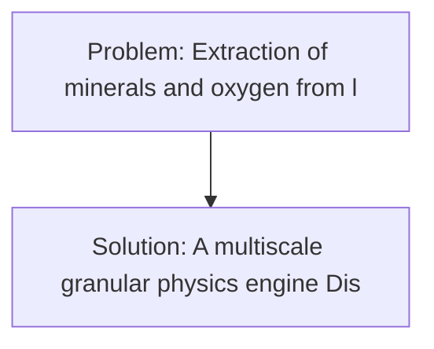
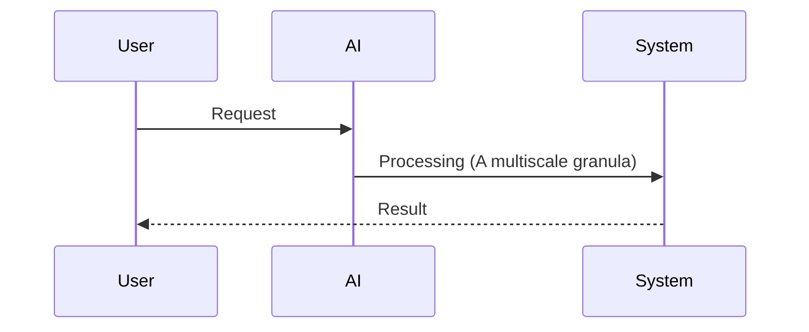

<!-- markdownlint-disable MD013 MD033 MD041 -->

[🇫🇷 Version Française](./README.fr.md)

# Lunar Regolith Refinery Sim

> **Executive Summary:** A B2B solution targeting Space agencies (NASA, ESA), space mining startups, offshore construction companies to solve the following problem: Extraction of minerals and oxygen from lunar regolith is essential for long-term space exploration (ISRU - In-Situ Resource Utilization), but physical tests cost billions (prototype launches) and often fail due to the unforeseen behaviour of abrasive lunar dust in vacuum and in low gravity. The approach relies on: A multi-scale granular physics engine (Discrete Element Method) coupled with thermochemical models running on GPU. It simulates exactly how regolith will melt, agglomerate or fracture under lasers or electrolysis reactions under lunar conditions.

---

## 1. Visual Overview & Wow Effect

## 2. Contrarian Thesis (Peter Thiel Style)

- **Popular Belief:** A generic SaaS approach is sufficient.
- **Hidden Truth:** Physical game engines (Unity, Unreal) make physics approach. This requires an absolute engineering physics (calculated particle per particle) coupled with thermodynamic state equations that do not exist in standard CAD tools.

## 3. Problem & Target Market

- **Business Model:** B2B
- **Target Audience:** Space agencies (NASA, ESA), space mining startups, offshore construction companies
- **Urgent Pain Point:** Extraction of minerals and oxygen from lunar regolith is essential for long-term space exploration (ISRU - In-Situ Resource Utilization), but physical tests cost billions (prototype launches) and often fail due to the unforeseen behaviour of abrasive lunar dust in vacuum and in low gravity.

## 4. Technical Architecture & Infrastructure

A multi-scale granular physics engine (Discrete Element Method) coupled with thermochemical models running on GPU. It simulates exactly how regolith will melt, agglomerate or fracture under lasers or electrolysis reactions under lunar conditions.

## 5. Business Model & Financial Viability

| Metric                 | Value                              |
| ---------------------- | ---------------------------------- |
| Pricing Structure      | B2B Subscription / License         |
| 12-Month Target        | 100 clients (or equivalent volume) |
| Revenue Formula        | 100 \* 1000€ = 100k€               |
| Estimated Gross Margin | 80%                                |

## 6. Distribution Engine & Moat

- **Acquisition Strategy:** Direct sales and partnerships in the domain: Deep Tech Infra
- **Moat (Defensibility):** Physical game engines (Unity, Unreal) make physics approach. This requires an absolute engineering physics (calculated particle per particle) coupled with thermodynamic state equations that do not exist in standard CAD tools. Risks include: Extremely small niche market in the short term (low current AMT). Requires limited experimental data (Apollo samples) to validate the physical model, technological risk of overlearning models on terrestrial data.

## 7. Detailed Evaluation Grid

| Criterion                   | VC Score (/100) | Market Score (/100) |
| --------------------------- | --------------- | ------------------- |
| Thesis & Monopoly / Urgency | -- / 25         | -- / 25             |
| Moat / LLM Immunity         | -- / 25         | -- / 25             |
| Scalability / UX Friction   | -- / 25         | -- / 25             |
| Unit Economics / ROI        | -- / 25         | -- / 25             |
| **TOTAL**                   | -- / 100        | -- / 100            |

> **VC Verdict:** Pending evaluation.
> **Market Verdict:** Pending evaluation.
