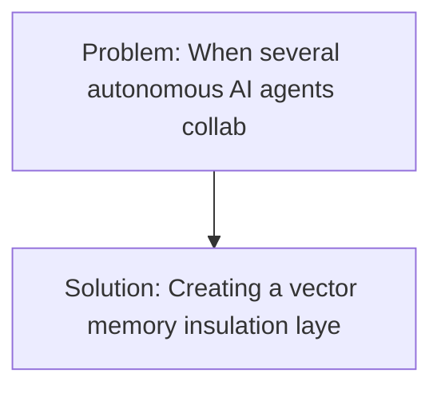
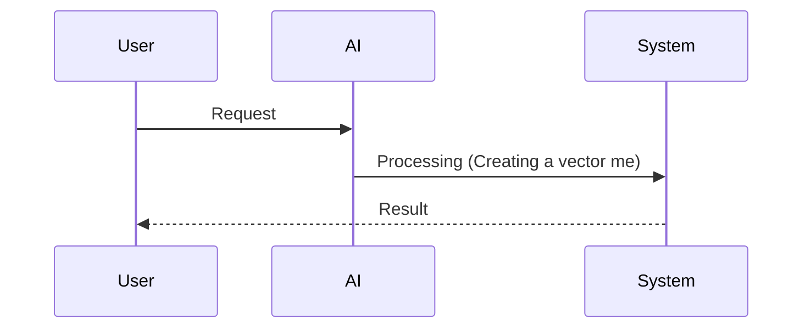

<!-- markdownlint-disable MD013 MD033 MD041 -->

[🇫🇷 Version Française](./README.fr.md)

# Multi-Agent Memory Isolation

> **Executive Summary:** A B2B solution targeting Large companies deploying internal autonomous AI agents (HR, Finance, Legal) and AI infrastructure providers (Hyperscalers). to solve the following problem: When several autonomous AI agents collaborate and share context memories (Vector Databases) within a company, the privacy boundaries explode. A "Support" agent could accidentally access and leak salary data stored by a "HR" agent, creating a compliance nightmare (GDPR, HIPAA). The approach relies on: Creating a vector memory insulation layer based on partial homomorphic encryption (FHE) or trusted execution environments (TEE). Agents question and share mathematical concepts without ever deciphering the underlying text, guaranteeing strict partitioning (Role-Based Memory Access) at the vector level.

---

## 1. Visual Overview & Wow Effect

## 2. Contrarian Thesis (Peter Thiel Style)

- **Popular Belief:** A generic SaaS approach is sufficient.
- **Hidden Truth:** The IAM (Identity and Access Management) works on structured SQL files or databases. It is inoperative on blurred and semantic embeddings. LLMs cannot "forget" or guarantee isolation without a low-level cryptographic architecture on their long-term memory layer.

## 3. Problem & Target Market

- **Business Model:** B2B
- **Target Audience:** Large companies deploying internal autonomous AI agents (HR, Finance, Legal) and AI infrastructure providers (Hyperscalers).
- **Urgent Pain Point:** When several autonomous AI agents collaborate and share context memories (Vector Databases) within a company, the privacy boundaries explode. A "Support" agent could accidentally access and leak salary data stored by a "HR" agent, creating a compliance nightmare (GDPR, HIPAA).

## 4. Technical Architecture & Infrastructure

Creating a vector memory insulation layer based on partial homomorphic encryption (FHE) or trusted execution environments (TEE). Agents question and share mathematical concepts without ever deciphering the underlying text, guaranteeing strict partitioning (Role-Based Memory Access) at the vector level.

## 5. Business Model & Financial Viability

| Metric                 | Value                              |
| ---------------------- | ---------------------------------- |
| Pricing Structure      | B2B Subscription / License         |
| 12-Month Target        | 100 clients (or equivalent volume) |
| Revenue Formula        | 100 \* 1000€ = 100k€               |
| Estimated Gross Margin | 80%                                |

## 6. Distribution Engine & Moat

- **Acquisition Strategy:** Direct sales and partnerships in the domain: IA & Autonomous Agents
- **Moat (Defensibility):** The IAM (Identity and Access Management) works on structured SQL files or databases. It is inoperative on blurred and semantic embeddings. LLMs cannot "forget" or guarantee isolation without a low-level cryptographic architecture on their long-term memory layer. Risks include: The massive computational cost (latency) of homomorphic encryption on cosinus similarity operations, the complexity of integration with existing vector databases (Pinecone, Milvus), potential degradation of the quality of agents responses.

## 7. Detailed Evaluation Grid

| Criterion                   | VC Score (/100) | Market Score (/100) |
| --------------------------- | --------------- | ------------------- |
| Thesis & Monopoly / Urgency | -- / 25         | -- / 25             |
| Moat / LLM Immunity         | -- / 25         | -- / 25             |
| Scalability / UX Friction   | -- / 25         | -- / 25             |
| Unit Economics / ROI        | -- / 25         | -- / 25             |
| **TOTAL**                   | -- / 100        | -- / 100            |

> **VC Verdict:** Pending evaluation.
> **Market Verdict:** Pending evaluation.
