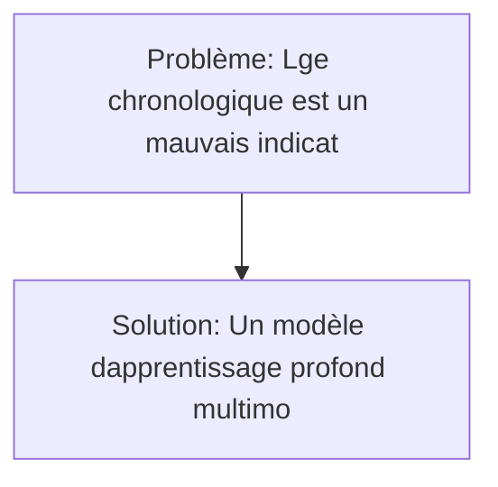
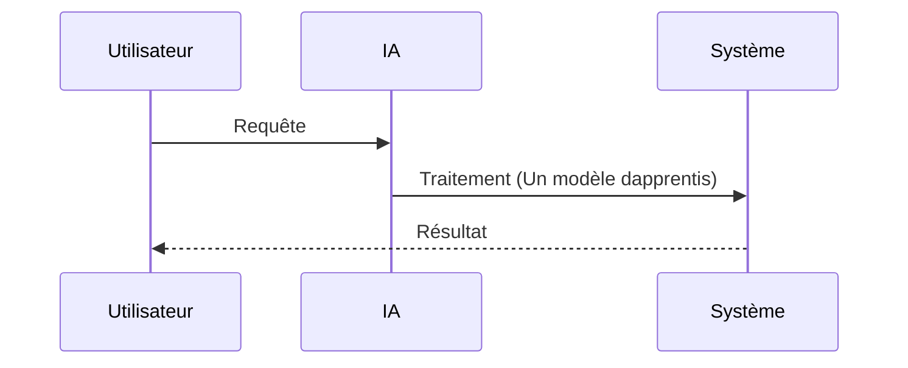

<!-- markdownlint-disable MD013 MD033 MD041 -->

[🇬🇧 English Version](./README.md)

# Deep Omic Clock

> **Résumé exécutif :** Une solution B2B ciblant Cliniques de longévité, compagnies d'assurance vie, chercheurs en géroscience (CMO, Actuaires). pour résoudre le problème suivant : L'âge chronologique est un mauvais indicateur de risque. Les horloges épigénétiques actuelles sont unidimensionnelles et manquent de précision pour cibler des interventions cliniques personnalisées ou valider l'efficacité de thérapies anti-âge. L'approche repose sur : Un modèle d'apprentissage profond multimodal intégrant l'épigénome, le protéome, le microbiome et les données cliniques longitudinales pour créer un World Model de vieillissement biologique, capable de simuler l'effet de molécules géroprotectrices.

---

## 1. Aperçu visuel & Effet Wahou

## 2. La thèse contrariante (Peter Thiel Style)

- **La croyance populaire :** Une approche générique SaaS classique est suffisante.
- **La vérité cachée :** L'intégration multi-omique confronte au fléau de la dimensionnalité. Nécessite des architectures d'IA spécialisées (Transformers biologiques) pour extraire des signaux causaux complexes, impossibles avec un outil d'analyse de données standard.

## 3. Le problème & La cible

- **Modèle économique :** B2B
- **Cible précise :** Cliniques de longévité, compagnies d'assurance vie, chercheurs en géroscience (CMO, Actuaires).
- **La douleur urgente :** L'âge chronologique est un mauvais indicateur de risque. Les horloges épigénétiques actuelles sont unidimensionnelles et manquent de précision pour cibler des interventions cliniques personnalisées ou valider l'efficacité de thérapies anti-âge.

## 4. Architecture technique & Plomberie

Un modèle d'apprentissage profond multimodal intégrant l'épigénome, le protéome, le microbiome et les données cliniques longitudinales pour créer un World Model de vieillissement biologique, capable de simuler l'effet de molécules géroprotectrices.

## 5. Modèle économique & Viabilité financière

| Métrique                    | Valeur                             |
| --------------------------- | ---------------------------------- |
| Structure de prix           | Abonnement / Licence B2B           |
| Objectif 12 mois            | 100 clients (ou volume équivalent) |
| Calcul du CA (Target 100k€) | 100 \* 1000€ = 100k€               |
| Marge brute estimée         | 80%                                |

## 6. Moteur de distribution & Fossé défensif (Moat)

- **Stratégie d'acquisition :** Ventes directes et partenariats dans le domaine : Biotech
- **Moat (Barrière à l'entrée) :** L'intégration multi-omique confronte au fléau de la dimensionnalité. Nécessite des architectures d'IA spécialisées (Transformers biologiques) pour extraire des signaux causaux complexes, impossibles avec un outil d'analyse de données standard. Les risques incluent : Accès aux données longitudinales très coûteuses, difficulté réglementaire (FDA) pour valider des biomarqueurs du vieillissement, acceptation éthique.

## 7. Grille d'évaluation détaillée

| Critère                           | Score VC (/100) | Score Terrain (/100) |
| --------------------------------- | --------------- | -------------------- |
| Thèse & Monopole / Urgence        | -- / 25         | -- / 25              |
| Moat / Résistance aux LLM natifs  | -- / 25         | -- / 25              |
| Scalabilité / Friction d'adoption | -- / 25         | -- / 25              |
| Unit Economics / ROI direct       | -- / 25         | -- / 25              |
| **TOTAL**                         | -- / 100        | -- / 100             |

> **Verdict VC :** En attente d'évaluation.
> **Verdict Terrain :** En attente d'évaluation.
