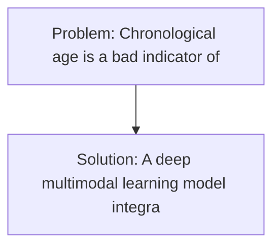
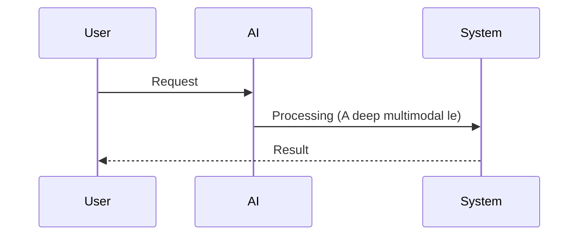

<!-- markdownlint-disable MD013 MD033 MD041 -->

[🇫🇷 Version Française](./README.fr.md)

# Deep Omic Clock

> **Executive Summary:** A B2B solution targeting Long-term clinics, life insurance companies, researchers in medicine (CMO, Actuaries). to solve the following problem: Chronological age is a bad indicator of risk. Current epigenetic clocks are one-dimensional and lack precision to target personalized clinical interventions or validate the effectiveness of anti-ageing therapies. The approach relies on: A deep multimodal learning model integrating epigenome, proteoma, microbiome and longitudinal clinical data to create a World Model of biological aging, capable of simulating the effect of generogenic molecules.

---

## 1. Visual Overview & Wow Effect

## 2. Contrarian Thesis (Peter Thiel Style)

- **Popular Belief:** A generic SaaS approach is sufficient.
- **Hidden Truth:** Multi-omical integration confronts the scourge of dimensionality. Requires specialized AI (Biological Transformers) architectures to extract complex, impossible causal signals with a standard data analysis tool.

## 3. Problem & Target Market

- **Business Model:** B2B
- **Target Audience:** Long-term clinics, life insurance companies, researchers in medicine (CMO, Actuaries).
- **Urgent Pain Point:** Chronological age is a bad indicator of risk. Current epigenetic clocks are one-dimensional and lack precision to target personalized clinical interventions or validate the effectiveness of anti-ageing therapies.

## 4. Technical Architecture & Infrastructure

A deep multimodal learning model integrating epigenome, proteoma, microbiome and longitudinal clinical data to create a World Model of biological aging, capable of simulating the effect of generogenic molecules.

## 5. Business Model & Financial Viability

| Metric                 | Value                              |
| ---------------------- | ---------------------------------- |
| Pricing Structure      | B2B Subscription / License         |
| 12-Month Target        | 100 clients (or equivalent volume) |
| Revenue Formula        | 100 \* 1000€ = 100k€               |
| Estimated Gross Margin | 80%                                |

## 6. Distribution Engine & Moat

- **Acquisition Strategy:** Direct sales and partnerships in the domain: Biotech
- **Moat (Defensibility):** Multi-omical integration confronts the scourge of dimensionality. Requires specialized AI (Biological Transformers) architectures to extract complex, impossible causal signals with a standard data analysis tool. Risks include: Access to very expensive longitudinal data, regulatory difficulty (FDA) to validate biomarkers of aging, ethical acceptance.

## 7. Detailed Evaluation Grid

| Criterion                   | VC Score (/100) | Market Score (/100) |
| --------------------------- | --------------- | ------------------- |
| Thesis & Monopoly / Urgency | -- / 25         | 18 / 25             |
| Moat / LLM Immunity         | -- / 25         | 20 / 25             |
| Scalability / UX Friction   | -- / 25         | 15 / 25             |
| Unit Economics / ROI        | -- / 25         | 17 / 25             |
| **TOTAL**                   | -- / 100        | 70 / 100            |

> **VC Verdict:** Pending evaluation.
> **Market Verdict:** Real desirability for clinics and researchers, although adoption depends on regulatory approvals. Strong defense against standard LLMs which cannot natively analyze diverse biological datasets. UX friction is moderate but significant due to clinical trial integration needs, with a high monetization potential if well positioned.
