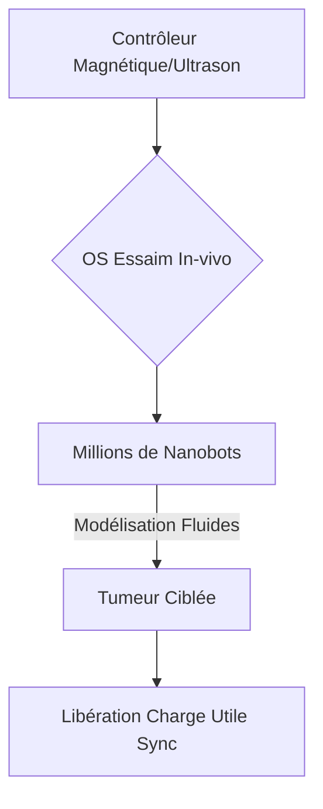
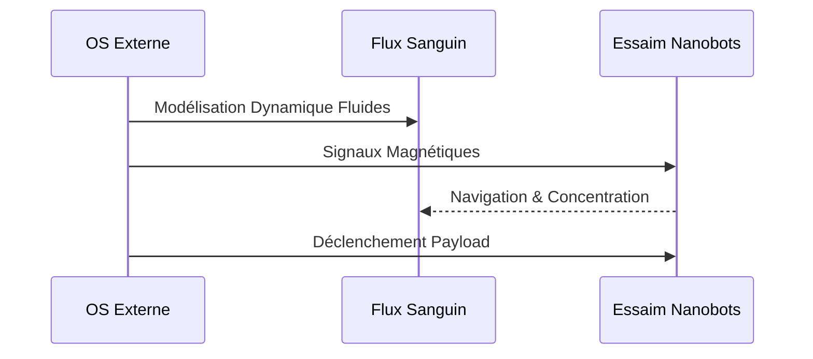

<!-- markdownlint-disable MD009 MD010 MD013 MD022 MD028 MD032 MD033 MD034 MD036 MD037 MD039 MD041 MD058 MD060 -->
[ 🇬🇧 English Version ](./README.md)

# Nanobot Orchestrator

> **Résumé exécutif :** Un système d'exploitation et protocole de communication pour orchestrer des essaims massifs de nanobots in-vivo pour des thérapies anticancéreuses ciblées.

---

## 1. Aperçu visuel & Effet Wahou

## 2. La thèse contrariante (Peter Thiel Style)

**La croyance populaire :** L'avenir de la médecine repose uniquement sur la découverte de médicaments chimiques et l'édition CRISPR.

**La vérité cachée :** Le véritable goulot d'étranglement est la distribution systémique ; nous avons besoin d'un OS basé sur la physique pour contrôler des agents physiques dans le sang, transformant la médecine en un problème robotique.

## 3. Le problème & La cible

**Modèle économique :** B2B2C

**Cible précise :** Hôpitaux de pointe, centres de traitement du cancer, laboratoires pharmaceutiques.

**La douleur urgente :** La chimiothérapie détruit les tissus sains. Coordonner des nanobots sans déclencher de réponse immunitaire nécessite un contrôle d'essaim précis in-vivo.

## 4. Architecture technique & Plomberie

## 5. Modèle économique & Viabilité financière

| Métrique | Valeur |
| --- | --- |
| Structure de prix | Licence OS par traitement + Partenariats Pharma |
| Objectif 12 mois | 5 essais cliniques partenaires |
| Calcul du CA (Target 100k€) | 5 essais * 200 000€ = 1M€ ARR |
| Marge brute estimée | 90% (Logiciel) |

## 6. Moteur de distribution & Fossé défensif (Moat)

**Stratégie d'acquisition :** Partenariats directs avec les centres de recherche en oncologie et la R&D pharmaceutique.

**Moat (Barrière à l'entrée) :** Problème complexe de dynamique des fluides, de contrôle non linéaire in-vivo (sans GPS), et obstacles réglementaires colossaux (FDA/EMA pour les dispositifs médicaux actifs de classe III).

## 7. Grille d'évaluation détaillée

| Critère | Score VC (/100) | Score Terrain (/100) |
| :--- | :---: | :---: |
| Thèse & Monopole / Urgence | -- / 25 | -- / 25 |
| Moat / Résistance aux LLM natifs | -- / 25 | -- / 25 |
| Scalabilité / Friction d'adoption | -- / 25 | -- / 25 |
| Unit Economics / ROI direct | -- / 25 | -- / 25 |
| **TOTAL** | **-- / 100** | **-- / 100** |

> **Verdict VC :** En attente d'évaluation.
>
> **Verdict Terrain :** En attente d'évaluation.
