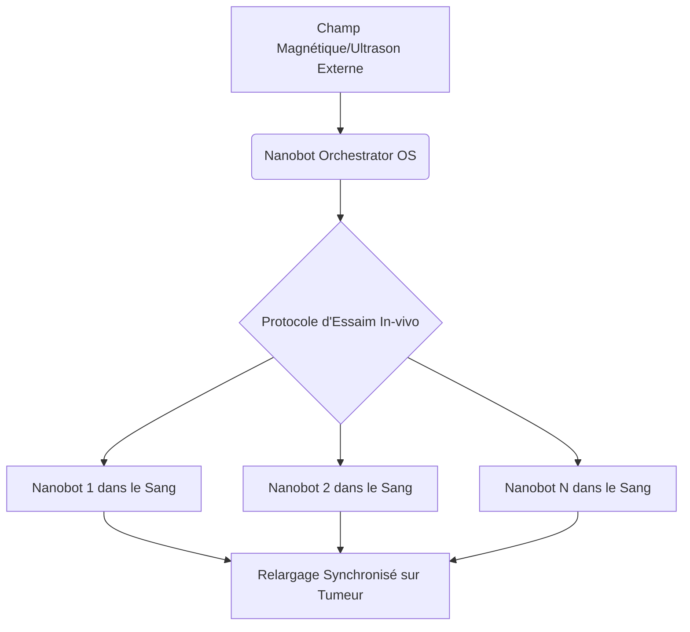
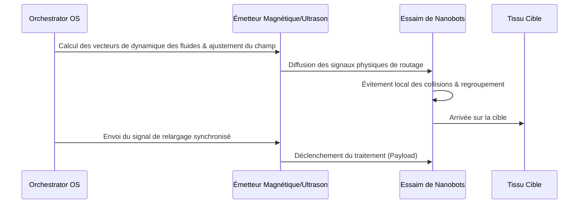

<!-- markdownlint-disable MD009 MD010 MD013 MD022 MD028 MD032 MD033 MD034 MD036 MD037 MD039 MD041 MD058 MD060 -->
[ 🇬🇧 English Version ](./README.md)

# Nanobot Orchestrator

> **Résumé exécutif :** Un système d'exploitation et protocole de communication in-vivo utilisant la dynamique des fluides complexes pour orchestrer des essaims de nanobots médicaux ciblant précisément les tumeurs sans déclencher de réponse immunitaire fatale.

---

## 1. Aperçu visuel & Effet Wahou

## 2. La thèse contrariante (Peter Thiel Style)

**La croyance populaire :** L'avenir de la médecine réside uniquement dans de meilleurs médicaments biochimiques et des molécules ciblées passives qui flottent dans le sang en espérant toucher les bons récepteurs.

**La vérité cachée :** L'avenir est mécanique et actif. La médecine deviendra un problème de routage et de physique où des logiciels piloteront activement des flottes de nanomachines à travers le corps, transformant le traitement en un déploiement logiciel précis et coordonné.

## 3. Le problème & La cible

**Modèle économique :** B2B2C

**Cible précise :** Hôpitaux de pointe, centres de traitement du cancer, laboratoires pharmaceutiques développant des thérapies ciblées.

**La douleur urgente :** L'administration systémique de traitements lourds (comme la chimiothérapie) détruit les tissus sains et cause des effets secondaires graves. L'avenir est la médecine ciblée, mais coordonner des millions de nanobots in vivo pour qu'ils ciblent uniquement les tumeurs sans provoquer de réponse immunitaire excessive ou d'agglutination fatale manque d'un protocole de contrôle robuste.

## 4. Architecture technique & Plomberie

## 5. Modèle économique & Viabilité financière

| Métrique | Valeur |
|---|---|
| Structure de prix | Licence aux fabricants Hardware + Frais par procédure |
| Objectif 12 mois | 20 licences laboratoires ou essais cliniques précoces |
| Calcul du CA (Target 100k€) | 20 licences × 5 000 €/an = 100 000 € ARR |
| Marge brute estimée | 90% (Licence logicielle) |

## 6. Moteur de distribution & Fossé défensif (Moat)

**Stratégie d'acquisition :** Partenariats directs avec les startups biotech matérielles développant les nanobots, en intégrant l'OS comme couche de contrôle par défaut avant les essais cliniques.

**Moat (Barrière à l'entrée) :** La gestion de la physique des fluides in-vivo, du contrôle non linéaire et de la biologie exige un moteur spécialisé que les algorithmes de routage classiques ignorent. De plus, les barrières réglementaires (FDA/EMA classe III) créent une immense protection contre la copie rapide.

## 7. Grille d'évaluation détaillée

| Critère | Score VC (/100) | Score Terrain (/100) |
|---|---|---|
| Thèse & Monopole / Urgence | -- / 25 | -- / 25 |
| Moat / Résistance aux LLM natifs | -- / 25 | -- / 25 |
| Scalabilité / Friction d'adoption | -- / 25 | -- / 25 |
| Unit Economics / ROI direct | -- / 25 | -- / 25 |
| **TOTAL** | **-- / 100** | **-- / 100** |

> **Verdict VC :** En attente d'évaluation.

> **Verdict Terrain :** En attente d'évaluation.
