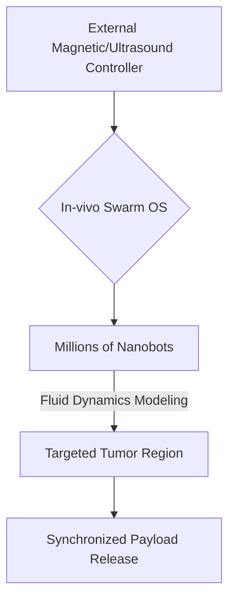
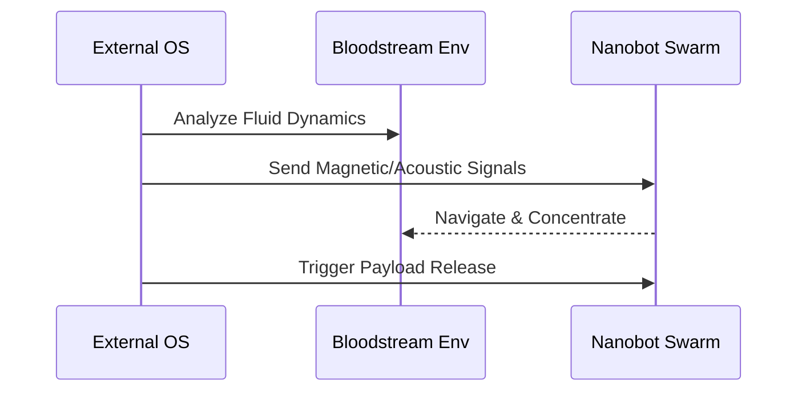

<!-- markdownlint-disable MD009 MD010 MD013 MD022 MD028 MD032 MD033 MD034 MD036 MD037 MD039 MD041 MD058 MD060 -->
[ 🇫🇷 Version Française ](./README.fr.md)

# Nanobot Orchestrator

> **Executive Summary:** An operating system and communication protocol for orchestrating massive in-vivo nanobot swarms to perform targeted cancer therapies and medical procedures.

---

## 1. Visual Overview & Wow Effect

## 2. Contrarian Thesis (Peter Thiel Style)

**Popular Belief:** The future of medicine lies entirely in better chemical drug discovery and CRISPR editing.

**Hidden Truth:** The delivery mechanism is the real bottleneck; we need a programmable physics-based OS to control physical agents inside the bloodstream, turning medicine into a robotics problem.

## 3. Problem & Target Market

**Business Model:** B2B2C

**Target Audience:** Top-tier hospitals, cancer treatment centers, pharmaceutical companies developing targeted therapies.

**Urgent Pain Point:** Systemic administration of heavy treatments destroys healthy tissues. Controlling millions of nanobots in vivo without causing immune responses or fatal agglutination lacks a robust control protocol.

## 4. Technical Architecture & Infrastructure

## 5. Business Model & Financial Viability

| Metric | Value |
| --- | --- |
| Pricing Structure | Per-treatment OS licensing fee + Pharma Partnerships |
| 12-Month Target | 5 Clinical Trial Partnerships |
| Revenue Formula | 5 trials * 200,000€ = 1M€ ARR |
| Estimated Gross Margin | 90% (Software) |

## 6. Distribution Engine & Moat

**Acquisition Strategy:** Direct partnerships with leading oncology research centers and pharmaceutical R&D labs.

**Moat (Defensibility):** Classical routing algorithms fail at this scale due to the lack of in-vivo GPS, massive biological noise, and different laws of physics at the nanoscale. Extreme regulatory barriers (Class III medical device).

## 7. Detailed Evaluation Grid

| Criterion | VC Score (/100) | Market Score (/100) |
| :--- | :---: | :---: |
| Thesis & Monopoly / Urgency | -- / 25 | -- / 25 |
| Moat / LLM Immunity | -- / 25 | -- / 25 |
| Scalability / UX Friction | -- / 25 | -- / 25 |
| Unit Economics / ROI | -- / 25 | -- / 25 |
| **TOTAL** | **-- / 100** | **-- / 100** |

> **VC Verdict:** Pending evaluation.
>
> **Market Verdict:** Pending evaluation.
