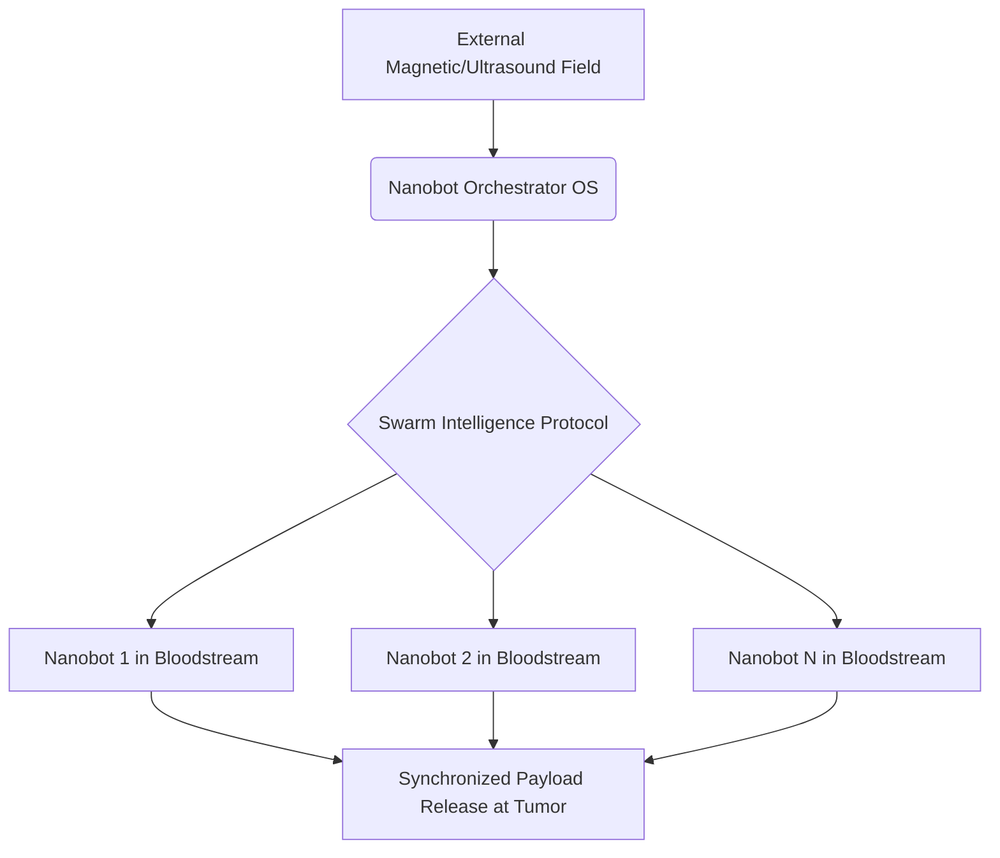
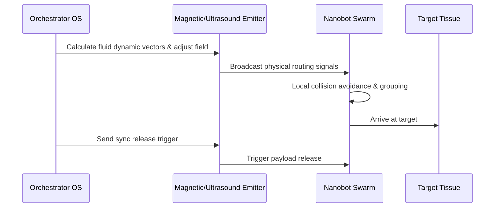

<!-- markdownlint-disable MD009 MD010 MD013 MD022 MD028 MD032 MD033 MD034 MD036 MD037 MD039 MD041 MD058 MD060 -->
[ 🇫🇷 Version Française ](./README.fr.md)

# Nanobot Orchestrator

> **Executive Summary:** An in-vivo operating system and communication protocol that uses complex fluid dynamics and external fields to coordinate swarms of medical nanobots for targeted therapies without causing fatal biological responses.

---

## 1. Visual Overview & Wow Effect

## 2. Contrarian Thesis (Peter Thiel Style)

**Popular Belief:** The future of medicine lies solely in better biochemical drugs and passive targeted molecules that simply float through the bloodstream hoping to hit the right receptors.

**Hidden Truth:** The future is mechanical and active. Medicine will become a routing and physics problem where software actively pilots fleets of nanomachines through the body, turning treatment into a precise, coordinated software deployment.

## 3. Problem & Target Market

**Business Model:** B2B2C

**Target Audience:** Advanced hospitals, cancer treatment centers, pharmaceutical labs developing targeted nanotherapies.

**Urgent Pain Point:** Systemic administration of heavy treatments (like chemotherapy) destroys healthy tissue and causes severe side effects. While nanobots offer a solution, coordinating millions of them in-vivo to target tumors without causing excessive immune response or fatal agglutination lacks a robust control protocol.

## 4. Technical Architecture & Infrastructure

## 5. Business Model & Financial Viability

| Metric | Value |
|---|---|
| Pricing Structure | Licensing to Hardware Manufacturers + Per-Procedure Software Fee |
| 12-Month Target | 20 research lab licenses or early clinical trial partnerships |
| Revenue Formula | 20 licenses × €5,000/year = €100,000 ARR |
| Estimated Gross Margin | 90% (Software licensing) |

## 6. Distribution Engine & Moat

**Acquisition Strategy:** Direct partnerships with biotech hardware startups building the nanobots, embedding the OS as the default control layer before FDA trials.

**Moat (Defensibility):** Navigating complex in-vivo fluid physics, non-linear control, and biology requires a specialized engine that generic routing algorithms cannot solve. Regulatory approvals (Class III SaMD) create a massive barrier to entry that prevents quick replication.

## 7. Detailed Evaluation Grid

| Criterion | VC Score (/100) | Market Score (/100) |
|---|---|---|
| Thesis & Monopoly / Urgency | -- / 25 | -- / 25 |
| Moat / LLM Immunity | -- / 25 | -- / 25 |
| Scalability / UX Friction | -- / 25 | -- / 25 |
| Unit Economics / ROI | -- / 25 | -- / 25 |
| **TOTAL** | **-- / 100** | **-- / 100** |

> **VC Verdict:** Pending evaluation.

> **Market Verdict:** Pending evaluation.
