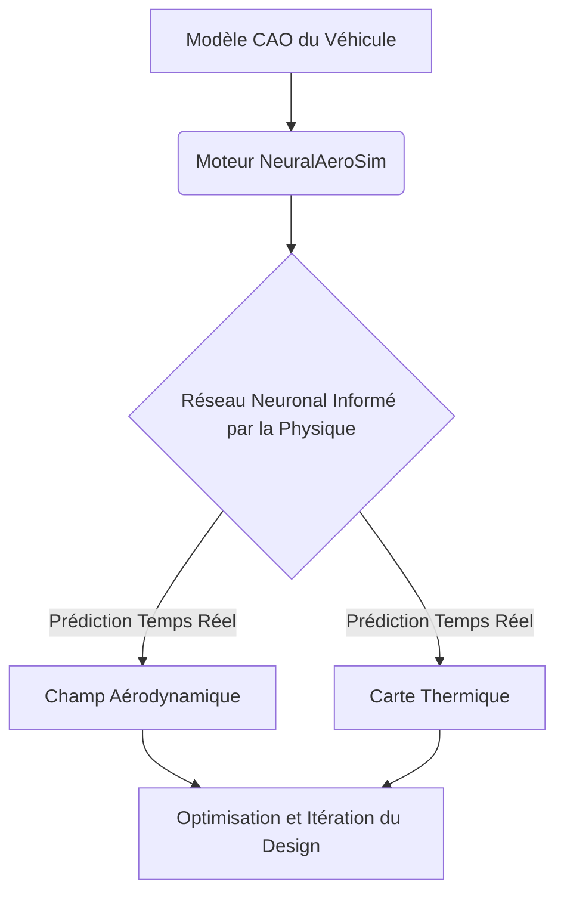
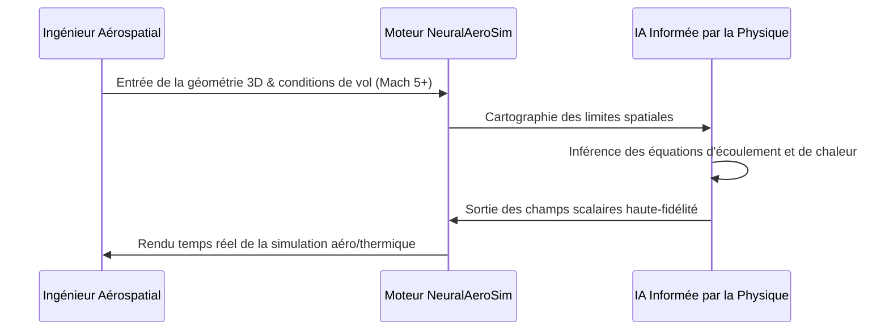

<!-- markdownlint-disable MD009 MD010 MD013 MD022 MD028 MD032 MD033 MD034 MD036 MD037 MD039 MD041 MD058 MD060 -->
[ 🇬🇧 English Version ](./README.md)

# NeuralAeroSim

> **Résumé exécutif :** Un moteur physique neuronal utilisant des PINNs (Physics-Informed Neural Networks) pour simuler l'aérodynamique et la thermodynamique hypersonique en temps réel, réduisant drastiquement les coûts et délais de R&D spatiale.

---

## 1. Aperçu visuel & Effet Wahou

## 2. La thèse contrariante (Peter Thiel Style)

**La croyance populaire :** Une dynamique des fluides (CFD) précise requiert des supercalculateurs résolvant itérativement les équations de Navier-Stokes sur des semaines, et les tests physiques en soufflerie restent la seule vraie validation.

**La vérité cachée :** Les lois de la physique peuvent être apprises directement par des réseaux de neurones. En intégrant les contraintes physiques dans l'IA (PINNs), on peut contourner totalement les méthodes numériques par force brute et calculer les champs de fluides et les charges thermiques en millisecondes.

## 3. Le problème & La cible

**Modèle économique :** B2B

**Cible précise :** Constructeurs aéronautiques, entreprises spatiales (lanceurs réutilisables), start-ups du vol hypersonique et agences de défense.

**La douleur urgente :** La conception et le test de véhicules hypersoniques nécessitent des simulations CFD extrêmement coûteuses en calcul et des tests en soufflerie hypersonique rares et hors de prix. Cela ralentit drastiquement la R&D et multiplie les coûts de certification par des dizaines de millions.

## 4. Architecture technique & Plomberie

## 5. Modèle économique & Viabilité financière

| Métrique | Valeur |
|---|---|
| Structure de prix | SaaS Enterprise Premium / Licence On-Premise |
| Objectif 12 mois | 2 contrats enterprise ou 5 sièges startups aérospatiales |
| Calcul du CA (Target 100k€) | 2 contrats × 50 000 €/an = 100 000 € ARR |
| Marge brute estimée | 85% |

## 6. Moteur de distribution & Fossé défensif (Moat)

**Stratégie d'acquisition :** Ventes techniques directes auprès des ingénieurs en chef et aérodynamiciens dans les startups spatiales et sous-traitants de la défense nécessitant des cycles d'itération rapides.

**Moat (Barrière à l'entrée) :** Les PINNs nécessitent une expertise très spécialisée liant deep learning et lois physiques complexes. Les LLM standards ne peuvent pas générer de la physique correcte. La précision du moteur devient un moat absolu, particulièrement s'il est affiné (fine-tuned) sur des données de soufflerie classifiées ou propriétaires.

## 7. Grille d'évaluation détaillée

| Critère | Score VC (/100) | Score Terrain (/100) |
|---|---|---|
| Thèse & Monopole / Urgence | -- / 25 | -- / 25 |
| Moat / Résistance aux LLM natifs | -- / 25 | -- / 25 |
| Scalabilité / Friction d'adoption | -- / 25 | -- / 25 |
| Unit Economics / ROI direct | -- / 25 | -- / 25 |
| **TOTAL** | **-- / 100** | **-- / 100** |

> **Verdict VC :** En attente d'évaluation.

> **Verdict Terrain :** En attente d'évaluation.
