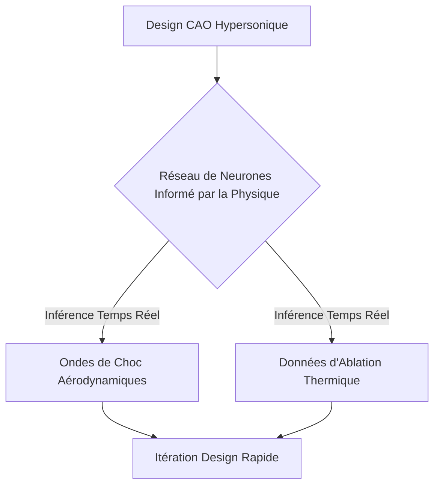
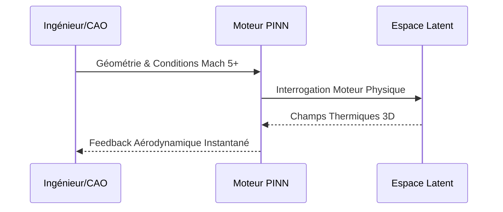

<!-- markdownlint-disable MD009 MD010 MD013 MD022 MD028 MD032 MD033 MD034 MD036 MD037 MD039 MD041 MD058 MD060 -->
[ 🇬🇧 English Version ](./README.md)

# NeuralAeroSim

> **Résumé exécutif :** Un moteur physique neuronal prédisant l'aérodynamique et la thermodynamique hypersonique en temps réel, remplaçant la lenteur des simulations de dynamique des fluides classiques.

---

## 1. Aperçu visuel & Effet Wahou

## 2. La thèse contrariante (Peter Thiel Style)

**La croyance populaire :** La simulation nécessite des supercalculateurs résolvant Navier-Stokes par éléments finis pendant des semaines.

**La vérité cachée :** Les solveurs classiques sont lents et non différentiables ; l'entraînement de réseaux neuronaux contraints par la physique permet un design génératif en temps réel.

## 3. Le problème & La cible

**Modèle économique :** B2B

**Cible précise :** Aérospatial, défense, start-ups de vols hypersoniques.

**La douleur urgente :** La conception CFD hypersonique est extrêmement lente et les tests en soufflerie rares/chers, bloquant l'innovation.

## 4. Architecture technique & Plomberie

## 5. Modèle économique & Viabilité financière

| Métrique | Valeur |
| --- | --- |
| Structure de prix | Licence logicielle B2B Entreprise |
| Objectif 12 mois | 10 clients Aérospatial/Défense |
| Calcul du CA (Target 100k€) | 10 clients * 10 000€/mois = 1.2M€ ARR |
| Marge brute estimée | 90% |

## 6. Moteur de distribution & Fossé défensif (Moat)

**Stratégie d'acquisition :** Ventes B2B aux grands groupes de la défense et de l'aérospatial.

**Moat (Barrière à l'entrée) :** Un LLM ne comprend pas les champs physiques 3D. Rareté des données d'entraînement (CFD/vol) très coûteuses ou classifiées.

## 7. Grille d'évaluation détaillée

| Critère | Score VC (/100) | Score Terrain (/100) |
| :--- | :---: | :---: |
| Thèse & Monopole / Urgence | -- / 25 | -- / 25 |
| Moat / Résistance aux LLM natifs | -- / 25 | -- / 25 |
| Scalabilité / Friction d'adoption | -- / 25 | -- / 25 |
| Unit Economics / ROI direct | -- / 25 | -- / 25 |
| **TOTAL** | **-- / 100** | **-- / 100** |

> **Verdict VC :** En attente d'évaluation.
>
> **Verdict Terrain :** En attente d'évaluation.
