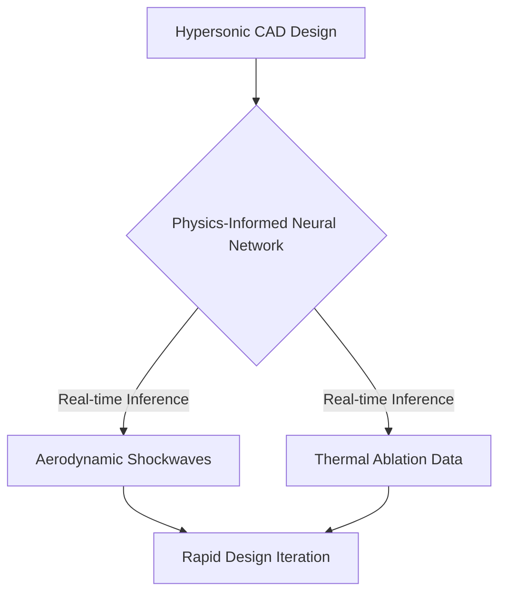
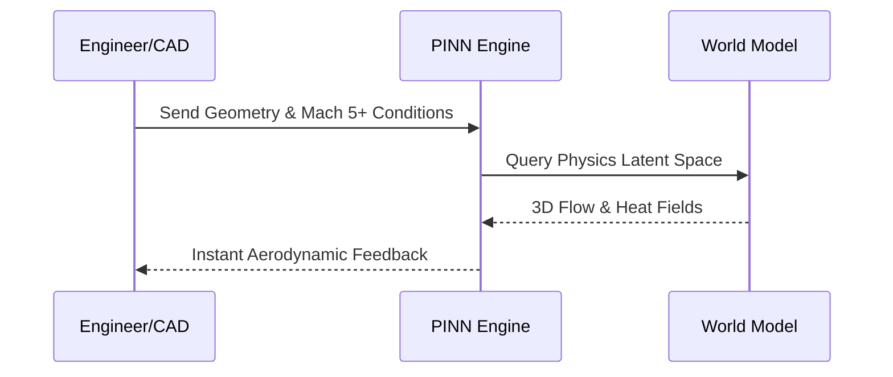

<!-- markdownlint-disable MD009 MD010 MD013 MD022 MD028 MD032 MD033 MD034 MD036 MD037 MD039 MD041 MD058 MD060 -->
[ 🇫🇷 Version Française ](./README.fr.md)

# NeuralAeroSim

> **Executive Summary:** A Neural Physics Engine predicting hypersonic aerodynamics and thermodynamics in real-time, completely bypassing traditional, massively slow computational fluid dynamics (CFD).

---

## 1. Visual Overview & Wow Effect

## 2. Contrarian Thesis (Peter Thiel Style)

**Popular Belief:** Aerospace simulation requires increasingly powerful supercomputers running finite element solvers on Navier-Stokes equations for weeks.

**Hidden Truth:** Traditional solvers are fundamentally non-differentiable and too slow; pre-training neural networks constrained by the laws of physics allows for real-time generative design in extreme flight regimes.

## 3. Problem & Target Market

**Business Model:** B2B

**Target Audience:** Aerospace manufacturers, space companies (reusable launch vehicles), hypersonic startups, and defense agencies.

**Urgent Pain Point:** Hypersonic CFD simulation takes weeks of compute time, and wind tunnel tests are incredibly rare and expensive, slowing R&D and costing tens of millions.

## 4. Technical Architecture & Infrastructure

## 5. Business Model & Financial Viability

| Metric | Value |
| --- | --- |
| Pricing Structure | Enterprise Software License per Seat |
| 12-Month Target | 10 Aerospace/Defense Clients |
| Revenue Formula | 10 clients * 10,000€/month = 1.2M€ ARR |
| Estimated Gross Margin | 90% |

## 6. Distribution Engine & Moat

**Acquisition Strategy:** High-ticket B2B sales to aerospace and defense primes.

**Moat (Defensibility):** A standard LLM or computer vision model cannot understand 3D physical fields. Training a World Model on massive, highly classified/expensive CFD data creates a massive data barrier.

## 7. Detailed Evaluation Grid

| Criterion | VC Score (/100) | Market Score (/100) |
| :--- | :---: | :---: |
| Thesis & Monopoly / Urgency | -- / 25 | -- / 25 |
| Moat / LLM Immunity | -- / 25 | -- / 25 |
| Scalability / UX Friction | -- / 25 | -- / 25 |
| Unit Economics / ROI | -- / 25 | -- / 25 |
| **TOTAL** | **-- / 100** | **-- / 100** |

> **VC Verdict:** Pending evaluation.
>
> **Market Verdict:** Pending evaluation.
