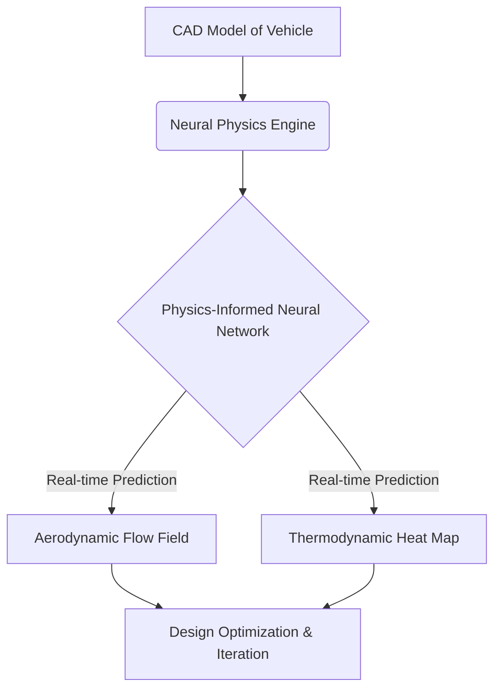
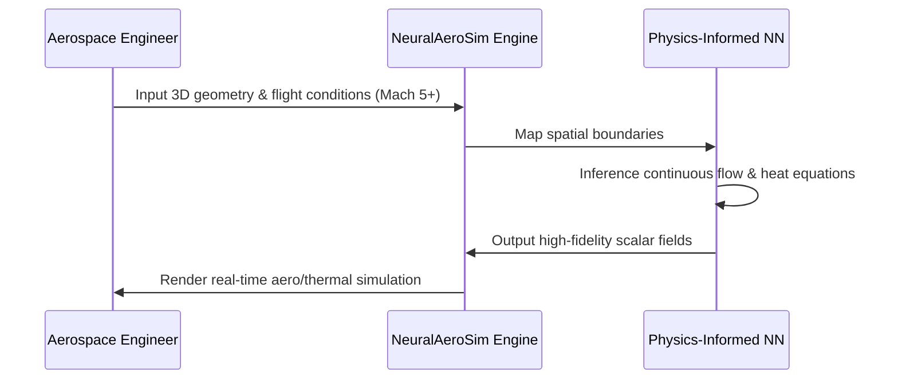

<!-- markdownlint-disable MD009 MD010 MD013 MD022 MD028 MD032 MD033 MD034 MD036 MD037 MD039 MD041 MD058 MD060 -->
[ 🇫🇷 Version Française ](./README.fr.md)

# NeuralAeroSim

> **Executive Summary:** A neural physics engine utilizing Physics-Informed Neural Networks to simulate hypersonic aerodynamics and thermodynamics in real-time, drastically reducing aerospace R&D costs and compute time.

---

## 1. Visual Overview & Wow Effect

## 2. Contrarian Thesis (Peter Thiel Style)

**Popular Belief:** Accurate computational fluid dynamics (CFD) requires massive supercomputers solving Navier-Stokes equations iteratively over weeks, and physical wind tunnels are the only true validation.

**Hidden Truth:** The laws of physics can be learned directly by neural networks. By embedding physics constraints into AI (PINNs), we can bypass brute-force numerical methods entirely and compute flow fields and thermal loads in milliseconds, enabling generative engineering.

## 3. Problem & Target Market

**Business Model:** B2B

**Target Audience:** Aerospace manufacturers, space companies (reusable launchers), hypersonic flight startups, and defense agencies.

**Urgent Pain Point:** Designing and testing hypersonic vehicles requires fluid mechanics simulations (CFD) that are extremely expensive in compute time and highly priced, scarce physical wind tunnel tests. This drastically slows down R&D and multiplies certification costs by tens of millions.

## 4. Technical Architecture & Infrastructure

## 5. Business Model & Financial Viability

| Metric | Value |
|---|---|
| Pricing Structure | High-ticket Enterprise SaaS / On-Premise License |
| 12-Month Target | 2 enterprise contracts or 5 aerospace startup seats |
| Revenue Formula | 2 contracts × €50,000/year = €100,000 ARR |
| Estimated Gross Margin | 85% |

## 6. Distribution Engine & Moat

**Acquisition Strategy:** Direct technical sales targeting Chief Engineers and aerodynamicists at space startups and defense contractors needing faster iteration cycles.

**Moat (Defensibility):** PINNs require highly specialized knowledge bridging deep learning and complex physical laws (Navier-Stokes, thermodynamics). Standard LLMs or generic AI cannot hallucinate accurate physics. The engine's accuracy becomes its moat, especially when fine-tuned on highly classified or proprietary wind tunnel data.

## 7. Detailed Evaluation Grid

| Criterion | VC Score (/100) | Market Score (/100) |
|---|---|---|
| Thesis & Monopoly / Urgency | -- / 25 | -- / 25 |
| Moat / LLM Immunity | -- / 25 | -- / 25 |
| Scalability / UX Friction | -- / 25 | -- / 25 |
| Unit Economics / ROI | -- / 25 | -- / 25 |
| **TOTAL** | **-- / 100** | **-- / 100** |

> **VC Verdict:** Pending evaluation.

> **Market Verdict:** Pending evaluation.
