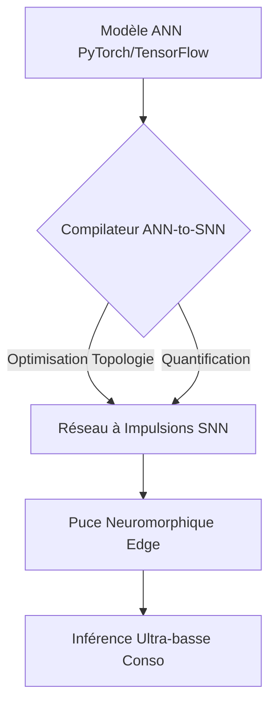
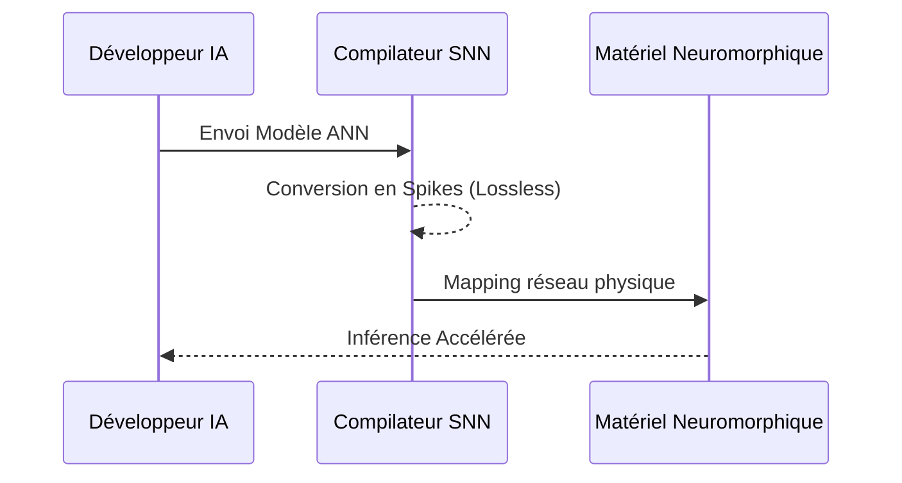

<!-- markdownlint-disable MD009 MD010 MD013 MD022 MD028 MD032 MD033 MD034 MD036 MD037 MD039 MD041 MD058 MD060 -->
[ 🇬🇧 English Version ](./README.md)

# Neuromorphic Compiler

> **Résumé exécutif :** Un compilateur universel convertissant les réseaux de neurones artificiels classiques (ANN) en réseaux de neurones à impulsions (SNN) économes en énergie pour le matériel neuromorphique.

---

## 1. Aperçu visuel & Effet Wahou

## 2. La thèse contrariante (Peter Thiel Style)

**La croyance populaire :** L'Edge AI sera résolue en améliorant légèrement l'efficacité des GPUs et NPUs.

**La vérité cachée :** L'architecture de von Neumann est physiquement limitée par la séparation mémoire/calcul ; pour réduire drastiquement la consommation, il faut des architectures neuromorphiques événementielles, qui manquent cruellement d'outils logiciels.

## 3. Le problème & La cible

**Modèle économique :** B2B (Licence logicielle / Royalty)

**Cible précise :** Fabricants de puces (Intel, start-ups semi-conducteurs), concepteurs de systèmes embarqués (IoT, automobile, défense).

**La douleur urgente :** Le matériel neuromorphique divise la consommation par 1000, mais aucun développeur classique ne sait compiler un modèle PyTorch vers ces puces analogiques à spikes.

## 4. Architecture technique & Plomberie

## 5. Modèle économique & Viabilité financière

| Métrique | Valeur |
| --- | --- |
| Structure de prix | Licence par siège + Royalty d'exécution |
| Objectif 12 mois | 3 fabricants majeurs de puces |
| Calcul du CA (Target 100k€) | 3 clients * 400k€/an = 1.2M€ ARR |
| Marge brute estimée | 95% |

## 6. Moteur de distribution & Fossé défensif (Moat)

**Stratégie d'acquisition :** Partenariats avec les concepteurs de matériel pour fournir l'écosystème logiciel de leurs nouvelles puces.

**Moat (Barrière à l'entrée) :** Défi mathématique profond pour convertir des tenseurs synchrones en spikes asynchrones. Les LLM ne peuvent pas écrire des compilateurs ISA pour du matériel non standardisé.

## 7. Grille d'évaluation détaillée

| Critère | Score VC (/100) | Score Terrain (/100) |
| :--- | :---: | :---: |
| Thèse & Monopole / Urgence | -- / 25 | -- / 25 |
| Moat / Résistance aux LLM natifs | -- / 25 | -- / 25 |
| Scalabilité / Friction d'adoption | -- / 25 | -- / 25 |
| Unit Economics / ROI direct | -- / 25 | -- / 25 |
| **TOTAL** | **-- / 100** | **-- / 100** |

> **Verdict VC :** En attente d'évaluation.
>
> **Verdict Terrain :** En attente d'évaluation.
