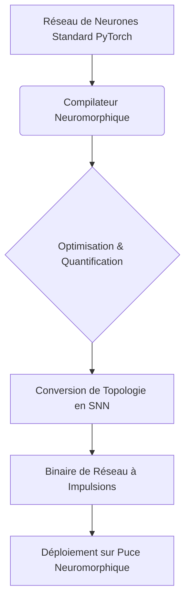
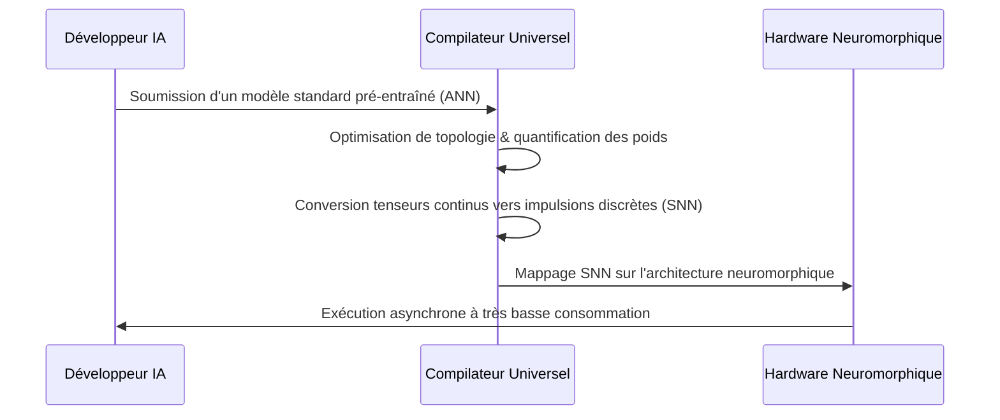

<!-- markdownlint-disable MD009 MD010 MD013 MD022 MD028 MD032 MD033 MD034 MD036 MD037 MD039 MD041 MD058 MD060 -->
[ 🇬🇧 English Version ](./README.md)

# Neuromorphic Compiler

> **Résumé exécutif :** Un compilateur universel qui traduit les réseaux de neurones IA standards en réseaux de neurones à impulsions (SNN), permettant une inférence Edge AI à très faible consommation d'énergie sur des processeurs neuromorphiques.

---

## 1. Aperçu visuel & Effet Wahou

## 2. La thèse contrariante (Peter Thiel Style)

**La croyance populaire :** Pour obtenir une meilleure IA à la périphérie, il suffit de miniaturiser les architectures de von Neumann (NPU/GPU) et d'utiliser des modèles quantifiés plus petits.

**La vérité cachée :** L'architecture de von Neumann est fondamentalement bloquée par la limite de la mémoire et l'énergie. L'IA véritablement "always-on" nécessite des puces analogiques (SNN) inspirées du cerveau humain, consommant 1000 fois moins d'énergie. Mais ce hardware est inutile sans un compilateur faisant le pont pour les développeurs logiciels classiques.

## 3. Le problème & La cible

**Modèle économique :** B2B

**Cible précise :** Fabricants de puces (Intel, IBM, start-ups semi-conducteurs), concepteurs de systèmes embarqués (IoT, automobile, défense) cherchant l'ultra-basse consommation.

**La douleur urgente :** L'inférence d'IA sur batterie est bridée par les architectures classiques. Les puces neuromorphiques promettent des économies massives, mais il n'existe aucun outil permettant aux développeurs classiques de compiler facilement un modèle standard vers ces architectures physiques basées sur des événements et des impulsions binaires (spikes).

## 4. Architecture technique & Plomberie

## 5. Modèle économique & Viabilité financière

| Métrique | Valeur |
|---|---|
| Structure de prix | Licence logicielle / Royalty par puce déployée |
| Objectif 12 mois | 2 partenariats fabricants de puces majeurs ou 10 clients systèmes embarqués |
| Calcul du CA (Target 100k€) | 2 partenariats × 50 000 €/an = 100 000 € ARR |
| Marge brute estimée | 95% (Logiciel pur) |

## 6. Moteur de distribution & Fossé défensif (Moat)

**Stratégie d'acquisition :** Partenariats B2B avec les startups concevant du hardware neuromorphique qui ont besoin de rendre leurs puces accessibles à la vaste communauté des développeurs IA.

**Moat (Barrière à l'entrée) :** La traduction mathématique entre des tenseurs synchrones en virgule flottante et des impulsions asynchrones binaires (spikes) est un défi de recherche profonde. Cela représente une barrière technique infranchissable pour les entreprises d'outillage IA génériques.

## 7. Grille d'évaluation détaillée

| Critère | Score VC (/100) | Score Terrain (/100) |
|---|---|---|
| Thèse & Monopole / Urgence | -- / 25 | -- / 25 |
| Moat / Résistance aux LLM natifs | -- / 25 | -- / 25 |
| Scalabilité / Friction d'adoption | -- / 25 | -- / 25 |
| Unit Economics / ROI direct | -- / 25 | -- / 25 |
| **TOTAL** | **-- / 100** | **-- / 100** |

> **Verdict VC :** En attente d'évaluation.

> **Verdict Terrain :** En attente d'évaluation.
