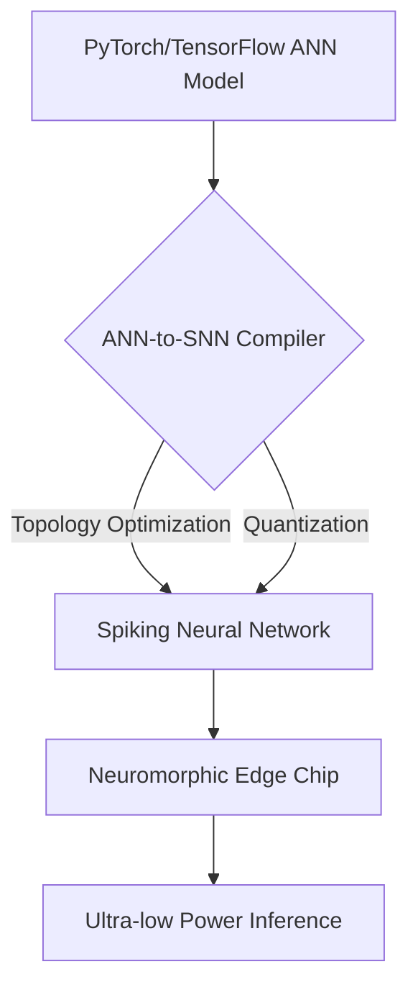
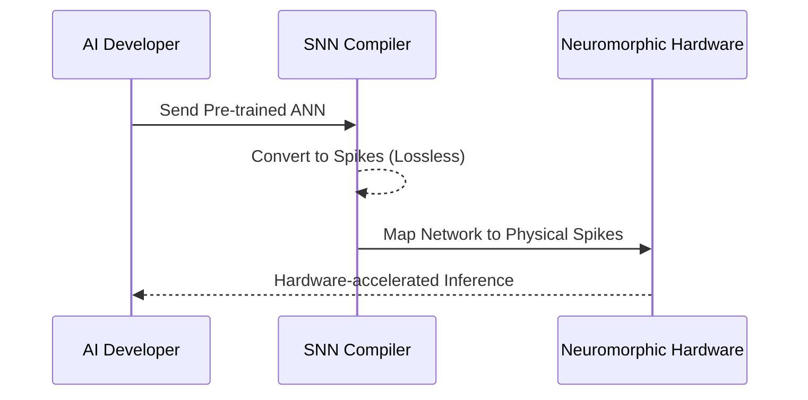

<!-- markdownlint-disable MD009 MD010 MD013 MD022 MD028 MD032 MD033 MD034 MD036 MD037 MD039 MD041 MD058 MD060 -->
[ 🇫🇷 Version Française ](./README.fr.md)

# Neuromorphic Compiler

> **Executive Summary:** A universal compiler converting standard artificial neural networks (ANNs) into energy-efficient spiking neural networks (SNNs) for next-generation neuromorphic hardware.

---

## 1. Visual Overview & Wow Effect

## 2. Contrarian Thesis (Peter Thiel Style)

**Popular Belief:** Edge AI will be solved by simply making traditional GPUs and NPUs slightly more power-efficient.

**Hidden Truth:** The von Neumann architecture is physically bottlenecked by memory-compute separation; massive leaps in efficiency require moving to event-driven neuromorphic architectures, which currently lack a software bridge.

## 3. Problem & Target Market

**Business Model:** B2B (Software License / Royalty)

**Target Audience:** Chip manufacturers (Intel, IBM, semi startups), embedded systems designers (IoT, auto, defense).

**Urgent Pain Point:** Neuromorphic chips promise a 1000x reduction in power consumption, but classical developers have no simple tools to compile a standard PyTorch/TF model to asynchronous spikes.

## 4. Technical Architecture & Infrastructure

## 5. Business Model & Financial Viability

| Metric | Value |
| --- | --- |
| Pricing Structure | Per-seat License + Runtime Royalty |
| 12-Month Target | 3 Major Chip Manufacturers |
| Revenue Formula | 3 clients * 400k€/year = 1.2M€ ARR |
| Estimated Gross Margin | 95% |

## 6. Distribution Engine & Moat

**Acquisition Strategy:** Deep partnerships with emerging hardware designers looking to provide a software ecosystem for their new chips.

**Moat (Defensibility):** Deeply mathematical compiler challenge translating synchronous floating-point tensors into asynchronous binary spikes. LLMs cannot write ISA compilers for unreleased, fragmented hardware.

## 7. Detailed Evaluation Grid

| Criterion | VC Score (/100) | Market Score (/100) |
| :--- | :---: | :---: |
| Thesis & Monopoly / Urgency | -- / 25 | -- / 25 |
| Moat / LLM Immunity | -- / 25 | -- / 25 |
| Scalability / UX Friction | -- / 25 | -- / 25 |
| Unit Economics / ROI | -- / 25 | -- / 25 |
| **TOTAL** | **-- / 100** | **-- / 100** |

> **VC Verdict:** Pending evaluation.
>
> **Market Verdict:** Pending evaluation.
