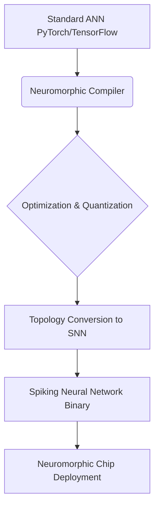
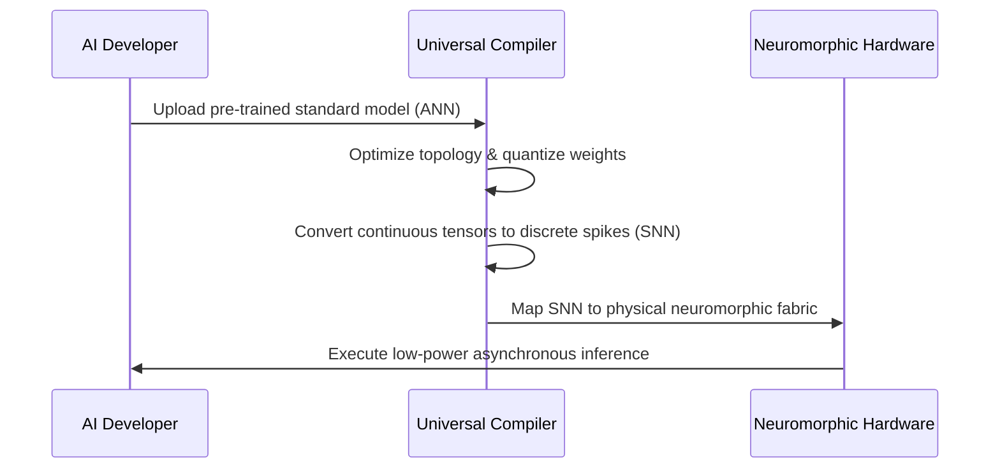

<!-- markdownlint-disable MD009 MD010 MD013 MD022 MD028 MD032 MD033 MD034 MD036 MD037 MD039 MD041 MD058 MD060 -->
[ 🇫🇷 Version Française ](./README.fr.md)

# Neuromorphic Compiler

> **Executive Summary:** A universal compiler that translates standard AI neural networks into Spiking Neural Networks (SNNs), enabling extreme low-power Edge AI inference on advanced neuromorphic hardware.

---

## 1. Visual Overview & Wow Effect

## 2. Contrarian Thesis (Peter Thiel Style)

**Popular Belief:** To get better AI at the edge, we just need to keep shrinking standard von Neumann architectures (NPUs/GPUs) and use smaller quantized LLMs.

**Hidden Truth:** The von Neumann architecture is fundamentally capped by the memory wall and energy limits. True "always-on" AI requires brain-inspired analog chips (SNNs) that consume 1000x less power, but this hardware is useless without a compiler that bridges the gap for standard software developers.

## 3. Problem & Target Market

**Business Model:** B2B

**Target Audience:** Chip manufacturers (Intel, IBM, semiconductor startups), embedded systems designers (IoT, automotive, defense) seeking ultra-low power.

**Urgent Pain Point:** Edge AI inference on battery power is severely bottlenecked by classical architectures. Neuromorphic chips promise massive energy savings, but there are virtually no tools allowing classical developers to easily compile a standard Artificial Neural Network (ANN) to these event-driven, binary-spiking physical architectures.

## 4. Technical Architecture & Infrastructure

## 5. Business Model & Financial Viability

| Metric | Value |
|---|---|
| Pricing Structure | Software License / Royalty per Chip deployed |
| 12-Month Target | 2 major chip partnerships or 10 embedded systems clients |
| Revenue Formula | 2 partnerships × €50,000/year = €100,000 ARR |
| Estimated Gross Margin | 95% (Pure Software) |

## 6. Distribution Engine & Moat

**Acquisition Strategy:** B2B partnerships targeting neuromorphic hardware startups needing to make their chips usable by the broader AI developer community.

**Moat (Defensibility):** The mathematical translation between synchronous floating-point tensors (standard AI) and asynchronous, temporal, binary spikes (SNNs) is a deep research challenge (Instruction Set Architecture compilation). It acts as a massive technical barrier for any generic AI tooling company attempting to enter the space.

## 7. Detailed Evaluation Grid

| Criterion | VC Score (/100) | Market Score (/100) |
|---|---|---|
| Thesis & Monopoly / Urgency | -- / 25 | -- / 25 |
| Moat / LLM Immunity | -- / 25 | -- / 25 |
| Scalability / UX Friction | -- / 25 | -- / 25 |
| Unit Economics / ROI | -- / 25 | -- / 25 |
| **TOTAL** | **-- / 100** | **-- / 100** |

> **VC Verdict:** Pending evaluation.

> **Market Verdict:** Pending evaluation.
