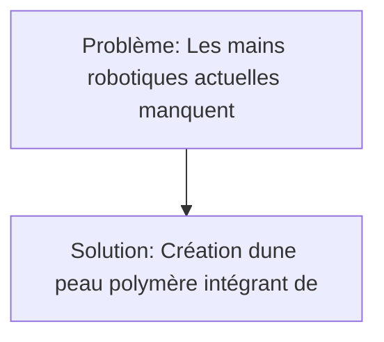
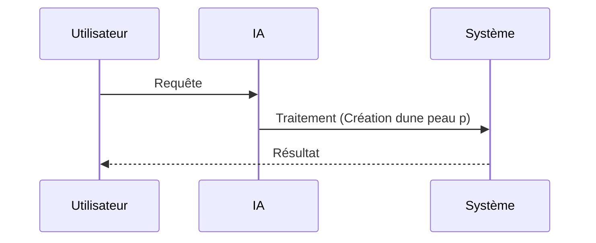

<!-- markdownlint-disable MD013 MD033 MD041 -->

[🇬🇧 English Version](./README.md)

# Neuromorphic Tactile Skin

> **Résumé exécutif :** Une solution B2B ciblant Fabricants de robots humanoïdes (Tesla, Figure), entreprises de logistique automatisée (Amazon), et concepteurs de prothèses médicales avancées. pour résoudre le problème suivant : Les mains robotiques actuelles manquent de dextérité fine car elles s'appuient principalement sur la vision par ordinateur, qui souffre d'occlusions. Les capteurs tactiles existants génèrent des volumes de données continus trop lourds à traiter en temps réel (latence) et sont fragiles. L'approche repose sur : Création d'une "peau" polymère intégrant des milliers de micro-capteurs de pression et de cisaillement, reliés à une architecture de puce neuromorphique (Spiking Neural Networks) qui ne transmet que les "événements" de changement (asynchrones), réduisant la latence à la microseconde et la consommation d'énergie de 99%.

---

## 1. Aperçu visuel & Effet Wahou

## 2. La thèse contrariante (Peter Thiel Style)

- **La croyance populaire :** Une approche générique SaaS classique est suffisante.
- **La vérité cachée :** Le goulot d'étranglement se situe au niveau de l'architecture de von Neumann classique et de la transmission de données physiques. Il faut inventer de nouveaux matériaux souples conducteurs, concevoir des ASIC neuromorphiques dédiés, et écrire de nouveaux paradigmes d'apprentissage (Spike Timing Dependent Plasticity) pour le contrôle moteur.

## 3. Le problème & La cible

- **Modèle économique :** B2B
- **Cible précise :** Fabricants de robots humanoïdes (Tesla, Figure), entreprises de logistique automatisée (Amazon), et concepteurs de prothèses médicales avancées.
- **La douleur urgente :** Les mains robotiques actuelles manquent de dextérité fine car elles s'appuient principalement sur la vision par ordinateur, qui souffre d'occlusions. Les capteurs tactiles existants génèrent des volumes de données continus trop lourds à traiter en temps réel (latence) et sont fragiles.

## 4. Architecture technique & Plomberie

Création d'une "peau" polymère intégrant des milliers de micro-capteurs de pression et de cisaillement, reliés à une architecture de puce neuromorphique (Spiking Neural Networks) qui ne transmet que les "événements" de changement (asynchrones), réduisant la latence à la microseconde et la consommation d'énergie de 99%.

## 5. Modèle économique & Viabilité financière

| Métrique                    | Valeur                             |
| --------------------------- | ---------------------------------- |
| Structure de prix           | Abonnement / Licence B2B           |
| Objectif 12 mois            | 100 clients (ou volume équivalent) |
| Calcul du CA (Target 100k€) | 100 \* 1000€ = 100k€               |
| Marge brute estimée         | 80%                                |

## 6. Moteur de distribution & Fossé défensif (Moat)

- **Stratégie d'acquisition :** Ventes directes et partenariats dans le domaine : Robotique & Systèmes embarqués
- **Moat (Barrière à l'entrée) :** Le goulot d'étranglement se situe au niveau de l'architecture de von Neumann classique et de la transmission de données physiques. Il faut inventer de nouveaux matériaux souples conducteurs, concevoir des ASIC neuromorphiques dédiés, et écrire de nouveaux paradigmes d'apprentissage (Spike Timing Dependent Plasticity) pour le contrôle moteur. Les risques incluent : Complexité de fabrication (intégration de puces dures sur des substrats étirables), durée de vie des matériaux sous des millions de cycles de déformation, difficulté à standardiser l'interface avec les OS robotiques existants (ROS).

## 7. Grille d'évaluation détaillée

| Critère                           | Score VC (/100) | Score Terrain (/100) |
| --------------------------------- | --------------- | -------------------- |
| Thèse & Monopole / Urgence        | -- / 25         | -- / 25              |
| Moat / Résistance aux LLM natifs  | -- / 25         | -- / 25              |
| Scalabilité / Friction d'adoption | -- / 25         | -- / 25              |
| Unit Economics / ROI direct       | -- / 25         | -- / 25              |
| **TOTAL**                         | -- / 100        | -- / 100             |

> **Verdict VC :** En attente d'évaluation.
> **Verdict Terrain :** En attente d'évaluation.
